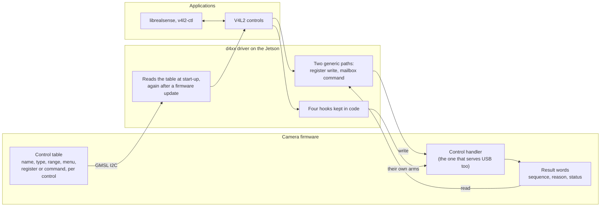
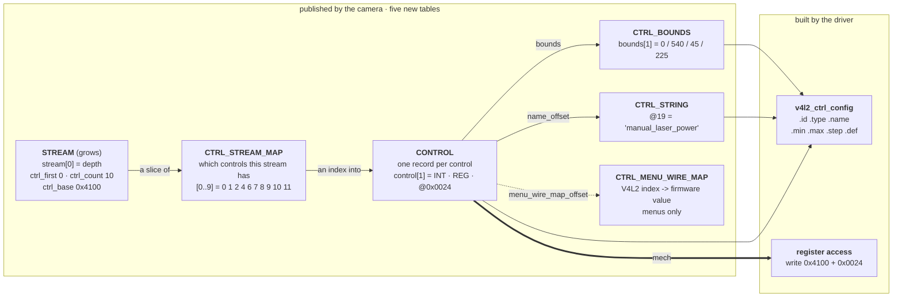
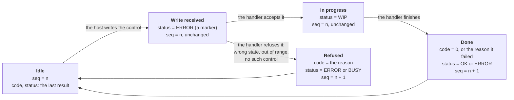
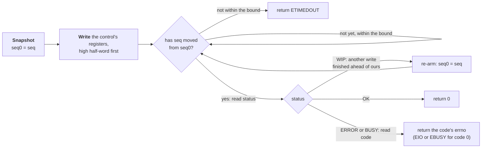
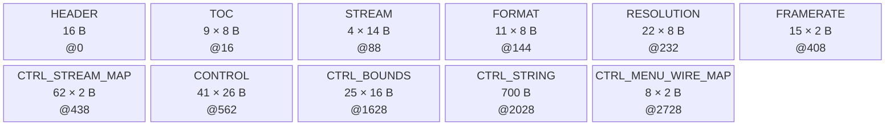

<!-- Source of truth for this design note. Edit it here.

     Companion to camera-format-descriptor.md: same blob, same aperture, more tables.
     An unnumbered overview first; sections 1-11 are the design (3 is the write-result
     protocol); 12-15 are the driver, the firmware obligations, the
     decisions taken against and the validation; Appendix A is the inventory it was derived from. Figures are
     Mermaid, rendered inline by GitHub and VS Code's Markdown preview. -->

# Camera-Resident Control Descriptor

Moving the V4L2 control set out of **d4xx_main.c** and onto the camera, beside the format
tables the camera already serves. What a control record has to carry so the driver can
register and operate a control it has never heard of, how the five new tables fit the blob
the format descriptor defined, what it costs on the wire — and the four controls that
**cannot** move, and why.

DESIGN NOTE **control descriptor** · STATUS **design — for review** · DRIVER **kernel/realsense/d4xx_main.c** · TICKET **RSDEV-15373** · STORY **RSDEV-14835** · COMPANION **[camera-format-descriptor.md](camera-format-descriptor.md)**

> Sources: `kernel/realsense/d4xx_main.c` at `dev` (`e9f04ee`, 1.0.7.12, including PR #700 /
> RSDEV-15386), the RS400 firmware's `I2cSlaveHostIf.c`, and a live enumeration on
> **fw-orin-5** — D585 at `9-001a`, D457 at `9-002a`, JP6.2, module 1.0.7.9. Every per-SKU
> difference claimed in Appendix A was read off those two cameras. Designed against four
> subdev instances per camera; the single-instance redesign is postponed and is not an input.

## Overview: What changes, and for whom

**What this is about.** A RealSense camera on GMSL exposes its settings — exposure, gain,
laser power, presets and the rest — to Linux as *V4L2 controls*, through the d4xx driver.
Today the driver carries the complete list for every camera model: which controls exist,
their ranges and names, the register or command behind each one, and which writes are
allowed while the camera streams. Any new control, any range change and any new camera model
therefore needs a driver release on every JetPack we support, and the camera firmware can
add nothing on its own.

**The change.** The camera describes its own controls. The small table it already serves to
list its video formats (the format descriptor, RSDEV-13342) gains the control set: for each
control, its name, type, range, menu entries and how to reach it. The driver reads that table
once at start-up, registers exactly what it finds, and operates every control through one of
two generic paths — a register write or a mailbox command — instead of a code branch per
control. After a firmware update the driver re-reads the table and the controls follow,
without a reboot or a driver reload. The same mechanism serves the D4xx family (DS5
firmware) and the D5xx family (HKR firmware).

| Question | Today | With the descriptor |
|---|---|---|
| Which controls a camera has, with what range, default and name | the driver, per model | **the camera** |
| Where a control lives — which register or command | the driver | **the camera** |
| May this write happen right now (for instance while streaming)? | the driver, guessing from its own state | **the camera**, which knows |
| What an application sees when a write is refused | varies | **the same error USB users see**, wherever USB reports one (§15.2 lists the D585 refusals USB leaves silent) |
| Standard Linux controls (exposure, gain, white balance …) | a list in the driver | named by the camera, looked up in Linux |
| Four controls: hardware reset, two EEPROM commands, one dual-camera policy | the driver | the driver — honouring them touches something that is not the camera: host hardware (the reset sequence), an SDK payload convention (the EEPROM commands) or boot-time host state (the policy). Sync mode is an ordinary published control; the driver adds the SerDes wiring after the camera accepts it |



**Figure 1.** The camera publishes; the driver registers and relays; the camera decides and
reports.

**A write, step by step.** An application sets a control. The driver notes the camera's result
counter and writes the value. The camera's handler — the same one that serves the control
over USB — accepts or refuses it, applies it, and records one result: a reason code, a
status, and the counter advanced by one. The driver sees the counter move, reads the status,
and returns success or the error USB would have returned for the same refusal. A refused
write leaves the camera's setting as it was. §3 gives this protocol in full.

**What it buys.**

- A new control, a changed range, a new menu entry or a new standard control is a firmware
  release, not a driver release — on every JetPack at once.
- One behaviour for all products: the D4xx and D5xx families publish the same tables and
  report results the same way.
- Refusals come from the camera, which knows its own state, and carry the error USB users
  already know wherever USB reports one (§15.2).

**What it costs.** About 2.7 KB of descriptor per camera, read once; a parser and two
generic executors in the driver, which replace forty-odd per-control code branches; and
four controls that keep code because honouring them touches something that is not the
camera: host hardware, an SDK payload convention, or boot-time host state.

**Status.** Implemented on the driver (RSDEV-15375), DS5 (RSDEV-15376) and HKR (RSDEV-15377),
validated together on a D457 and a D585 (§15). Nothing has shipped yet, so the wire layout
is still free to change; it freezes with the first release.

**How to read on.** §1–§2 the design problem and shape; §3 the write-result protocol; §4–§7
the wire format and a worked camera; §8–§11 the errno, who refuses, what stays in the driver
and the cost; §12–§15 the driver, the firmware obligations, the decisions taken against and
the validation; Appendix A the control inventory the design was derived from.

## 1 · The starting point: Forty structs, three fixup passes, five places

**Today a control exists because the driver says so.** `ds5_ctrl_init()` carries 37
`v4l2_ctrl_config` structs, branches four ways on which sensor is being set up, and then runs
three per-SKU passes that adjust ranges and hide menu entries for particular cameras. The
value's register or mailbox opcode is a `case` arm in `ds5_s_ctrl()` — about forty of them,
and as many again in `ds5_g_volatile_ctrl()`. Adding a control to a camera means editing all
of that and shipping a module; a camera with a control the driver does not know about simply
does not have it.

Unlike formats, which sat in one `switch (dev_type)`, control knowledge is spread across five
places in the driver and a sixth outside the repo:

| # | Place | What it decides | Moves? |
|---|---|---|---|
| 1 | 37 `v4l2_ctrl_config` structs | name, type, dims, flags, bounds, menu labels | Yes |
| 2 | `ds5_ctrl_init()` — four `sid` branches × `is_d58x` | which node gets which control | Yes |
| 3 | `ds5_adjust_sync_mode_control()`, `ds5_adjust_rgb_controls()`, `d500_adjust_device_mode_controls()` | post-probe per-SKU range / mask / disable fixups | Two of three — the third hides the 2C-only controls from boot-time state and stays (§10.1) |
| 4 | the register map + `ds5_rgb_ctrl_offset()` | which address or opcode the value goes to | Yes, as data |
| 5 | `ds5_s_ctrl()` / `ds5_g_volatile_ctrl()` — ~40 `case` arms each | transport, encoding, locking, gating, errno | Mostly — down to two executors and four hooks |
| 6 | librealsense `RS_CAMERA_CID_*` + `xu_to_cid()` | the SDK's own copy of the CID numbering | No — separate repo |

As with the format descriptor, the decision that shapes everything else is *who actually
knows the answer*:

| Fact | Known by | Consequence |
|---|---|---|
| Which controls the camera has | **CAMERA** | Moves wholesale into the blob. The driver registers what it finds and nothing else. |
| A control's range, step and default | **CAMERA** | Moves. Today it is patched per SKU after registration, in three fixup passes. |
| A private control's name and menu labels | **CAMERA** | Moves. Today 37 names and 7 label tables live in the driver. |
| The register, or the mailbox opcode, that reaches a control | **CAMERA** | Moves. It is a token in the firmware's own register vocabulary — only the firmware can state it, and today the driver keeps two parallel `#define` blocks to guess it per SKU. |
| Whether a write is permitted in the camera's *current* state | **CAMERA** | **Moves — the row with teeth.** Today the driver approximates it from its own streaming flags, which are a proxy for what firmware knows. The camera refuses and reports; the driver stops tracking. Section 9. |
| A standard control's name, labels and type | **HOST** | **Stays.** Linux's. A camera names a standard control by its V4L2 CID and inherits the rest from the kernel; the driver keeps no list of them |
| The V4L2 type system | **HOST** | **Stays.** A six-entry map from the wire's type byte. |
| What index *n* of a private menu means, across the whole family | **SHARED** | A registry both sides append to and neither renumbers; a camera lacking an entry masks it. Section 6. |
| SerDes operations a control triggers | **HOST** | **Stays**, as a host step after the generic write: once the camera accepts `camera_sync_mode`, the driver drives ESYNC tunnelling through the serializer and deserializer (§10.1). |
| The HW-reset recovery sequence | **HOST** | **Stays**, as a hook. Thirteen steps around one opcode, none of them visible to the camera. |
| The librealsense payload convention on `erb`/`ewb` | **HOST** | **Stays**, as a hook. An SDK contract the driver cannot change alone. |

> [!NOTE]
> The camera must therefore describe controls in **firmware and RealSense terms** — register
> offsets, opcodes, private CID numbers — and names a standard control by the one Linux
> number the SDK already shares, its V4L2 CID. The driver keeps three small registries,
> none of them keyed by control (section 10), and four controls keep code
> because honouring them means touching something that is not the camera. Everything else
> becomes data, and a new private control of a known type costs **no driver change**.

What moves, in one table:

| | Today | With the descriptor |
|---|---|---|
| What controls exist | a table in the driver, per SKU | a table on the camera |
| Their ranges and defaults | hard-coded, patched per camera | published per camera |
| Their names and menu labels | hard-coded | published |
| Reaching the hardware | a `case` arm per control | one of two generic transports |
| Adding a control | a driver release | a firmware release |
| Who decides a write is illegal now | the driver, from its own streaming flags | the camera, which actually knows |

## 2 · The shape of it: Five tables that point one way

Five tables join the blob the format descriptor defined. They are flat arrays that reference
each other by index, in one direction, so a parser reads them in order and never looks back:



**Figure 2.** The five control tables, read in the one direction they point; the boxes carry
the values of one control, `manual_laser_power` on a D585 depth node.

Read it as one sentence: **a stream owns a slice of the map, each map entry names a control,
and a control names its bounds, its strings and — if it is a menu whose numbering differs
from Linux's — its wire values.** The driver turns the first four into a
`v4l2_ctrl_config` and the record's `mech` into the actual I2C access.

The values in the boxes are `manual_laser_power` on a D585's depth node; §7.1 dumps the same
blob, and following that one control through it shows the entire mechanism.

Three things the picture settles:

- **Nothing in the chain is keyed by control.** No table in the driver has a row per control,
  so a new control costs no driver change.
- **`CONTROL` is the only fixed-stride record that grows** when a camera gains a control.
  `CTRL_BOUNDS`, `CTRL_STRING` and `CTRL_MENU_WIRE_MAP` are pools it points into and grow
  with it — a control costs its 26 B record *plus* its bounds row, its strings and any wire
  map, about 60 B on the D585 in section 7, not 26. `CTRL_STREAM_MAP` is the slice pool a
  *stream* points into.
- **`STREAM` is the only existing record that changes** — four new fields, appended (§4).

## 3 · The write result: Three words and one state machine

An I2C write is ACKed at the bus level whatever firmware thinks of it. A camera that may
refuse a write (§9) therefore needs somewhere to say so, and the driver needs to know *which*
write it is reading about. On USB that is the UVC Request Error Code read after a stalled
transfer. On GMSL it is **three words of the stream record**, served the same way by every
firmware (DS5 from RSDEV-15376, HKR from RSDEV-15377), and one state machine the driver runs
against them. No flag selects the mechanism: every REG record whose write firmware reports
uses it, and `F_NO_STATUS` marks the few that produce no result (§8.4).

### 3.1 The three words

| Word | Address | Width | Firmware writes it | Driver reads it |
|---|---|---|---|---|
| `control_seq` | `status_addr − 6` — `0x4018` depth, `0x4038` RGB | `u16`, wraps | **last**, once a write's result is final: after the code and the status are stored | before the write, as the snapshot; while polling — an advance means *a* result is final |
| `control_error` | `status_addr − 4` — `0x401A` / `0x403A` | `u16` | with the result: the UVC Request Error Code, `0` on success | once the sequence has advanced and the status is terminal |
| `control_status` | `status_addr` — `0x401E` / `0x403E` | `u16` | on entry (`ERROR`, a marker), on dispatch (`WIP`), and with the result | while polling; terminal only together with an advanced sequence |

| `control_status` | Meaning | Driver returns |
|---|---|---|
| `RS_CTRL_STATUS_OK` (0) | the control was applied | `0` |
| `RS_CTRL_STATUS_ERROR` (1) | firmware rejected or failed it — or, before the sequence moves, *not dispatched yet* | the code's errno (§8.1), `-EIO` for code 0 |
| `RS_CTRL_STATUS_WIP` (2) | still in flight | keep polling; `-ETIMEDOUT` past the bound |
| `RS_CTRL_STATUS_BUSY` (3) | refused in the current state; the register is unchanged | the code's errno, `-EBUSY` for code 0 |

Depth, IR and IMU write the cam0 control block and share the depth record's words; RGB
writes the cam1 block and has its own. On the D585 every `0x45xx` XU window reports in the
depth record as well. The stream record publishes only `status_addr`; the other two words
sit at fixed offsets below it, which is all rule 12 asks for (`status_addr ≥ 6`). The
values are append-only extensions of firmware's own `I2C_STATUS_*`.

### 3.2 Firmware: exactly one result per write



**Figure 3.** What the three words of one stream record hold at each stage of one write,
as the camera moves it along. The handler is the camera's own control handler, the one that
serves the same control over USB, so the reasons it refuses are USB's reasons. Three
properties hold the protocol together:

- **The sequence is the commit point.** Firmware stores the code, then the status, then bumps
  the sequence, so a reader that saw the sequence move sees a complete result. The entry
  `ERROR` and the `WIP` in between never advance it, which is why they can never be mistaken
  for a result.
- **Every write to a control slot's low word ends in exactly one result**, whether firmware
  refused it in the pre-check, failed it on execution, served it synchronously, or has no
  handler for the slot. A high-word write (the first half of an `F_LSW_LATCH` scalar, §5)
  reports nothing by itself.
- **A refusal leaves the register as it was** (§13.2): the write is not stored, so a readback
  never shows a value the camera rejected. DS5 reports a refusal as `ERROR` with its code;
  HKR reports a stream-state refusal as `BUSY` with code 2 (*wrong state*) and everything
  else as `ERROR` (§8.1).

On HKR a control-block write is queued to a worker and its result lands when the worker
completes it; an XU write or a refusal before the queue reports on the I2C thread, so the
driver's first poll already sees the sequence move. If a later write for the same camera is
still queued when one completes, firmware reports that completion as `WIP` with the sequence
advanced, and the driver re-arms (§3.3) until the queue drains.

### 3.3 Driver: snapshot, write, wait for the sequence



**Figure 4.** The driver's side of one write: `ds5_ctrl_reg_set()` and
`ds5_ctrl_seq_status()` (§12.3). The whole sequence
runs under `ds5_dev->lock`, because depth, IR and IMU share one result block: a sibling's
write between ours and our read would hand us its result. The poll uses single-shot,
unlogged reads (`ds5_read_poll()`) and the same bound as the HWMC wait; the compare is `!=`
on a `u16`, so a wrap counts as an advance.

> [!WARNING]
> **A terminal status is not by itself this write's result.** Firmware stores `ERROR` on
> entry and reaches `WIP` only once the dispatch is accepted, and the host's read is a
> separate I2C transaction from the write that triggered it. A poll that exits on "anything
> but `WIP`" latches two values that say nothing about this write — the entry `ERROR`
> (reported as `-EIO` for a write that then succeeds) and the *previous* control's terminal
> value (a refused write reported as applied). The snapshot-and-advance rule is what rules
> both out; it is the whole reason the sequence exists.

### 3.4 Two writes, register by register

A depth node on a DS5 camera, after boot, with depth AE on. The three words are the depth
record's `0x4018` / `0x401A` / `0x401E`.

| Step | `seq` | `code` | `status` | Driver |
|---|---|---|---|---|
| idle after boot | 0 | 0 | 0 `OK` | — |
| `S_CTRL(exposure_time_absolute, 10000)`: snapshot | 0 | 0 | 0 | `seq0 = 0` |
| high word written to `0x4102` | 0 | 0 | 1 `ERROR` (marker) | not polling yet |
| low word written to `0x4100`, dispatch accepted | 0 | 0 | 2 `WIP` | polls: `seq = seq0`, keeps polling |
| handler completes; firmware stores code, status, then seq | **1** | 0 | 0 `OK` | `seq ≠ seq0`, status terminal → returns `0` |
| `S_CTRL(analogue_gain, 32)` while AE is on: snapshot | 1 | 0 | 0 | `seq0 = 1` |
| low word written to `0x4104`; pre-check refuses | **2** | 2 *wrong state* | 1 `ERROR` | `seq ≠ seq0`, `ERROR`, code 2 → `-EILSEQ`; the register still reads the old gain |

The same two writes on a D585 differ only in the second row's status: HKR reports the state
refusal as `BUSY` (3) with the same code 2, so the errno is the same `-EILSEQ`. §8.1 maps
every code; §8.2 says where firmware gets it.

## 4 · The blob and its records: Nine tables, one minor version bump

### Blob layout

The control tables are optional as a group and sit after the format tables, which stay
mandatory. Nothing about the header, the TOC or the fetch changes; the enum grows, the stream
record grows, and the aperture grows.

```c
enum rs_desc_table {
	RS_DESC_T_STREAM = 1,
	RS_DESC_T_FORMAT,
	RS_DESC_T_RESOLUTION,
	RS_DESC_T_FRAMERATE,
	RS_DESC_T_LAST_REQUIRED = RS_DESC_T_FRAMERATE,

	/* Optional as a group, and numbered in reference order: a stream names
	 * controls, a control names its bounds, labels and wire values.
	 */
	RS_DESC_T_CTRL_STREAM_MAP,    /* flat u16 pool: control indices,
				       * one slice per stream                  */
	RS_DESC_T_CONTROL,            /* the records themselves                */
	RS_DESC_T_CTRL_BOUNDS,        /* min/max/step/def                      */
	RS_DESC_T_CTRL_STRING,        /* flat NUL-separated u8 pool:
				       * control names and menu labels         */
	RS_DESC_T_CTRL_MENU_WIRE_MAP, /* flat u16 pool: menu index -> wire
				       * value, for any menu whose two
				       * numberings differ. Omitted when no
				       * menu needs one                        */
	RS_DESC_T_MAX = RS_DESC_T_CTRL_MENU_WIRE_MAP,
};
```

- `ver_minor` bump, not `ver_major`. `ds5_desc_find_tables()` already skips table types it
  predates.
- The control set is present or absent as a whole; absent ⇒ built-in tables. **Within it, a
  pooled table with no entries is omitted rather than served empty** — `ds5_desc_find_tables()`
  rejects a TOC entry with `n_entries == 0`. `CTRL_MENU_WIRE_MAP` is the one that may be
  absent: a camera is free of it unless some menu's indices and firmware values differ
  (today's SKUs: the standard menus and nothing else). `CTRL_BOUNDS` and `CTRL_STRING` are
  absent only in theory.
- `RS_DESC_MAX_SIZE` rises **2048 → 8192**.

> [!WARNING]
> **The present-check loop.** `ds5_desc_find_tables()` skips table types it predates — so
> adding tables is safe for old drivers. But it then requires every type from
> `RS_DESC_T_STREAM` to `RS_DESC_T_MAX` to be present. Extending that enum without re-bounding
> the loop to `RS_DESC_T_LAST_REQUIRED` makes a **new driver reject every existing blob**,
> formats included. One line, and it must land with the enum.

Laid out, with the format tables it joins. Sizes are the D585 firmware's (RSDEV-15377,
measured) — 39 controls published as **41 records**, since a control whose bounds or wire
values differ per sensor is one record per sensor (`exposure_time_absolute` and
`auto_exposure` on depth and RGB; §7.3), across 62 (stream, record) pairs — as a concrete
instance, not a requirement. A generator sizes `CONTROL` by records, never by controls.



**Figure 5.** Regions in blob order with record count, stride and byte offset; boxes are
equal width, not to scale. The order is reference order, matching the enum. The driver finds
each table through the TOC, so a generator may lay them out in any order.

| Region | Entries | Stride | Bytes | At |
|---|---|---|---|---|
| Header | — | — | 16 | 0 |
| TOC | 9 | 8 | 72 | 16 |
| Stream | 4 | 14 | 56 | 88 |
| Format | 11 | 8 | 88 | 144 |
| Resolution | 22 | 8 | 176 | 232 |
| Framerate | 15 | 2 | 30 | 408 |
| **Stream map** | 62 | 2 | **124** | 438 |
| **Control** (records, not controls) | 41 | 26 | **1066** | 562 |
| **Bounds** | 25 | 16 | **400** | 1628 |
| **Strings** | — | — | **700** | 2028 |
| **Menu wire values** | 8 | 2 | **16** | 2728 |
| **Total** | | | **2744** | |

**`CONTROL` is 39% of the blob and `CTRL_STRING` another 26%**; both scale with the control
count, not with the number of SKUs.

### The records: one that grows, one that is new, three pools

Listed in the order the blob lays them out: the stream record first, then the control record
and the tables it points into.

`rs_desc_stream` is the only existing record that changes, and growing it is safe in both
directions — `ds5_desc_rec()` zeroes the destination then copies `min(sizeof, stride)`, so a
new driver reading an old 6-byte record sees `ctrl_count = 0` and an old driver reading a
14-byte one stops at `fmt_count`.

```c
struct rs_desc_stream {               /* 6 B -> 14 B */
	u16 stream_id;
	u16 fmt_first;
	u16 fmt_count;
	u16 ctrl_first;     /* NEW: into CTRL_STREAM_MAP */
	u16 ctrl_count;     /* NEW: 0 = this stream advertises none */
	u16 ctrl_base;      /* NEW: base of this stream's control block; an
			     * F_ADDR_RELATIVE address is an offset into it */
	u16 status_addr;    /* NEW: the result register for this stream's REG
			     * controls; 0 = none, and every REG control on
			     * the stream must then set F_NO_STATUS. HWMC
			     * controls never read it */
} __packed;

/* Absent, for every optional table index and pool offset in rs_desc_control.
 * Offsets stay 0-based, so 0 is a real one; no pool reaches 0xFFFF under an
 * 8 KiB aperture, which is what makes the value safe to reserve.
 * The HWMC mech fields keep their own: an opcode is 0xFF because 0x00 is a
 * real opcode, a param index is 0 because HWMC params are numbered from 1. */
#define RS_DESC_NONE 0xFFFF
#define RS_CTRL_NAME_MAX 32       /* bytes incl. NUL: V4L2's name field */
#define RS_CTRL_MENU_MAX 16       /* menu_mask is a u16 indexed by menu index */

struct rs_desc_control {                  /* 26 B */
	u32 control_id;           /* private CID offset, or the V4L2 CID if F_STANDARD */
	u8  v4l2_type;            /* enum rs_ctrl_type */
	u8  transport;            /* RS_CTRL_XPORT_* */
	u16 flags;                /* RS_CTRL_F_* */
	u16 elems;                /* array length; 1 = scalar */
	u16 menu_mask;            /* bit i set = menu index i absent; 0 = all present.
				   * Indexed by menu index, so a menu has at most 16
				   * entries. Publish the minimal form: bits above
				   * `max` are never consulted - see §6 */
	u16 bounds;               /* index into CTRL_BOUNDS; RS_DESC_NONE = the
				   * type's natural range (§12.1), legal only
				   * where the type has one */
	u16 name_offset;          /* into CTRL_STRING; RS_DESC_NONE if absent
				   * (F_STANDARD only) */
	u16 menu_offset;          /* into CTRL_STRING, max+1 labels;
				   * RS_DESC_NONE if absent (F_STANDARD only) */
	u16 menu_wire_map_offset; /* into CTRL_MENU_WIRE_MAP, max+1 values.
				   * RS_DESC_NONE = the index IS the wire value */
	union {                   /* discriminated by `transport`, never variable-length */
		struct rs_desc_mech_reg  reg;
		struct rs_desc_mech_hwmc hwmc;
	} mech;
} __packed;

struct rs_desc_mech_reg {             /* 6 B */
	u16 addr;           /* absolute, or an offset into the stream's
			     * ctrl_base if F_ADDR_RELATIVE */
	u16 extent;         /* bytes transferred; for a scalar, its width.
			     * 1..RS_CTRL_MAX_EXTENT (256) - see §5 */
	u16 rsvd;           /* 0; both arms are the same size (rule 19) */
} __packed;

struct rs_desc_mech_hwmc {            /* 6 B */
	u8  opcode_set;     /* 0xFF = not settable */
	u8  opcode_get;     /* 0xFF = not gettable */
	u8  value_param;    /* 0 = value rides in Data; else first param index,
			     * consuming `elems` of them */
	u8  rsvd;           /* 0; aligns resp_bytes (rule 19) */
	u16 resp_bytes;     /* least reply length, opcode echo included;
			     * 0 = no minimum. Bounded by rule 7 */
} __packed;

struct rs_desc_ctrl_bounds { s32 min, max, step, def; } __packed;      /* 16 B */
```

### Type and flags

```c
enum rs_ctrl_type {                   /* -> V4L2_CTRL_TYPE_*, via the type map */
	RS_CTRL_T_INTEGER = 1, RS_CTRL_T_BOOLEAN, RS_CTRL_T_MENU,
	RS_CTRL_T_BUTTON,      RS_CTRL_T_U8_ARRAY, RS_CTRL_T_U32_ARRAY,
	RS_CTRL_T_U16_ARRAY,
};

#define RS_CTRL_F_READ_ONLY      BIT(0)
#define RS_CTRL_F_VOLATILE       BIT(1)  /* read: call the driver, never the core's copy  */
#define RS_CTRL_F_EXEC_ON_WRITE  BIT(2)  /* write: call the driver even if unchanged      */
#define RS_CTRL_F_READ_TO_CLEAR  BIT(3)  /* a read consumes the value */
#define RS_CTRL_F_ADDR_RELATIVE  BIT(4)  /* REG: addr is an offset into the
					  * advertising stream's ctrl_base */
#define RS_CTRL_F_CAMERA_SCOPE   BIT(5)  /* applies to the camera, not one sensor */
#define RS_CTRL_F_STANDARD       BIT(6)  /* control_id is the V4L2 CID; Linux names it */
#define RS_CTRL_F_NO_STATUS      BIT(7)  /* firmware reports NO result for this write;
					  * skip the status read. Rare - see §8.4 */
#define RS_CTRL_F_LSW_LATCH      BIT(8)  /* REG: a scalar spanning 16-bit registers that
					  * firmware acts on at the low half-word */
#define RS_CTRL_F_MSW_FIRST      BIT(9)  /* REG, read-only: a scalar spanning 16-bit
					  * registers, the high half-word at addr */
```

A flag may describe only the **camera's own behaviour**. Host-side consequences are never
flagged; they are driver code (section 10).

## 5 · Two transports: A struct at an address, or a mailbox command

A transport is how a control's bytes reach the camera. There are two, and the record says
which in `transport`. Together with whose CID the control is, that is the whole placement
of a record:

### Two axes: which transport, whose CID

Transport is independent of **whose CID it is**, and both matter to what a record must carry:


**Figure 6.** Two independent choices place every record — the transport, register or
mailbox, and whose CID it is, Linux's or ours — and the leaves say what the record must
then carry.

**Standard** controls are ones V4L2 already defines — `V4L2_CID_EXPOSURE_ABSOLUTE`,
`V4L2_CID_SATURATION`. A camera cannot mint one, so it names it by its V4L2 CID and inherits
Linux's name, labels and index numbering; the camera supplies only bounds, flags and
mechanism. The driver keeps no list of them: it asks the V4L2 core whether it knows the CID
(`v4l2_ctrl_get_name()`) and which type it fixes for it (`v4l2_ctrl_fill()`), so a camera
may publish any standard control the running kernel defines, with no driver change.
Thirteen of the fifty controls are of this kind.

**Private** controls are ours: we assign the `control_id`, publish the name, and for a menu
publish the labels and choose the values. Today every private menu numbers its indices to
match its firmware values, so it needs no wire map — a convenience, not a rule (§6).

### What the driver's arms really are

`ds5_s_ctrl()`'s forty `case` arms turn out to be the two transports wearing different
clothes:

| Shape in the driver today | Really | What publishing the mechanism removes |
|---|---|---|
| `ds5_write(state, base \| OFFSET, ctrl->val)` | **REG**, one field | the `#define` and the `case` arm |
| `ds5_rgb_ctrl_offset()` picking one of two offsets | **REG** at a different address | *the whole category* — two parallel `#define` blocks and the helper |
| a D5xx XU window written as a struct | **REG**, several bytes | the layout; **not** the constraints on it |
| `hwm_cmd` template + `ds5_hwmc_xfer()` | **HWMC**, interpreted | the opcode constant and the request marshalling |
| the caller's blob straight through (`hwmc`, `hwmc_rw`) | **driver-owned** | nothing to publish — the opcode is in the caller's payload, so no record can describe it; the driver registers both itself (§10.1) |

The second row is the one that pays: a per-SKU register offset stops being a *kind* of
variation and becomes a field. The third is the warning — the layout moves, the semantics do
not. `hw_reset` is not a third transport: it is one HWMC opcode wrapped in thirteen host-side
steps (§10.1).

### REG — a packed struct at an address

The driver transfers `extent` bytes to or from `addr`. A scalar is the one-field case; a
D5xx XU window is the general one.

`addr` is absolute unless the record sets `F_ADDR_RELATIVE`, in which case it is an offset
into the **advertising stream's `ctrl_base`**, which that stream's record publishes. The
driver holds no notion of where a stream's control block lives — today it derives
`control_base` from the DT `cam-type` string and a pair of `#define`s, and that mapping goes
away. Relative addressing exists because firmware's own model is a block per camera with an
identical layout (`REG_BASE_CAM0_CONTROLS`, `REG_BASE_CAM1_CONTROLS`, stride `0x100`), so
one record can serve two streams whose bases differ.

| `extent` | Means | Today |
|---|---|---|
| 1, 2 or 4 | a scalar of that width | 1 B for a D58x XU byte, 2 B for a D4xx control register, 4 B for exposure's register pair |
| anything else | a byte window, and `elems × elem_size` must equal it (§12.2 rule 7) | 38 B — `sizeof(struct d500_dpp_xu_control)` |

**1–38 B is what cameras publish today, not the limit.** The ceiling is
`RS_CTRL_MAX_EXTENT`, **256 bytes**, the chunk size the descriptor fetch already proves good
for a single `regmap` transfer. A record above it is refused outright (§12.2), so a future
40-byte window works and a 400-byte one is declined with a log line — never truncated, and
never clocked onto the bus to find out.

### HWMC — a mailbox command

The driver builds a `hwm_cmd` from `opcode_set`/`opcode_get`, places the value in a parameter
or in `Data`, leaves every other parameter zero, sends it, and waits on the status register.
Request is a 24-byte command plus payload; the response is bounded by `DS5_HWMC_BUFFER_SIZE`,
1 KB.

**No record fixes a parameter for the caller.** The driver is a pipe between the caller and
firmware (architect decision). A command whose parameters select a table, a register group
or a size — GLD, GETINTCAL/SETINTCALNEW, AMCGET/AMCSET — is therefore not published as a
control; the caller sends it through `hwmc_rw` with its own values, as librealsense always
has. The HWMC mechanism therefore carries only the opcodes, the value's parameter slot and
the reply length; §14 records the constant pool this replaced and why it was removed.

**The controls this removes, and how to get the same result.** A camera that publishes a
control set does not register these seven; a camera without one keeps them through the
built-in tables. CIDs are offsets from `DS5_CAMERA_CID_BASE`; `p1`/`p2` are
`param1`/`param2`.

| Control (CID) | What the driver sent | Same result now, through `hwmc_rw` |
|---|---|---|
| `logger` (+0) | GLD `0x0F`, `p1 = 0x400` (1024 B) | GLD `0x0F`, `p1` = bytes wanted, at most 1020 |
| `get_depth_calib` (+3) | GETINTCAL `0x15`, `p1 = 0x1F` | GETINTCAL `0x15`, `p1 = 0x1F`, or any other table id |
| `set_depth_calib` (+4) | SETINTCALNEW `0x62`, `p1 = 0x1F`, `p2 = 2`, 256-byte table in `Data` | SETINTCALNEW `0x62`, `p1` = table id, `p2` = region, table in `Data` |
| `get_coeff_calib` (+5) | GETINTCAL `0x15`, `p1 = 0x19` | GETINTCAL `0x15`, `p1 = 0x19` |
| `set_coeff_calib` (+6) | SETINTCALNEW `0x62`, `p1 = 0x19`, `p2 = 2`, 512-byte table in `Data` | SETINTCAL `0x16`, `p1 = 0x19` (dynamic copy only, as librealsense does), or SETINTCALNEW `0x62` with `p2` = region |
| `ae_setpoint_get` (+11) | AMCGET `0x2C`, `p1 = 0x0A` (AE group), `p2 = 0` (current) | AMCGET `0x2C`, `p1` = group (`0x0A` = AE), `p2` = 0 current, 1 min, 2 max |
| `ae_setpoint_set` (+12) | AMCSET `0x2B`, `p1 = 0x0A`, 4-byte set-point in `Data` | AMCSET `0x2B`, `p1` = group, the group's struct in `Data` (AE: one `u32`) |

- **Region** (`p2`): 0 or 1 writes the dynamic copy only (firmware logs a warning for 0); 2
  writes the dynamic copy and the factory "gold" copy. The removed setters always sent 2.
- **Table id** (`p1` of a setter) must equal the table type in the payload's own header, or
  firmware rejects the write.
- **The reply is raw.** The removed calibration and set-point getters dropped the 4-byte
  opcode echo; `hwmc_rw` returns it first, then the payload.
- **A published HWMC getter follows the same rule.** An array control gets the reply as-is:
  the opcode echo, then the payload, or the firmware's negative error code in the first 4
  bytes, exactly what `hwmc_rw` and the USB hw monitor return (`ae_roi_get` is the raw 12-byte
  GETAEROI reply). A scalar control cannot carry the echo, so it takes its value from after
  it, and a firmware failure becomes `-EREMOTEIO`, as on the driver's own HWMC controls
  (§12.3). The record needs no flag for either.
- **`hwmc_rw` (+32)** takes a command frame on write — `u16` header (20 + data length), `u16`
  magic `0xCDAB`, `u32` opcode, `u32` `param1..param4`, then the data — and returns the reply
  on the next read, with the payload length in bytes 1020–1021, or the firmware's negative
  error code in the first 4 bytes if the command failed.
- **D585 only:** `depth_ae_mode` (+35) is not published either, because that firmware rejects
  GETAETYPE/SETAETYPE (a camera publishes only what it serves, §13.4). D4xx cameras still
  publish it.
- **librealsense** already sends all of these through `hwmc_rw` and never used the removed
  controls; it does depend on `gvd` (+8), which every camera keeps publishing with the `0x10`
  echo in byte 0, since that is how it identifies a MIPI camera.

A record is refused only when its opcode is one whose host sequence the driver owns and no
hook is bound for it (§12.2). An opcode the driver has never seen is registered and works.

### One scalar, two registers: the low-half-word latch

A 4-byte scalar on a D4xx control block is two 16-bit registers, and a single 4-byte burst
to it is silently wrong. `i2cHostIfControlSet()` in the RS400 firmware
(`DS5_B0_DEV/AppServicesLib/I2cSlaveHostIf.c`) handles every write to the camera-control
blocks:

```c
if ( REG_CAM_CONTROL_LSW_ADDR(regAddress) )      /* 4-byte-aligned => the low half-word */
{
    pCtrlData[0] = *(uint16_t*)pBuffer;          /* store the low half */
    ...
    ret = UvcControlOutRequest(pCtrl->unit, pCtrl->control, (uint8_t*)pCtrlData);
}                                                /* ^ acts on the whole 32-bit value */
else
{
    pCtrlData[1] = *(uint16_t*)pBuffer;          /* high half: store only, no action */
}
```

Three facts follow:

1. **Firmware acts on the low half-word write.** A write to `+0x02` only stores; the write to
   `+0x00` stores *and* dispatches the complete 32-bit value to the UVC layer. So the high
   half must already be in place — the driver's `+0x02`-then-`+0x00` ordering is required,
   not stylistic.
2. **A 4-byte burst does not work.** The handler reads `*(uint16_t*)pBuffer` — exactly two
   bytes — whatever the transaction length, and `I2cHostIfSlaveWrite()` checks only that the
   offset is 2-byte aligned. A burst to `0x4100` would set the low half, dispatch with a
   **stale** high half, and silently discard the two bytes the host sent. No error anywhere.
3. **Reads cannot burst either.** `I2cHostIfSlaveRead()` loads exactly `sizeof(uint16_t)`
   for a register-file address, so a 4-byte read returns the low word twice — `0x21342134`
   for an exposure of 8500 on a D457 — and clocks past what the firmware loaded, the
   over-read that wedges the I2C slave. A latched scalar is read the way it is written: one
   2-byte read per register.

So `extent = 4` alone is ambiguous: on a D4xx control block it means two latched 16-bit
registers, on an HKR XU window four raw bytes. `F_LSW_LATCH` marks the first, and the
executor then moves it as two 2-byte transfers, high half first. Without the flag the natural
single transfer produces no error, only a wrong exposure. `V4L2_CID_EXPOSURE_ABSOLUTE` is the
only such control today. `F_MSW_FIRST` is the read-only mirror for a value whose high word
sits at `addr` (`fw_version`: version at `0x030C`, build at `0x030E`).

## 6 · Menus: Whose numbering, whose values, and why the two are kept apart

A menu control has three numberings that look like one: the V4L2 index userspace sets, the
value the firmware register wants, and the label a human reads. The record keeps them
separate — `menu_mask` says which indices exist, `menu_offset` names the labels,
`menu_wire_map_offset` translates index to value — because none can be derived from another.

**A menu's index space is never the individual camera's to choose**, which is what makes
`menu_mask` necessary.

For a **standard** menu the index space is Linux's — `V4L2_CID_EXPOSURE_AUTO` is numbered by
`enum v4l2_exposure_auto_type`, and a camera implementing two of its four modes masks the
other two.

For a **private** menu it is the *family's*, not the camera's. librealsense maps its own
option values to V4L2 menu indices at compile time, so index 2 of `camera_sync_mode` must
mean *External Sync* on a D457 and on a D585 alike. A D58x with no Master role therefore
publishes three entries and masks index 1; publishing two would shift External down to 1 and
collide with D457's Master. So **a private menu's indices are an append-only shared registry,
exactly like `control_id`** — a camera chooses which entries it *has*, never what they are
numbered.

A standard menu publishes no labels, because the V4L2 core names `v4l2_exposure_auto_type`
itself; a private menu publishes `max + 1` of them at `menu_offset` — `control[7]` in §7.1
points at `"Default" "Master" "External Sync"`.

**Whether the index is the wire value is a per-menu fact, not a per-kind one.** Either kind
may be identity, and `menu_wire_map_offset == RS_DESC_NONE` says so — offset `0` is a real
run, as `control[4]`'s is in §7.1:

| | Identity today | Needs a map |
|---|---|---|
| **Private** | `visual_preset` `0..5`, `camera_sync_mode` `0..2` — the camera numbered its indices to match its own values | a menu whose firmware values are sparse, say `1` and `500` |
| **Standard** | `V4L2_CID_POWER_LINE_FREQUENCY` — V4L2's `0..3` happen to be the firmware's, and the driver writes `ctrl->val` straight through | `V4L2_CID_EXPOSURE_AUTO` — index `1` is value `0` on depth and `1` on RGB |

The sparse case cannot be served by indices alone: the mask is indexed by menu index and
`menu_mask` is a `u16`, so **sixteen entries is the ceiling** and a value of 500 cannot be an
index. Such a menu publishes indices `0`,`1` and a wire map of `{ 1, 500 }`.

A private menu is identity by construction, because the camera chose both numberings. A
standard menu's identity is a **coincidence between two independent numberings**, confirmable
only by reading the Linux enum — so a generator must check it per control, and the
cross-check tool should verify that an omitted wire map matches what the driver writes.

**Masked entries still get a label.** The V4L2 `qmenu` array is indexed by menu index, so the
slot has to exist; the core never returns the string. Publishing the real name keeps the
blob auditable — a cross-check tool can assert that every camera in the family agrees on
index → label, the only mechanical defence against a renumber.

The wire map does not subsume the mask: the map translates an index, the mask says which
indices exist. A menu needs both when its values and indices diverge *and* some entries are
absent.

`F_STANDARD` affects identity and naming only: `name_offset` and `menu_offset` are
`RS_DESC_NONE`, and the name and labels come from Linux (§12.1). `bounds`, `menu_mask`,
`menu_wire_map_offset`, `flags` and `mech` still come from the record.

## 7 · Worked example: A D585, twelve of forty-one records

One D585, as control-descriptor tables: twelve of its forty-one records — ten controls, two of
which (`exposure_time_absolute`, `auto_exposure`) are one record per sensor — chosen so that
every mechanism above appears at least once. §2's diagram uses these values.

> [!NOTE]
> The `status_addr` column is what the RSDEV-15377 firmware publishes: every writable REG
> record reports into its stream record, the XU windows included (§3).

### 7.1 The camera, as a descriptor

```text
header      magic RSDS   ver 1.1   header_size 16   total_size 2744   crc32 ...
toc         STREAM 4×14 @88 ... STREAM_MAP 62×2 @438   CONTROL 41×26 @562
            BOUNDS 25×16 @1628   STRING 700 @2028   MENU_WIRE_MAP 8×2 @2728

              stream_id fmt_first fmt_count ctrl_first ctrl_count ctrl_base status_addr
stream[0]             0         0         1          0         10    0x4100      0x401E  depth
stream[1]             1         4         1         16          6    0x4200      0x403E  rgb
stream[2]             2         5         1         22          2    0x4100      0x401E  imu
stream[3]             4         1         3         10          6    0x4100      0x401E  ir
                                                                     ^^^^^^      ^^^^^^
                                       depth, IR and IMU share a control block, so they also
                                       share its result register - hence §12.3's lock is
                                       camera-wide and not per node

                flat u16 pool of control indices, indexed by ctrl_first
ctrl_stream_map  [0]  0  1  2  4  6  7  8  9 10 11      depth
                [10]  0  1  2  4  9 10                  ir
                [16]  3  5  9 10 11 12                  rgb
                [22]  9 12                              imu

                id  type   xport flags       elems bnds name menu wire   mask  mech
control[0]       1  BOOL   REG   V E R           1    0    0    -    -      0  @0x0008 ext 2
control[1]       2  INT    REG   V E R           1    1   19    -    -      0  @0x0024 ext 2
control[2]    0902  INT    REG   V E R S L       1    2    -    -    -      0  @0x0000 ext 4
control[3]    0902  INT    REG   V E R S L       1    3    -    -    -      0  @0x0000 ext 4
control[4]    0901  MENU   REG   V E R S         1    4    -    -    0   0005  @0x000C ext 2
control[5]    0901  MENU   REG   V E R S         1    4    -    -    4   0005  @0x000C ext 2
control[6]      21  MENU   REG   V E R           1    5   38   52    -      0  @0x0020 ext 2
control[7]      16  MENU   REG   V E R C         1    6  114  131   -   0002  @0x002C ext 2
control[8]      44  U8[]   REG   V E            38    -  160    -    -      0  @0x4500 ext 38  absolute
control[9]       8  U8[]   HWMC  V O           606    -  179    -    -      -  get 0x10  resp var
control[10]      9  U8[]   HWMC  V O            12    -  183    -    -      -  get 0x45  resp var
control[11]     10  U16[]  HWMC  -               4    -  194    -    -      -  set 0x44  value p1..p4

                columns, abbreviated from the §4 field names:
                  id    control_id        bnds  bounds          wire  menu_wire_map_offset
                  type  v4l2_type         name  name_offset     mask  menu_mask
                  xport transport         menu  menu_offset     mech  mech.reg / .hwmc
                  ext   mech.reg.extent   value  mech.hwmc.value_param: the value's param slots

                flags: V volatile · E execute-on-write · O read-only · R address relative
                       S standard CID · L low-half-word latch · C camera scope
                       N no status reported

                `control_id` is a private CID offset, or - when S is set - the V4L2
                CID itself; the S rows show its low half-word, class 0x009a:
                0x009a0902 V4L2_CID_EXPOSURE_ABSOLUTE, 0x009a0901 V4L2_CID_EXPOSURE_AUTO

                     min      max   step     def
bounds[0]              0        1      1       1    control[0]  laser on/off
bounds[1]              0      540     45     225    control[1]  manual laser power, D585 range
bounds[2]              1   200000      1   33000    control[2]  exposure, depth
bounds[3]              1    10000      1    1660    control[3]  exposure, rgb
bounds[4]              0        3      -       3    control[4..5]  step unused on a menu
bounds[5]              0        5      -       1    control[6]
bounds[6]              0        2      -       0    control[7]

                flat u16 pool. Present when a menu's V4L2 indices and firmware values
                differ - always for a standard menu, and for a private one only if its
                values are not already 0..max dense, which none is today.
                A record's `menu_wire_map_offset` names the first entry of its run; the run
                is `bounds[].max + 1` long, and entry i is the firmware value to write
                for V4L2 menu index i. Masked indices are never read.

                              V4L2 index:    0     1     2     3
                                          AUTO  MANUAL SHUTTER APERTURE
menu_wire_map  [0]  control[4], depth:        -     0     -     1
               [4]  control[5], rgb:          -     1     -     8
                                          masked       masked
                                            by menu_mask = 0x0005

                NUL-separated byte pool, indexed by name / menu
string       @0   "laser_power_on_off"
            @19   "manual_laser_power"
            @38   "visual_preset"
            @52   "Custom" "Default" "Hand" "High Accuracy" "High Density" "Medium Density"
           @114   "camera_sync_mode"
           @131   "Default" "Master" "External Sync"
           @160   "minz_configuration"
           @179   "gvd"
           @183   "ae_roi_get"
           @194   "ae_roi_set"
```

`control[8]` is an absolute XU window outside the depth block, yet it reports into the depth
record like the block's registers: firmware stores every write's result there, whichever
handler served it (§3). HWMC records need no flag, since they never read the register.

### 7.2 Reading a cross-reference

Each column is one field, so a reference reads off the row. Taking the IR node:

```text
stream[3].ctrl_first = 10, .ctrl_count = 6       ->  ctrl_stream_map[10..15] = 0 1 2 4 9 10
ctrl_stream_map[11] = 1                          ->  control[1]
control[1].id = 2, no S flag                     ->  DS5_CAMERA_CID_BASE + 2
control[1].bounds = 1                            ->  bounds[1] = { 0, 540, 45, 225 }
control[1].name_offset = 19                      ->  string@19 = "manual_laser_power"
control[1].mech.reg = { 0x0024, extent 2 }, REL  ->  write 0x4100 | 0x0024 = 0x4124
stream[3].status_addr = 0x401E                   ->  read the result there, under the lock
```

`control[2]` on the same node resolves its identity the other way: `id = 0x009a0902` with
the `S` flag set is `V4L2_CID_EXPOSURE_ABSOLUTE` itself, and the name comes from Linux —
which is why its `name` column is `-`.

A menu takes two more lookups. Setting `auto_exposure` to *Aperture Priority* on the depth
node:

```text
control[4].menu_mask = 0x0005              ->  bit 3 clear, so index 3 is a legal setting
control[4].bounds = 4, bounds[4].max = 3   ->  the menu_wire_map run is 4 entries long
control[4].menu_wire_map_offset = 0        ->  menu_wire_map[0..3] = { -, 0, -, 1 }
index 3                                    ->  menu_wire_map[0 + 3] = 1, written to 0x410C
```

On the RGB node the same control is `control[5]`, whose run is
`menu_wire_map[4..7] = { -, 1, -, 8 }`, so the identical request writes **8** to `0x420C`.
That divergence is why `CTRL_MENU_WIRE_MAP` exists: the index belongs to Linux, the value to
firmware, and on this control they disagree differently per sensor.

> [!NOTE]
> **Why four entries and not two?** The run is indexed *directly* by the V4L2 menu index:
> `MANUAL = 1` and `APERTURE_PRIORITY = 3` are the two this camera implements, so entries 0
> and 2 are holes. Packing it to `{ 0, 1 }` would make the lookup popcount `menu_mask` below
> the index, so masking one more entry would silently repoint every value after it. Direct
> indexing costs 2 bytes per hole — eight bytes in the whole D585 blob — and keeps the lookup
> a single add. A private menu's labels have holes for the same reason: `control[7]` masks
> *Master* at index 1 so *External Sync* stays at index 2 on every SKU (§6).

That is the whole registration and execution path for one control: six lookups, no
driver-side table.

### 7.3 What each row demonstrates

| Row | Mechanism |
|---|---|
| `control[0]`, `control[1]` | the common case — one register, bounds that differ per SKU. A D457 publishes `bounds[1] = { 0, 360, 30, 150 }` and nothing else changes |
| `control[2]`, `control[3]` | **a control whose bounds differ per sensor is two records**, referenced from different streams. Both carry `id = 0x009a0902` — the same CID with different bounds, and nothing has to know they are "the same" control |
| `control[2]` | `LATCH`: `extent 4` here is *two 16-bit registers*, written high half first, because firmware acts on the write to the low one (§5). On an HKR window the same `extent 4` would be four raw bytes |
| `control[4]`, `control[5]` | `F_STANDARD` + `menu_wire_map_offset`: both are `V4L2_CID_EXPOSURE_AUTO`, so V4L2 owns the indices and firmware owns the values — and they differ *per sensor*, `1 -> 0` on depth and `1 -> 1` on RGB. The only use of `MENU_WIRE_MAP` |
| `control[4]` | `menu_mask = 0x0005` skips indices 0 and 2, leaving the two AE modes the camera implements of the four V4L2 defines. Only bits up to `max` are ever consulted, so the mask is published in that minimal form |
| `control[6]`, `control[7]` | private menus: both publish their labels at `menu_offset`, and neither needs a wire map because their indices are their firmware values (a property of these two, not of private menus — §6). `camera_sync_mode` masks index 1, which a D58x has no role for, but still publishes its label so *External Sync* stays index 2; a D457 publishes mask `0` |
| `control[8]` | an opaque 38-byte window at an *absolute* address: `bounds = none`, no `REL`. It reports into the depth record all the same (§3) |
| `control[9]` | `resp_bytes = 0` — the length comes from `DS5_HWMC_RESP_LEN` at read time, bounded by `elems` |
| `control[10]`, `control[11]` | one HWMC pair: the getter returns the raw 12-byte reply, opcode echo first, and takes the response length from firmware; the setter carries its four `u16` values in `param1..4` (`value_param = 1`). Neither fixes a parameter for the caller (§5) |
| `control[7]`, `control[8]` | what a record does not carry: `camera_sync_mode`'s serializer ESYNC step, which the driver adds after the generic write (§10.1), and MinZ's streaming rule, which is firmware's (§9.3) |
| `stream[0..3]` | three of four streams share `status_addr` — the reason §12.3's lock is camera-wide |

Two absences are as informative as the rows. **No record names a stream it is gated on**,
because the refusal is firmware's (§9); and **no record carries a width**, because `extent`
is the width for a scalar and meaningless for an array (§5).

The remaining twenty-eight records of §4's blob are the same shapes again.

## 8 · The errno: The same table as USB

§3 gives the driver an exact result and its UVC Request Error Code; this section says
what errno that becomes, where firmware gets the code, and which REG controls report one.

### 8.1 The mapping

**A refused control returns the errno USB returns for it.** On USB the firmware's own codes
never reach userspace as errnos: when the camera refuses a control request, the kernel's
`uvcvideo` driver reads the camera's UVC Request Error Code and maps it through a fixed table
(`uvc_query_ctrl()`, `drivers/media/usb/uvc/uvc_video.c`). When firmware also publishes the
request error code (§13 B2), the driver maps it through **the same table**, so the SDK sees the
same errno on both transports:

| UVC Request Error Code (`ETControlReturnCode`) | Driver returns, as `uvcvideo` |
|---|---|
| 0 No error (`CRC_SUCCESS`) | `0` |
| 1 Not ready | `-EBUSY` |
| 2 Wrong state | `-EILSEQ` |
| 3 Power | `-EREMOTE` |
| 4 Out of range | `-ERANGE` |
| 5 Invalid unit, 6 Invalid control, 7 Invalid request | `-EIO` |
| 8 Invalid value within range | `-EINVAL` |
| anything else | `-EPIPE` |

An `ERROR` or `BUSY` result with code 0 returns `-EIO` or `-EBUSY`. Both firmwares now
publish the code (B2). HKR derives it the way its own USB path does:

| HKR refusal | Code | errno |
|---|---|---|
| refused in the current stream state (`GMSL_ERR_CONTROL_BUSY`, passive depth busy) | 2 Wrong state | `-EILSEQ` |
| the same for `2c_ae_policy`, which USB refuses through `processUsbParamSet()` | 1 Not ready | `-EBUSY` |
| a control this SKU or mode lacks (passive depth on 3C) | 6 Invalid control | `-EIO` |
| an unknown window, or a write to a read-only word | 7 Invalid request | `-EIO` |
| not ready, control queue full, shutting down | 1 Not ready | `-EBUSY` |
| any other rejection | 4 Out of range | `-ERANGE` |

A state refusal also sets status `BUSY`; everything else sets `ERROR`. Where HKR's USB
path itself has no defined code for a refusal, MIPI keeps this mapping and §15.2 records the
difference.

**The table covers REG controls only.** An HWMC-backed control is refused with a hw-monitor
code, which no table turns into the UVC code USB would have reported, so it returns
`-EREMOTEIO` like every native HWMC control (§12.3). A control that must match USB's errno
belongs on the control block, where firmware runs it through the same UVC handler.
`depth_ae_mode` is the known mismatch: refused while streaming on MIPI, silently acked on USB
(§15.2).

**Reading the result is the default**, because firmware produces one for all but a handful
of REG controls (§8.4); `F_NO_STATUS` marks the exceptions.

### 8.2 Where it comes from

`STStreamConfiguration` carries `uint16_t control_status` at offset `0x1E` of each 32-byte
stream record — `0x401E` for the depth block, `0x403E` for RGB. `i2cHostIfControlSet()` sets
it to `WIP` when it dispatches a control and bumps a sent counter; the asynchronous
`I2cHostIfUvcControlHandleComplete()` bumps a completed counter and sets `OK` or `ERROR` from
the UVC layer's own return code:

```c
s_controlCompletedSeqId[camIndex]++;
s_pStreamConfiguration[camIndex].control_status =
    (s_controlSentSeqId[camIndex] != s_controlCompletedSeqId[camIndex])
        ? I2C_STATUS_WIP : ( ERR_Success == status )
            ? I2C_STATUS_OK : I2C_STATUS_ERROR;
```

Two consequences shape §12.3:

- **It is per control block, not per node.** Depth, IR and IMU all write controls at `0x4100`
  and share `0x401E`, so the driver's lock is the camera-wide `ds5_dev->lock` and spans the
  write and the poll.
- **It is binary.** `OK`/`ERROR` cannot tell wrong-state from out-of-range from unsupported;
  `control_error` (B2, §3.1) carries the distinction `uvcvideo` makes on USB.

### 8.3 The register is doing two jobs

The driver's HW reset also needs a **readiness probe**: it writes a sentinel before the reset
and waits for the reboot to restore `0x0000`. Any word of the stream-config block can carry
it, because `i2cHostIfCamConfigurationSet()` writes any offset there with no field
protection:

```c
if ( config_offset < sizeof(s_pStreamConfiguration) )
    ((uint16_t*)s_pStreamConfiguration)[config_offset>>1] = value;
```

The probe once used `control_status` itself, which §3 turns into a result: a write whose
result the driver stopped waiting for (`-ETIMEDOUT`, §12.3) completes later and stores `OK`
— `0x0000` — over the sentinel, and HKR's worker does the same for a queued write, so the
reset would read "ready" before the camera rebooted. The driver therefore scratches
**`0x400E`**, the first reserved word of the depth record (`reserved3[7]` on stock DS5,
`reserved3[5]` / `reserved_0e[5]` beside the result words now): every firmware zeroes it at
boot and none writes it, so only the reboot clears the sentinel. One word serves every node
and both SKUs, written under `ds5_dev->lock` so it never lands inside a result read; a
register of its own (§13.3 B4) is not needed, and would not exist on old firmware anyway.

### 8.4 How many controls report a result

`s_hostCtrlTable` maps each control register slot to a UVC unit and control:

| Block | Slots | UVC-dispatched | Ext-func | Unused (`vfID_Count`) |
|---|---|---|---|---|
| `etMipiDepth` | 13 | **9** | 1 — AE ROI at `4x10` | 3 — `4x14`, `4x18`, `4x1C` |
| `etMipiRGB` | 12 | **9** | 0 | 3 — `4x24`, `4x2C`, `4x30` |

**18 of the 19 live control-block slots dispatch through UVC**, and each gets a status derived
from the handler's own return code. A D585 also publishes **ten absolute XU windows** at
`0x45xx` — A1–A8 of §13.2 plus `detection_distance` and `d500_temporal_configuration` — which
no handler in this table serves. HKR reports all of them, and its control-block writes, in
the stream records (§3); only its read-only records set `F_NO_STATUS`.

The table also shows what the result covers:

- **The AE-ROI ext-func slot reports** (B3): `i2cHostIfControlSet()` ends every low-word
  write with one result, the `vfID_UnitExtFunc` branch included, which stores `OK`, or
  `ERROR` with *not ready*, from the function's own return. The driver drives AE ROI over
  HWMC anyway.
- **The six `vfID_Count` slots have no handler.** The write lands in the shadow register and
  the result is `ERROR` with *invalid control* (7), so a readback would show a value the
  camera never applied. **A descriptor must not publish them** (C3) — nothing on the wire
  distinguishes a live register from a dead one, so no parser rule can catch it.

## 9 · Who refuses a write: The camera

Whether MinZ's filter type may change mid-stream is a property of the camera's pipeline. By
§10.1's rule — *a flag may state a fact about the camera* — the camera decides, and the driver
holds no notion of which controls are legal in which state. The host could only approximate
the answer from its own streaming flags, which are a proxy for what firmware knows and can
diverge from it, for instance after a reset-generation invalidation.

### 9.1 The obstacle: firmware has no way to say no

An I2C write to an XU window is ACKed at the bus level whatever firmware thinks of it. Four
ways to get an answer back:

| Channel | Verdict |
|---|---|
| **A per-stream result status register** | **Adopted** (§3). Firmware already drives one, and §12.3's camera-wide `ds5_dev->lock` serialises the subdevs that share it |
| Read the window back and compare | No new firmware surface, but it reports only *whether the bytes changed*, never why, and nothing for a write-only window (§14) |
| Route control writes through HWMC | Real status protocol, but every REG control becomes a mailbox round-trip |
| Firmware ignores silently, driver reports success | The failure this design is trying to remove |

Only the first carries a reason rather than an inference, which is what returning the same
errno as USB (§8.1) needs.

### 9.2 What it removes

The host stops re-deriving state rules. MinZ is the clearest case: its partial rule — *the
header and two of seven parameters are frozen while depth or IR streams* — would have needed
published byte ranges, a `CONST_WHILE_STREAMING` bit and a check-streaming-flags-then-write
sequence under lock (§14). Here `control[8]` is an ordinary 38-byte window: the driver writes
it and returns what firmware reports.

### 9.3 What it puts on firmware, and when the host gate goes

Firmware must refuse a write that is not permitted in the current state and leave the
register unchanged (§13.2). That path may never have run — for every gated control the driver
has always blocked the write first — so whether firmware refuses has to be read from its
source, control by control. "It did not crash" is not evidence.

**A gate leaves the host only together with its report.** Every gated control is an XU window
at `0x45xx`; without B1b a refusal there would return `0` for a dropped write. On the D585
both land in RSDEV-15377: HKR refuses each A-item write in the states the driver used to
refuse it and reports `BUSY` with its UVC code, which the driver turns into
USB's errno for it (§8.1, §13.2). A camera
that publishes its controls therefore gets no host gate for them. Where firmware does not
refuse, that is a firmware ticket, not a reason to design the gate back into the host.

## 10 · What stays in the driver: Three registries and four hooks

Worth stating plainly, because it bounds the payoff.

### 10.1 The hooks that remain

A flag may state a fact about the **camera**. It may not state a consequence for the
**host**. `READ_TO_CLEAR` and the control result are the camera describing itself; the
deserializer line-buffer flush, the I2C alias, the serializer ESYNC call and the descriptor
reload are the host describing its own hardware and lifecycle, and none of them gets a flag.

That line is the one the format descriptor drew for `embedded_metadata_height`, and applying
it leaves exactly four hooks — of which two are not host facts either, but a payload
convention between the driver and librealsense (`erb`, `ewb`). The resulting rule is easier
to defend than a list of special cases: *a control gets driver code only when honouring it
requires touching something that is not the camera.*

A hook is not a new structure. `ds5_s_ctrl()` and `ds5_g_volatile_ctrl()` already have
a `case` for each of the four, and those arms stay exactly as they are: dispatch (§12.3)
looks the CID up in a four-entry list, `ds5_ctrl_hooked()`, and lets a hooked control fall
through to its arm instead of the generic executor. Nothing is duplicated, and the arms keep
their own locking, which is what makes `hw_reset` safe to leave alone.

**`camera_sync_mode` is not a hook.** Its register write is the camera's, so it runs through
the generic executor like every other control — under the same lock, waiting for its own
result (§3) — and after every write the camera accepts, on whichever node wrote it, the
driver adds what the host owns: `ser_ops->enable_gpio_tunneling()` and
`dser_ops->setup_fsync(fps)` when the mode is *External*, both disabled when it is anything
else. The test is on the **menu index**: §6 makes index 2 mean *External Sync* on every
camera — it is also the value librealsense writes — and leaves the wire value behind it to
the camera, so firmware may remap the wire values without the driver noticing. Changing
the control's V4L2 type is a shape change, which firmware must never make (§12.4), so the
index meaning cannot drift that way either. A refused mode leaves the SerDes untouched.
**If the host step itself fails** after the camera accepted the mode, the driver puts the
camera back on the mode the control still holds, re-applies that mode's SerDes state, and
returns the error — so camera, SerDes and the cached value agree after every write.
Keeping the write on the shared path is not only tidier: a control-block write outside the executor
advances the camera's result sequence under a sibling's snapshot and hands that sibling the
wrong result. The same holds for any future host-side consequence of a control: it follows
the generic write, it does not replace it.

| Control | Where | What it does | Why it cannot move |
|---|---|---|---|
| `hw_reset` | `s_ctrl` arm | cooldown · `dser_ops->recover_link` · stop four FW streams · bump reset generation · clear `cached_device_type` and the streaming flags · scratch readiness · send `0x20` · poll · re-alias I2C · `ds5_hw_init()` · per-link line-buffer flush · `ds5_desc_reload_after_reset()` | reaches the deserializer, the I2C alias and the driver's own lifecycle |
| `erb` | `g_volatile_ctrl` arm | offset and size taken from the caller's payload header; the actual size written back into it | a librealsense payload ABI |
| `ewb` | `s_ctrl` arm | the same convention, write direction | the same |
| `2c_ae_policy` | `s_ctrl` arm | `-EOPNOTSUPP` unless `device_mode_valid && active_device_mode == 2C` | driver-cached boot state — **removable** if firmware publishes the control only when the camera booted in 2C, since `active_device_mode` is refreshed exactly when the descriptor is (§13). `2c_passive_depth_mode` (A8) is no sixth hook: fixup 3, `d500_adjust_device_mode_controls()`, still runs for a descriptor sensor and disables both controls on a 3C camera through the pointers `ds5_ctrl_find_stored()` resolves by CID |

**No hook exists because of a camera fact.** Each is the host operating hardware the camera
cannot see, or a convention between the driver and the SDK.

Two further controls are **driver-owned rather than hooked**: `hwmc` and `hwmc_rw`, the raw
passthroughs. Their opcode is in the caller's payload, so no record can describe them, and
the driver registers them unconditionally beside a published set (`ds5_ctrl_driver_owned()`);
the post-reset re-sync (§12.4) leaves them alone.

### 10.2 Driver-side registries

| Registry | Size | Content |
|---|---|---|
| CID class base | 1 | `DS5_CAMERA_CID_BASE` |
| Type map | 7 | `rs_ctrl_type` → `V4L2_CTRL_TYPE_*` |
| Wrapper-required opcodes | 3 | `0x20` (reset), `0x17`/`0x18` (`erb`/`ewb`, whose arms size the transfer); `0x1e` (enter DFU) a candidate |

None is keyed by control; none grows when firmware adds one — a standard control is
checked against the V4L2 core itself (`v4l2_ctrl_get_name()`, `v4l2_ctrl_fill()`,
`v4l2_ctrl_get_menu()`), not against a list of ours. *Registry* here means
knowledge the driver must carry about controls, not memory: parsing a blob still allocates
per-control data, such as the `qmenu` pointer array a private menu needs (§12.1), exactly as
the format tables allocate per-format resolution arrays.

### 10.3 Out of scope

| | |
|---|---|
| librealsense | `xu_to_cid()` maps selectors to CIDs at compile time; a new control still needs an SDK change to be reachable by selector |
| Legacy D4xx | every shipping D4xx predates this; built-in tables stay behind the fallback indefinitely |
| The four hooks, and sync mode's SerDes step | host facts and SDK conventions; this design does not try to publish them |
| nvidia-oot | one VI patch, `0016-Tegra_channel_runtime_control_changes`: the `ctrls_dirty` mark and its consumer (§12.4), the control-set twin of the format patch `0014` |

### 10.4 Honest accounting

| | Today | After |
|---|---|---|
| `v4l2_ctrl_config` structs | 37 | 0 — built from records |
| Registration branching | 4 `sid` arms × `is_d58x` | one loop |
| Per-SKU fixup passes | 3 functions | 1 — `d500_adjust_device_mode_controls()`, boot-time state the 2C hook gates on |
| Control register `#define`s | ~40, in two parallel D4xx/D58x blocks | 0 |
| `s_ctrl` / `g_volatile_ctrl` arms | ~40 each | 2 executors + 4 hooks + sync mode's SerDes step |
| Control name / menu label tables | 7 menus + 37 names | 0 — published |

The parser, the three registries and the post-reset re-sync (§12.4) are new code. As with the
format descriptor, this adds code before it removes any; it pays off on the SKU after next,
and the four hooks are the floor.

## 11 · Cost: 2744 bytes for a D585

A D585's blob grows from **334 B** of format tables to **2744 B** (§4, measured on the
RSDEV-15377 firmware); the DS5 blobs are 1.6–1.7 KB. That is over the old 2048 B cap, so the
driver's cap rises to **8192 B**: the control set is meant to grow without a driver release,
and the driver's cap is the one ceiling firmware cannot raise on its own. Each firmware sizes
its own aperture to its blob — the D585's is 4 KB (`0x6000–0x6FFF`).

Fetch cost goes from two 256-byte reads to eleven. `ds5_desc_read_blob()` already chunks
and needs no change.

## 12 · Driver: Building, validating and operating controls from the blob

Implementation only — none of it changes what firmware publishes.

### 12.1 Building a `v4l2_ctrl_config`

| Wire | Becomes |
|---|---|
| `control_id`, no `F_STANDARD` | `.id = DS5_CAMERA_CID_BASE + control_id` |
| `control_id`, `F_STANDARD` | `.id = control_id`; `.name` from `v4l2_ctrl_get_name(.id)` |
| `v4l2_type` | `.type` via the type map; `.elem_size` follows |
| `elems` | `.dims[0]`; `elems == 1` ⇒ scalar, no `dims` |
| `bounds` → `CTRL_BOUNDS` | `.min` `.max` `.step` `.def` |
| `bounds == RS_DESC_NONE` | the type's natural range — see below |
| `menu_mask` | `.menu_skip_mask` |
| `name_offset` → `CTRL_STRING` | `.name`, for a private control |
| `menu_offset` → `CTRL_STRING` | `.qmenu`, **for a private menu**, via a `max + 1` pointer array the parser builds over the label run — `.qmenu` is `const char * const *`, not a pointer into the pool |
| `flags` bits 0–2 | `.flags`, **translated** — `READ_ONLY` → `V4L2_CTRL_FLAG_READ_ONLY` (`0x0004`), `VOLATILE` → `..._VOLATILE` (`0x0080`), `EXEC_ON_WRITE` → `..._EXECUTE_ON_WRITE` (`0x0200`). The wire bits are `BIT(0..2)`; copying them would set `GRABBED`/`READ_ONLY` instead |
| `menu_wire_map_offset`, `mech` | not `v4l2_ctrl_config` fields — they drive §12.3 |

> [!NOTE]
> **`bounds == RS_DESC_NONE` is a substitution, not a blank.** `check_range()` rejects
> `step == 0` for every type it range-checks — `BOOLEAN` falls through to the same test — so
> a zeroed `v4l2_ctrl_config` registers nothing. Where the type has a natural range the
> parser substitutes it; where it does not, rule 11 refuses the record:
>
> | Type | `min` | `max` | `step` | `def` |
> |---|---|---|---|---|
> | `RS_CTRL_T_BOOLEAN` | 0 | 1 | 1 | 0 |
> | `RS_CTRL_T_U8_ARRAY` | 0 | `0xFF` | 1 | 0 |
> | `RS_CTRL_T_U16_ARRAY` | 0 | `0xFFFF` | 1 | 0 |
> | `RS_CTRL_T_U32_ARRAY` | 0 | `0xFFFFFFFF` | 1 | 0 |
> | `RS_CTRL_T_BUTTON` | 0 | 0 | 0 | 0 |
>
> `check_range()` has no case for a button, so that row is inert — it exists only so the
> table covers the whole enum. `RS_CTRL_T_INTEGER` and `RS_CTRL_T_MENU` are the two types
> that **must** publish a bounds row; rule 11 refuses them without one.
>
> The substituted rows are what the hand-written configs do today for the blob controls,
> where a per-element range carries no information: `minz_configuration` is a 38-byte struct
> firmware validates as a whole, not 38 independently bounded bytes.
>
> `RS_CTRL_T_INTEGER` has no natural maximum. **A menu's `bounds.max` is its highest index**,
> and the rest of the design reads the run lengths off it — rule 5's `max + 1` labels and
> values, §12.3's run length, and the `max + 1` `.qmenu` array above. Deriving it from the
> label count instead would be circular for a private menu and undefined for an `F_STANDARD`
> one, which publishes no labels at all.

> [!NOTE]
> A standard record's `.name` is filled in by the driver, not left NULL for the core:
> `v4l2_ctrl_new_custom()` reads a NULL name as "fill everything from the CID" and
> `v4l2_ctrl_fill()` then overwrites `flags`, `type` and the bounds the camera published.
> `.qmenu` may be left NULL — that fill runs after the name check.

### 12.2 Validating the blob

The blob is **device-supplied**: it arrives over I2C from a camera that may be faulty, a
prototype, or running firmware newer than the driver. Every index, offset and length in it
is untrusted input and is bounded before it is used — not because a hostile camera is the
expected case, but because a record assembled from an out-of-range index registers with an
arbitrary `mech.reg.addr`/`extent`, and the first `VIDIOC_S_CTRL` clocks that onto the bus.

**Refuse the record** (register nothing for it, log once) when:

1. `transport == HWMC` and the opcode is on the wrapper-required list (§10.1) while no hook
   is bound for that `control_id`. An opcode the driver has never seen is **not** a reason to
   refuse.
2. `transport == REG` and `[addr, addr + extent)` overlaps another REG control's window on
   the same node — compared **after** resolving `F_ADDR_RELATIVE` against the advertising
   stream's `ctrl_base`, since a relative `0x0008` and an absolute `0x4108` are the same
   register and the rule exists to catch exactly that. An HWMC record has no window and is
   not compared: `mech` is a union, so reading `addr`/`extent` on that arm would invent one
   out of the opcode and parameter bytes.
3. The resulting CID duplicates one already registered on that node.
4. A record **without** `F_STANDARD` whose `control_id` would put the CID outside the camera
   control class — it must fit 16 bits above `DS5_CAMERA_CID_BASE`. A standard record's
   `control_id` is the V4L2 CID itself, in whichever class Linux put it (rule 6).
5. **Any index or offset leaves its table.** Every one of them is device-supplied, so each
   is bounded against that table's TOC `n_entries` before it is dereferenced:

   | Reference | Must satisfy |
   |---|---|
   | `stream.ctrl_first`, `ctrl_count` | `ctrl_first + ctrl_count <= CTRL_STREAM_MAP.n_entries` |
   | a `CTRL_STREAM_MAP` entry | `< CONTROL.n_entries` |
   | `control.bounds` | `RS_DESC_NONE`, or `< CTRL_BOUNDS.n_entries` |
   | `name_offset`, `menu_offset` | inside `CTRL_STRING` |
   | `menu_wire_map_offset` | inside `CTRL_MENU_WIRE_MAP` |

   A name must also be terminated, at most 32 bytes and printable; a present `menu_offset`
   must have `max + 1` **labels** after it and a present `menu_wire_map_offset` `max + 1`
   **values** — labels being strings in `CTRL_STRING`, values `u16`s in
   `CTRL_MENU_WIRE_MAP`, and a menu may carry either, both or neither.
6. An enumerated field holds a value the driver does not know: `v4l2_type`, `transport`, or
   with `F_STANDARD` a `control_id` the kernel does not name (`v4l2_ctrl_get_name()` is
   NULL) — **or, with `F_STANDARD`, a `v4l2_type` that disagrees with the type
   `v4l2_ctrl_fill()` fixes for that CID**. A standard CID's type belongs to Linux along
   with its name and labels, and nothing downstream will correct a mismatch:
   because the driver always supplies `.name` (§12.1), `v4l2_ctrl_fill()` never runs and
   `cfg->type` passes through as published. `V4L2_CID_EXPOSURE_AUTO` declared
   `RS_CTRL_T_INTEGER` would register as an integer with a NULL `qmenu`, and
   `VIDIOC_QUERYMENU` — librealsense's AE enumeration — would answer `-EINVAL`. All three are
   append-only registries (§6), so an unknown value means a camera newer than the driver: the
   record is skipped and the rest of the blob still loads. An unknown `transport` matters
   most, since it discriminates the `mech` union. A menu whose `bounds.max > 15` is refused
   here too: `menu_mask` is a `u16`, so a seventeenth index could not be masked.
7. **The transfer does not fit.** `mech` is a union discriminated by `transport`, so each
   arm is checked on its own fields — a rule written against `extent` alone leaves the HWMC
   arm unbounded.

   **REG:** `extent` is 0, exceeds `RS_CTRL_MAX_EXTENT` (256), or disagrees with the
   payload — a scalar (`elems == 1`) must be 1, 2 or 4 bytes, and an array must have
   `extent == elems × elem_size`, `elem_size` being 1 for `RS_CTRL_T_U8_ARRAY`, 2 for
   `RS_CTRL_T_U16_ARRAY` and 4 for `RS_CTRL_T_U32_ARRAY`, so a 7-slot `u32` window is 28
   bytes, not 7. A U8/U16/U32 record obeys
   the array form even with one element: the core stores its value behind a pointer of
   exactly that size, so a 1-element U8 with a 4-byte extent would write past it.

   **HWMC:** a value sent in `Data` (`opcode_set` present and `value_param == 0`) exceeds
   the request payload, 1 KB less the 24-byte command; the response — `elems × elem_size`
   for an array, which receives the whole reply, **plus 4 for a scalar**, whose value follows
   the 4-byte opcode echo — exceeds the 1 KB data window; `value_param + elems - 1 > 4`
   with `value_param` non-zero, there being four parameter slots; `resp_bytes` exceeds the
   response bound; or a reply could not hold the 4-byte opcode echo it starts with (a
   gettable array under 4 B, or `resp_bytes` 1–3). A record on the wrapped-opcode list (rule 1) is exempt from the size
   bounds, because its arm sizes the transfer — that is how `erb`/`ewb` publish 1020 B against
   a 1000 B `Data`. A GET-only record may carry a full 1 KB payload, since only a value sent
   in `Data` shares the buffer with the command.

   Either way a mismatch reads or writes past a buffer.
8. A menu's `def` is an index the `menu_mask` skips. `check_range()` does test this —
   `if (step && ((1 << def) & step)) return -EINVAL;`, `step` *being* the mask for a menu —
   so `v4l2_ctrl_new()` returns NULL and the record never registers at all. There is no
   runtime symptom to look for: the control is simply absent.
9. `menu_mask` is non-zero on a record that is not a menu, or `bounds.step` is non-zero on
   one that is. `v4l2_ctrl_new_custom()` carries `WARN_ON(cfg->menu_skip_mask)` for the
   first and `WARN_ON(step)` for the second — a kernel splat on an otherwise ordinary blob,
   because `struct v4l2_ctrl` unions `step` with `menu_skip_mask`.
10. A record without `F_STANDARD` has `name_offset == RS_DESC_NONE`, or a **menu** without
    `F_STANDARD` has `menu_offset == RS_DESC_NONE`. For a private control the V4L2 core has
    nothing to fall back on: `v4l2_ctrl_get_name()` returns `NULL` for a CID outside its
    table and `v4l2_ctrl_fill()` assigns that to `*name`.
11. `bounds == RS_DESC_NONE` on `RS_CTRL_T_INTEGER` or `RS_CTRL_T_MENU`, the two types with
    no natural range to substitute (§12.1). An integer has no natural maximum, and a menu's
    `bounds.max` is the highest index — the source for every `max + 1` run length in §4,
    §12.2 and §12.3, so omitting it resolves `CTRL_BOUNDS[RS_DESC_NONE]` far past the table.
12. `transport == REG`, it does not set `F_NO_STATUS`, and its stream's `status_addr` is
    below 6: there are no result words to read, since the sequence and code sit 6 and 4
    bytes below the status (§3.1). The record's address does not matter. A record that
    claims a result its write never reports costs a `-ETIMEDOUT` when the sequence fails to
    move, never a false result. An HWMC record is exempt: it never reads `status_addr`, and
    reading `addr` on that union arm would invent one out of the opcode bytes, as in rule 2.
13. `F_STANDARD` is set and `name_offset` or `menu_offset` is **not** `RS_DESC_NONE`. The
    name and labels of a standard CID belong to Linux (§6); a camera that publishes its
    own would silently replace them for that control only, so `QUERYMENU` would disagree
    with every other driver exposing the same CID.
14. `F_LSW_LATCH` on anything but a REG scalar of `extent == 4`. The latch is the two
    half-words of one 4-byte register (§5); on a narrower window the second write lands
    past what rule 2 checked for overlap, carrying bytes nothing initialised. `F_MSW_FIRST`
    likewise, and only on a `READ_ONLY` record without `F_LSW_LATCH`: it orders a read of
    two registers (`fw_version`: version word at `0x030C` over build at `0x030E`), and has
    no write order to define.
15. `F_STANDARD` menu whose `bounds.max` is not below the entry count of Linux's label table
    for that CID. The core never checks a menu's `max` against its labels, and
    `validate_new()` indexes `qmenu[val]` unchecked — `EXPOSURE_AUTO` has four entries, so a
    published `max` of 4 lets an unprivileged `S_CTRL` dereference the terminator.
16. A private menu's labels would not fit the label pool. The pool is sized by the map
    (§12.1), one `RS_CTRL_MENU_MAX` run per slot, and two streams whose slices overlap on the
    map each resolve the shared controls' labels; the sum can exceed the pool, and the
    record that would overflow it is refused.
17. An array (`elems > 1`) of anything but INTEGER, U8, U16 or U32. A menu, boolean or button
    has one value; an array menu could not be re-ranged after a reset, while its labels
    could be swapped for a shorter run, leaving `qmenu[val]` past the end.
18. A private `control_id` naming `hwmc` (+15) or `hwmc_rw` (+32). The driver registers
    those itself (§10.1), so a record claiming one would collide with it.
19. A record whose mechanism `rsvd` is not zero. It only pads the union, and a field may
    take it later only if every blob before that keeps it 0.

Rules 8 to 11 share a reason: §12.3's `hdl->error` containment turns a core rejection into a
**silently missing control** rather than a probe failure. That containment is right — one
bad record must not drop the rest — but it means anything the core would refuse has to be
caught here, where it can be logged against the record that caused it. `v4l2_ctrl_new()`'s
own sanity check is what makes rule 10 a silent drop rather than something worse: it rejects
a NULL `name` or `qmenu` up front, before either is stored.

**Rules 12 and 13 are the opposite case**, and belong here for that reason: the core accepts
both records and the control works. Rule 13's standard record works with one camera's
wording for a CID whose wording is Linux's; rule 12's record has no result words below its
`status_addr`, so every write would poll some other register as its sequence. Nothing
downstream can detect either, so the parser is the only place they can be caught.

**Rule 5 is the one exception to per-record containment.** A bad `name_offset` or `bounds`
condemns its own record and nothing else, but a `ctrl_first`/`ctrl_count` past
`CTRL_STREAM_MAP`, or a map entry past `CONTROL`, means the blob's own cross-references do
not hold — there is no sound way to register *part* of it. The control tables are rejected
whole and the node falls back to the built-in controls, as for a camera with no descriptor.
The format tables are unaffected; they have their own TOC entries and bounds.

**Always:**

- Save and restore `hdl->error` around each record. `v4l2_ctrl_new()` sets it on rejection
  and every later `v4l2_ctrl_new*()` early-returns while it is set, so one bad record would
  otherwise drop every control after it on that node.
- `CTRL_STRING` ends in `NUL`.
- Published strings live in the **parsed, module-lifetime** tables, never the temporary fetch
  buffer: `ctrl->name` stores the pointer, not a copy. **The same holds for the `qmenu`
  array** — `v4l2_ctrl_new()` stores that pointer too, so the `const char *[]` the driver
  builds over the label run must itself be module-lifetime, not a local in the registration
  loop.

### 12.3 Registration and dispatch

**Registration** replaces `ds5_ctrl_init()`'s `sid` branching and two of the three per-SKU
fixup passes; `d500_adjust_device_mode_controls()` still runs (§10.1). The cross-references are bounded once at load, before anything indexes through
them — rule 5 — so the loop itself can dereference freely:

```c
/* sensor->desc_ctrls: the stream's records, resolved and validated at
 * load (§12.1, §12.2); one v4l2_ctrl per record, hdl->error contained */
for (i = 0; i < sensor->n_desc_ctrls; i++)
	ds5_ctrl_new_from_desc(state, hdl, sensor, &sensor->desc_ctrls[i]);
```

`ds5_ctrl_new_from_desc()` builds the `v4l2_ctrl_config` (§12.1), calls
`v4l2_ctrl_new_custom()` and restores `hdl->error` if that one record was refused. It is the
same function the post-reset re-sync uses to register a control that appeared (§12.4), so
there is one place a record becomes a control.

**Dispatch** — `ds5_s_ctrl()` and `ds5_g_volatile_ctrl()` open the same way:

```c
c = ds5_ctrl_record(sensor, ctrl->id);     /* NULL on a built-in sensor */
if (c && !ds5_ctrl_hooked(ctrl->id)) {
	if (!set)
		return ds5_ctrl_desc_get(state, c, ctrl);
	ret = ds5_ctrl_desc_set(state, c, ctrl);  /* takes and drops ds5_dev->lock */
	if (!ret && ctrl->id == DS5_CAMERA_CID_SYNC_MODE)
		ret = ds5_sync_mode_apply(state, c, ctrl);  /* §10.1, rolls back */
	return ret;
}
switch (ctrl->id) {
	/* the existing arms: the four hooks, and every built-in control */
```

The sync-mode SerDes step runs after `ds5_ctrl_desc_set()` returns, so outside
`ds5_dev->lock`: the GMSL transactions it makes never hold up the camera's other control
writes. `ds5_ctrl_desc_set()`/`_get()` pick the executor from `c->transport`. A hooked control (§10.1)
has a record too — firmware publishes it like any other — but the lookup skips it, so it
reaches the arm it always had. Because the arm reads the control's storage the way the
built-in config declares it (`erb`/`ewb` as a 1020-byte U8 array), a hooked record of
another shape is not registered at all.

**The record found by CID is used only if it fits the registered control** — same
`type`, `elems` and `elem_size` — and a menu value is re-checked against the record's `max`
and mask before the wire map is indexed. The registered control is what the executors copy
into; the record can be newer (§12.4), and the core validated the value against the range it
was told at registration, not the one firmware holds now. A record that does not fit answers
`-EIO`. The `desc_ctrls`/`n_desc_ctrls` pair is read under `ds5_dev->lock`, like
`formats`/`n_formats`, since the reload republishes both.

**The REG executor** (`ds5_ctrl_reg_set()` / `ds5_ctrl_reg_get()`) resolves the address —
`F_ADDR_RELATIVE` ⇒ `stream->ctrl_base + addr`, otherwise `addr` as given — and transfers
`extent` bytes. An `F_LSW_LATCH` scalar is two 2-byte transfers in both directions, **high
half-word first**, because firmware acts on the write to the low one and its register file
serves one word per read (§5); `F_MSW_FIRST` reads the same way.

Unless the record sets `F_NO_STATUS`, the write and its result read share one lock:

```c
mutex_lock(&state->ds5_dev->lock);
seq0 = <read status_addr - 6>;
ret = <write the control>;
if (!ret)
	ret = ds5_ctrl_seq_status(state, status_addr, seq0); /* exact, coded */
mutex_unlock(&state->ds5_dev->lock);
```

**The lock is camera-wide** because depth, IR and IMU report into the same `0x401E` (§8.2):
a sibling's write between ours and our read would hand us its result.
The result is exact. `ds5_ctrl_seq_status()` polls with `ds5_read_poll()`, bounded like
the HWMC wait, until the sequence differs from the snapshot (`!=` on the `u16`, so a wrap is
an advance too) — an advance that still reads
`WIP` is another write completing first, so it re-arms — and maps status and code per
§3.3 and §8.1; a sequence that never moves is `-ETIMEDOUT`.

**The HWMC executor** (`ds5_ctrl_hwmc_xfer()`) builds the `hwm_cmd` from the opcode pair,
scatters `elems` values from `value_param` or places the payload in `Data`, leaves every
other parameter zero, and runs it through `ds5_hwmc_xfer()`, the transfer every HWMC
control shares. That holds the camera's `hwmc_lock` from the send to the last response read
(RSDEV-14617), so a sibling node's command cannot overwrite the mailbox in between; the
lock order is `hwmc_lock`, then `ds5_dev->lock`. The response length is firmware's
`DS5_HWMC_RESP_LEN`, read into a full-window buffer. The reply must start with the opcode
echo and be at least `resp_bytes` long, or it is `-EBADMSG`. Firmware may answer more than
the control holds — a D4xx answers GETAEROI with 14 B, the D585 with 12 — so the excess is
cut to the control's storage when the reply is copied out (§5):

- **An array control gets the reply as-is**, opcode echo first, up to its own size
  (`ae_roi_get`: 12 B; a shorter reply is zero-filled). A firmware failure is returned the same way, the negative
  hw-monitor code in the first 4 bytes and success, as `hwmc_rw` and the USB hw monitor do.
- **A scalar control takes its value after the 4-byte echo**, so a reply shorter than the
  payload plus 4 is `-EBADMSG`. A firmware failure is `-EREMOTEIO`, as on every native HWMC control: a hw-monitor
  code has no UVC Request Error Code behind it, so §8.1's table does not apply.

A write's firmware failure is `-EREMOTEIO` too. The length checks run at read time even
though rule 7 bounds `resp_bytes`, because the length that arrives is firmware's, not the
blob's.

**Both** return `-EBUSY` while `cached_device_type` is `DS5_DEVICE_TYPE_UNKNOWN`.

**Menu translation** — where a record carries a `menu_wire_map_offset`, the run there is
`bounds.max + 1` entries long and entry *i* is the value to write for V4L2 menu index *i*. A
write sends `CTRL_MENU_WIRE_MAP[menu_wire_map_offset + index]`; a read searches the run for
the value the camera returned and reports its index. Where the field is `RS_DESC_NONE` the
index **is** the wire value and both directions are the identity — true for every private
menu shipping today, and for the standard `V4L2_CID_POWER_LINE_FREQUENCY` as well.

**The reverse search must skip every index set in `menu_mask`.** A masked entry holds no
meaningful value, and a generator that zero-fills the ones it was not told about is the
normal case — so an unskipped search finds a hole before the real entry and reports an index
the mask says does not exist. In §7.1 that is exactly `control[4]`: its run is
`{ -, 0, -, 1 }`, the holes zero, and a camera reporting wire `0` for *manual* would match
index 0, `V4L2_EXPOSURE_AUTO`. librealsense would read AE as on with the camera in manual,
and `QUERYMENU` on the index just reported would answer `-EINVAL`. Skipping masked indices
costs one mask test per candidate and makes the hole-filling convention irrelevant.

### 12.4 After a HW reset: re-sync, not re-probe

Firmware owns the ranges now, so a DFU can change them — and a DFU ends in a HW reset. The
format tables already handle this: `ds5_desc_reload_after_reset()` re-fetches the blob and
swaps each node's tables. Control records swap with the formats, so a registered control
reads and writes through the new blob's addresses at once. What does **not** follow by
itself is what V4L2 has already told userspace: range, step, default, menu mask and labels,
and the set of controls itself.

The reload cannot fix that in place. It runs from `hw_reset`'s `s_ctrl`, under the reset
node's handler lock and `ds5_dev->lock`, and a sibling node's `s_ctrl` takes *its* handler
lock before `ds5_dev->lock` — so re-ranging a sibling's controls from the reload is an ABBA
deadlock. The formats had the same problem with the VI's format bitmap, and the same answer
applies: **mark, and let the next ioctl do the work outside every lock.**

```
hw_reset s_ctrl ──► ds5_desc_reload_after_reset()
                      swap records ──► tegra_channel_mark_ctrls_dirty(chan)   (lock-free)

next control ioctl on that node
  tegra_channel_ioctl()                      VI, before video_ioctl2: no lock held
    ├─ subdev core.command(TEGRA_CHANNEL_CMD_REFRESH_CTRLS)
    │    └─ ds5_ctrl_refresh()               d4xx, under the role handler's lock
    │         target = the records, or the built-in set if the camera publishes none
    │         control, same storage in target ──► re-range, re-label, re-flag
    │         control, not in target ───────────► FLAG_DISABLED
    │         target entry, no control ─────────► register it
    └─ v4l2_ctrl_add_handler(chan, subdev)   re-merge; adds only what is new
```

The VI side is one patch, `0016-Tegra_channel_runtime_control_changes`, twin of the format
patch `0014`: a `ctrls_dirty` flag on the channel, an exported mark, and a wrapper on the
video node's `unlocked_ioctl` that, for the eight control ioctls only, consumes the mark
before `video_ioctl2` runs. It has to sit there rather than in `ioctl_ops`: the V4L2 core
serves `QUERYCTRL`/`G_CTRL`/`S_CTRL` straight from the node's control handler and never
calls a driver op for them. The re-sync itself reaches d4xx through
`v4l2_subdev_core_ops.command`, the one core op a bridge may use for a private request.

What the first post-reset control query sees is therefore the firmware's current set: a
control whose bounds moved reports the new bounds and clamps to them; one the new firmware
withdrew answers `-EINVAL` as a disabled control does; one it added is enumerable. The
`ctrls->*` pointers the driver dereferences are found by CID again after a refresh, and so
are the probe-time fixups: the refresh re-runs `d500_adjust_device_mode_controls()` for a
descriptor sensor (and the two per-SKU passes for a built-in one), so `2c_ae_policy` and
`2c_passive_depth_mode` stay hidden on a 3C camera after a reset or a DFU — the record's
flags carry no *disabled* bit; the fixup does.

**The re-sync goes both ways.** A DFU to firmware without control tables (a downgrade, or a
format-only v1.0 descriptor) removes the records, and the node takes the **built-in** set,
as if it had probed that way: the driver builds the built-in controls into a scratch handler
and re-syncs the node to it, then re-runs the per-SKU passes. Dispatch follows, since with no
record a control is served by its switch arm, firmware-version gates included. A DFU back
re-syncs to the records. Validated on a D457 (5.17.5.11 → stock 5.17.4.26 → 5.17.5.11), with
no reprobe: on stock its control set is identical to a D457 that always ran on built-in tables
(types, dimensions, ranges, defaults, flags, names, menus) except `ae_roi_get`, `error_code`
answers `-EOPNOTSUPP` through the built-in FW gate, and the round trip ends identical to the
start. `ae_roi_get` is the one shape change today: the descriptor publishes the raw 12-byte
reply and the built-in control is 8 bytes, so across the switch to stock it is disabled and
logged, and it re-enables on the way back. Aligning the built-in control removes that.

V4L2 cannot replace a control under the same CID, so **one control object serves both sets**,
matched by its *shape*. **Every published attribute follows a firmware update live**, upgrade
or downgrade, so the user never needs to know when to reload the driver; the shape is the one
thing V4L2 fixes at registration:

| Change across a firmware update | Shape? | After the update |
|---|---|---|
| V4L2 type (`int`, `bool`, `menu`, `button`, `u8`/`u16`/`u32` array), except `int` ↔ the built-in exposure's relabelled `u32`, which follows | **yes** | not allowed (§13); the control is disabled and the kernel log names it and says a driver reload restores it |
| Scalar ↔ array, element count (`elems`), element size (`u8`/`u16`/`u32`) | **yes** | the same |
| Range, step, default | no | re-ranged |
| Number of menu entries (`max`), `menu_mask`, labels, wire map | no | re-ranged and re-labelled; a menu stores one index whatever its length, within the sixteen-entry ceiling (§6) |
| Flags (read-only, volatile, execute-on-write), transport and mechanism (address, register width, opcode, status) | no | taken from the new record or built-in config |
| Name | no | updated |
| An array's range | no | updated (set directly: the core re-ranges value scalars only, and an array's range bounds later writes) |
| Controls added or withdrawn | — | registered, or disabled |

Where a re-range leaves the current value invalid — a menu entry the new firmware dropped or
masked, a value outside the new range — the core resets it to the new default and writes that
to the camera.

**A shape change is the one exception, and firmware must not make one.** Across a firmware
update that switches the set, the existing object cannot take a new shape and a second object
cannot take its CID, so that control would stay disabled until the next probe (a driver reload
or a reboot) while the rest of the set follows. Seen on a D457 whose dev firmware went from a
`u32[4]` to a `u16[4]` `ae_roi_set`. That would make the user's instructions depend on which
firmware pair is involved, so the rule is absolute: a control keeps its shape against its
built-in counterpart and across firmware versions (§13). That is why `ae_roi_set` is `u16[4]`
on both sides (`RS_CTRL_T_U16_ARRAY`): the built-in control is four `u16` ROI corners. A
control that needs another shape takes a new CID. If firmware breaks the rule anyway, the
kernel log names the control and says a driver reload restores it.

Every sensor handler of a camera follows, not only the one behind each video node: the sensor
subdev nodes expose all four.

Details:

- **A masked default** would be refused by `__v4l2_ctrl_modify_range()`, leaving the old range
  (logged); rule 8 already refuses such a record at parse time, so a valid blob never reaches it.
- **A control whose shape changed** is disabled by the refresh and logged, as above. Until the
  refresh runs, the executors refuse it (§12.3) and every fixed-size switch arm checks the
  storage it copies into (`ds5_ctrl_arm_fits()`), so it fails safe.
- **A one-element `u8`/`u16`/`u32` record registers as an array `[1]`**, as its built-in
  counterpart (`fw_version`) always has, so the two sets agree on the dimensions too.

## 13 · Firmware obligations and the migration list

**Publish as if the driver knows nothing.** A blob must let a driver holding only §10's
registries register the camera's full control set from the wire alone. The built-in tables
exist for legacy cameras and **will be deleted** when backward compatibility is dropped; a
blob that left out a name because today's driver knew it would turn that deletion into a
firmware release for every camera in the field. The one exception is safe: an `F_STANDARD`
control publishes no strings, because Linux names it.

- **Every private control carries its `name_offset`**, every private menu its `menu_offset`,
  every menu whose indices are not its wire values its `menu_wire_map_offset`. Ship
  `CTRL_STRING` populated in the first version — a driver predating the table skips it.
- **Serve the control set or none of it**, omitting `CTRL_MENU_WIRE_MAP` when no menu needs
  it. Never publish a control that would fix an HWMC parameter for the caller (§5).
- **`control_id`, `rs_ctrl_type` and every private menu's index space are append-only shared
  registries** (a standard `control_id` is Linux's own number). A value never changes meaning; a camera that
  lacks an entry masks it (§6). The initial `control_id` space is the driver's current CID
  allocation, gaps included.
- **Refuse a write that is not permitted in the current state, and report the outcome** —
  §13.2 and §13.3 list what that takes, control by control.
- **Publish `2c_ae_policy` only when the camera booted in 2C.** `active_device_mode` is
  refreshed exactly when the descriptor is fetched, so the §10.1 hook and the
  `active_device_mode` machinery behind it disappear.
- **Size the aperture to the blob**; the driver accepts up to 8192 B (§11).
- **Never change a control's shape** — type, scalar or array, element count and size — against
  its built-in counterpart or across firmware versions. It is the one change the driver cannot
  follow across a firmware update (§12.4); a control that needs another shape takes a new CID.
  Ranges, menu entries, labels, names, flags and mechanism may change freely.

> The cross-check tool should assert completeness — every record sets `F_STANDARD` or carries
> a real `name_offset`, plus a real `menu_offset` for a menu (rule 10, checked at the other
> end) — and the **identity claim**: a menu with no wire map asserts that its V4L2 index is
> its firmware value, which for a standard menu is a coincidence to verify, not assume.

### 13.1 The migration list

Every item below is something the driver does today and will stop doing, so firmware must do
it instead or the behaviour is lost silently. Status is read from the source, not a rig:
**present** — the firmware path exists; **unknown** — it has never had to run, because the
driver prevents the case; **absent** — it is missing.

### 13.2 State-dependent refusals

The driver gated these eight. Under §9 it stops tracking state and writes
unconditionally, so firmware must reject the write **and leave the register unchanged**.

| # | Control | What the driver refuses today | Firmware status |
|---|---|---|---|
| A1 | `minz_configuration` | a change to the header, or to `params[FILTER_TYPE]` / `params[DOWNSCALE_RATIO]`, while depth or IR streams | **present** — a `filter_type`/`downscale_ratio` change while depth or IR is active |
| A2 | `d500_decimation_configuration` | any write while the advertising node streams (`desc->idle_only`) | **present** — any write while depth is active |
| A3 | `enable_aligned_depth` | any write unless the whole camera is idle | **present** — any write while a video stream is active; IMU does not block, as it does not change the graph |
| A4 | `gyro_sensitivity` | any write while the IMU streams | **present** |
| A5 | `accel_sensitivity` | the same, at `0x4539` | **present** |
| A6 | `device_mode` | any write unless the whole camera is idle | **present** |
| A7 | `2c_ae_policy` | any write unless the camera is idle **and** booted in 2C | **present** for idle; the 2C-boot check stays in the driver hook (§10.1) |
| A8 | `2c_passive_depth_mode` (`BASE+17`, XU `0x4531`, RSDEV-14783) | any write unless the camera is idle and in 2C | **present** — HKR refuses it unless 2C (invalid control) and while any stream is active (busy); published like `2c_ae_policy` and hidden on 3C by the driver |

Status is the D585's (RSDEV-15377, in `HostProxyGmsl.cpp`): A1 and A3 were already refused
there, A8 arrived with its control, the rest were added when the host gates left the driver.
Each stream-state refusal reports `BUSY` in the depth record (B1b) with code 2, so it reaches
userspace as `-EILSEQ`, `uvcvideo`'s errno for UVC "wrong state"; A7's code is 1 (`-EBUSY`),
as on USB, and A8 refuses a non-2C camera with `ERROR` and code 6, *invalid control*
(`-EIO`) (§8.1). A *stream counts as active* from its START until its STOP completes.

### 13.3 Reporting the outcome

| # | What | Firmware status |
|---|---|---|
| B1 | Report every REG control write at the stream's `status_addr`, moving it out of `WIP` on completion | **DS5: present for the control blocks** (`0x41xx`/`0x42xx`); DS5 publishes no XU window. **HKR: present** (RSDEV-15377) — queued control writes report when the worker completes them, the rest at once, all in the stream records |
| B1a | **Publish a result sequence** beside the status, so the host can tell this write's result from the previous one's or from the entry `ERROR` (§3) | **present on both** — `control_seq` at `status_addr - 6`: DS5 from RSDEV-15376, HKR from RSDEV-15377 |
| B1b | **Report the absolute XU windows too**, at `status_addr` or a register of their own. A1–A8 all live at `0x45xx`, outside `[ctrl_base, ctrl_base + 0x100)` | **HKR: present** — every `0x45xx` write reports in the depth record (§3). DS5 publishes no XU window |
| B1c | **Keep the sent and completed counters in step.** A rejected async write posted a completion with no send behind it, leaving the word `WIP` from boot on — seen on two D457s, stock FW included | **fixed in RSDEV-15376** |
| B2 | Publish the UVC request error code instead of discarding it (§8.2), so a refused control returns the errno USB returns (§8.1) | **present on both.** DS5 (RSDEV-15376): `control_error` at `status_addr - 4`. HKR (RSDEV-15377): the same word of its stream records |
| B3 | Report a result for the `vfID_UnitExtFunc` path, so a successful AE-ROI write stops reporting `ERROR` (§8.4) | **DS5: present** with B1a — every low-word write ends in one result, the unused slots included |
| B4 | Give the host's reset-readiness probe a register of its own (§8.3) | **not needed** — the probe scratches `0x400E`, a reserved word of the depth record that every firmware zeroes at boot and none writes, so no result can clear the sentinel; a new register would not exist on old firmware |

### 13.4 Capability, declared rather than probed

These are not checks firmware must add — they are checks firmware makes unnecessary by
**not publishing** a control it does not implement.

| # | What the driver does today | What replaces it |
|---|---|---|
| C1 | writes `0x4538`, reads it back, maps `0xFF` to `-EOPNOTSUPP` to detect firmware without the gyro register | firmware omits the record. §14 drops the readback |
| C2 | gates `error_code` on FW ≥ 5.17.6, because older D4xx aliases `0x413C` to the manual-exposure register | unreachable: firmware that old serves no descriptor at all |
| C3 | — | **do not publish the six `vfID_Count` slots.** Neither dispatch branch runs: the write lands in the shadow register and the result is `ERROR` / *invalid control*, so a readback would show a value the camera never applied. No parser rule can detect this from the wire (§8.4) |

### 13.5 The order these matter in

- **B1 and C1–C3 come first** — without them the first blob is unreadable or misleading.
- **B1a with B1.** B1 alone makes the status register look usable when it is not: without
  the sequence a poll can report the entry marker or the previous write's result. The driver
  therefore requires the sequence beside every asynchronous status (§12.3). B2 only sharpens
  an errno that B1a makes trustworthy; on DS5 both landed together.
- **B1b with A1–A8.** Retiring a host gate before firmware can report the refusal turns a
  correct `-EBUSY` into a silent no-op; on the D585 both landed together.
- **A1–A8 and B2–B3 land per control**, each closing a gate or sharpening an errno.

## 14 · Decisions taken against

Recorded because each was proposed in review and the reasoning matters more than the verdict.

| Proposal | Verdict | Why |
|---|---|---|
| **An HWMC opcode allowlist** — register an HWMC control only if the driver knows its opcode | **Rejected** | Asserted as a safety property; it is not one. Arbitrary HWMC is *already* exposed unfiltered through `DS5_CAMERA_CID_HWMC`/`_RW`, which librealsense depends on, and the driver has no allowlist anywhere. What is real is far narrower: an opcode whose host sequence the driver owns must not run without it. That is the wrapper-required list, which the existing `cmd->opcode == 0x20` interception already is |
| **Verify every REG write**, or verify by flag | **Rejected** | The four existing verifies are not load-bearing — all return straight to userspace and nothing branches on them. Their real job is detecting firmware that lacks the register, which the descriptor makes obsolete: firmware that lacks `0x4538` does not publish the control. Keeping a readback to re-derive what the camera declared is the host second-guessing the wire. The residual case — firmware publishing a control it then refuses — is a firmware self-contradiction, and belongs in firmware test |
| **An `idle_streams` mask per record**, checked against the driver's streaming flags | **Removed** | Those flags are a proxy for what firmware knows and can diverge from it (§9). Dropping it shortened the record by 2 B |
| **A completion window of its own** — `0x4820` on HKR (io #751): status, last control id, error and sent/completed/failed/rejected counters, polled by a driver path of its own after each 2C RGB write | **Not adopted** (owner) | The stream-record result words already carry status, code and sequence for every write on both firmwares (§8.1), so one protocol serves every product; the driver does not read `0x4820`, and the paired driver change is not taken |
| **A `CTRL_FIELD` table** — per-slot bounds, later byte ranges marking fields frozen while streaming | **Removed** | The bounds had no consumer once PR #700 deleted the DPP per-slot tables. The byte ranges then had none once §9 made the refusal firmware's: they existed only to let the host re-derive it |
| **A width byte in the REG mechanism** | **Removed** | `extent` already states a scalar's width and an array has none; its word-order bit survives as `F_LSW_LATCH` (§5) |
| **`RS_CTRL_F_HETEROGENEOUS` and custom `type_ops`** | **Removed** | Same reason. #700 deleted `d500_dpp_ctrl_type_ops`; nothing is left to describe |
| **A second aperture for the control tables** | **Rejected** | One blob keeps one CRC, one version, one fetch and one reload path — including the post-reset reload the format tables already use, which the control set shares (§12.4) or goes stale after a DFU. The cost is a larger aperture, which is a `#define` and a firmware constant |
| **#700's `param_count <= 8` check** | **Not carried forward** | The generic REG executor writes `extent` bytes and parses nothing, so the check has nowhere to live. It is safe to drop: `extent` bounds the write at the window size, and firmware validates the struct it is handed — which is #700's own premise |
| **HWMC constants** — a `const_mask` plus a `CTRL_HWMC_CONST` pool, so a record could pin the parameters the driver's fixed-function controls pinned | **Removed** (architect) | Each pinned value was a selector or policy the caller owns — the logger size, the calibration table id and flash region, the advanced-mode group and value kind. librealsense never used those controls; it sends every such command through `hwmc_rw`. Pinning also made the MIPI controls diverge from the SDK (the calibration setters wrote the factory copy). The driver is a pipe: the HWMC mechanism has no constant fields and the blob no constant pool, and those commands are not published (§5) |
| **Carrying `erb`/`ewb`'s payload convention on the wire** | **Rejected** | It would need "take params from payload offsets X,Y" and "write the response length back to offset Z" — a bespoke mini-protocol for two controls, and an SDK contract the driver cannot change alone |

## 15 · Validation: What is proven, and what is not yet

Hardware runs were on **fw-orin-5** (Orin, JetPack 6.2, kernel 5.15) with four GMSL cameras:
a D585 on the RSDEV-15377 HKR firmware, a D457 DUT on the RSDEV-15376 DS5 firmware, and a stock
D457 and D401 as cameras without a control descriptor. Every driver deploy and every HKR burn was
preceded by an independent crash review of its diff. The figures are from the DS5 v12 and HKR
v9 images, built to §4's 26 B record (a standard control named by its V4L2 CID) and packed
flag bits; the earlier development images
used the previous layout and were re-burned, and no image or driver with control tables has
shipped.

### 15.1 Validated

| Area | What was shown | Evidence |
|---|---|---|
| Registration | The D457 DUT registers 17/13/17/1 controls and the D585 27/12/20/3 (depth/IR/RGB/IMU) from their descriptors, with no record rejected | kernel log on each probe; `v4l2-ctl -L` dumps |
| Same controls as before | Names, types, ranges and menus match each camera's built-in set, minus exactly the controls removed by design (§5) and the shapes aligned on purpose | dumps diffed against pre-descriptor references |
| Cameras without a descriptor | The stock D457 and the D401 (a format-only v1.0 descriptor) keep their built-in controls, unchanged | dumps; streaming |
| SDK | librealsense enumerates all four cameras, including the `gvd` identification contract | `rs-enumerate-devices` after every step |
| REG executor | Reads and writes, including the latched exposure (two 2-byte transfers), the high-word-first `fw_version`, signed 16-bit values (D585 brightness, hue, temperatures), both AE modes through the wire map, the IMU accel menu and the 38-byte XU windows | `v4l2-ctl` and `ioctl` probes on the rig |
| HWMC executor and `hwmc_rw` | `gvd` (276 B / 606 B), `ae_roi_get` as the raw 12-byte reply (echo `0x45` first) on both cameras, `ae_roi_set`, `depth_ae_mode` read/write as a bare value (D457); through `hwmc_rw`: GETINTCAL for any table including RGB `0x20`, GLD with the caller's size, AMCGET current/min/max | rig probes |
| DS5 write result (§3) | With the result sequence and code (DS5 v12): manual exposure or gain while depth AE is on, and RGB gain while RGB AE is on, return `EILSEQ` (UVC "wrong state") and leave the register unchanged; the same writes succeed with AE off; RGB manual exposure under AE is accepted, as firmware allows it. Each image burned under the live driver, without a reload. Before it (v8) the same refusals returned 0 and the readback showed the rejected value | `refused_write_test.py`, 16/16 |
| HKR stream-state gates (§9, §13.2) | 21/21: each gated write returns `EILSEQ` (code 2, through the depth record; HKR v9) while its stream runs and succeeds when idle; a refused MinZ write leaves the register unchanged. Before the code (v5) the same refusals returned `EBUSY`. Passive depth registers from the descriptor and is hidden on the 3C D585 | `gate_test.py` with exact errnos from `ioctl`, repeated after every later driver and firmware change |
| HKR control-block results (§3, B1) | HKR v9: depth exposure, gain, laser on/off and power, and RGB exposure, saturation and sharpness each return 0 through the queued worker in 4–7 ms and read back; 5 D585 HW resets with a sibling writer each became ready after ~1.7 s on the `0x400E` scratch | `d585_block_test.py` 20/20; `reset_race_test.py` |
| Streaming | Depth and colour stream on both descriptor cameras after every change | 30-frame `v4l2-ctl` captures |
| HW reset | A reset recovers the camera and the control set re-syncs; 10 resets on the D457 while a sibling node kept writing controls all completed in ~2 s, every write returned 0 or a reset errno (`EBUSY`, `EREMOTEIO`), and writes worked again after | D585 reset; D457 resets inside every DFU; `reset_race_test.py` |
| DFU, both directions (§12.4) | D457 5.17.5.11 → stock 5.17.4.26 → 5.17.5.11 over MIPI with `rs-fw-update`, no reprobe: on stock every attribute (type, size, range, default, flags, name, menu) is identical to the D457 that always runs on built-in tables except `ae_roi_get`, disabled and logged because its shape differs (12 B raw vs the built-in 8 B, §12.4), and `error_code` answers `EOPNOTSUPP` through the built-in FW gate; back on 5.17.5.11 every attribute, `ae_roi_get` included, is identical to the start | strict diffs of full `v4l2-ctl -L` dumps, values masked |
| Shape change across firmware (§12.4) | A descriptor-to-descriptor update that changed one control's shape (`ae_roi_set`, dev images only) disables just that control and re-syncs the rest | DS5 v6 → v7 on the DUT |
| Build | All ten JetPack builds (5.0.2 to 7.2) pass | CI on the driver PR at `a24a5eb`, the head with the two-way re-sync |
| Firmware side, host | HKR `io/gmsl` tests and the device-mgr contract test pass; every DS5 SKU blob and the D585 blob pass the driver's parser rules | host test runs; the DS5 parser mirror |

### 15.2 Not yet validated

| Gap | Risk | How to close it |
|---|---|---|
| **JetPack 5 (Xavier, VI4) and 7 (Thor) on hardware.** Only JP6.2 ran; JP5 and JP7 are built by CI only | the VI control-refresh patch (`0016` and its JP5 carriers) and the control core differ per kernel; a re-sync could fail there unseen | the DFU round trip and `gate_test.py` on one Xavier and one Thor rig |
| **D585 firmware update without a reprobe.** Every D585 firmware change was flashed over USB and followed by a driver reload | the D585's live re-sync (descriptor to descriptor, and to the built-in set) is shown only by the D457 | an HKR firmware update over GMSL, then the strict control diffs, with no reload |
| **Sensor subdev nodes.** Only the video nodes were diffed after a DFU | the three non-role sensor handlers (re-synced quietly) could keep stale attributes | the same strict diff on each `/dev/v4l-subdev*` of the DUT after a DFU |
| **Other D4xx models with descriptor firmware.** Only the D457 ran the RSDEV-15376 firmware; the D40x/D41x/D43x/D45x blobs were checked on the host only | a per-model record mistake shows only on that model | flash one camera per model and compare against its built-in set |
| **Errno parity with USB (§8.1).** Both firmwares publish the code (B2) and MIPI returns `uvcvideo`'s errno for it, but no refusal was issued over USB to compare on the rig; HKR's mapping follows a code audit of its USB path; HWMC-backed controls stay `-EREMOTEIO` | a code-to-errno difference between the transports | issue each refusal over USB and MIPI and compare |
| **Known mismatch, kept: `depth_ae_mode` while depth or IR streams (DS5).** Firmware refuses the write in the execution phase (`uvcControlAeType()` on USB, `bchSetAeType()` → `ERR_HWNotReady` on MIPI). USB XU `0x11` is a synchronous control, so the status phase is acked anyway: **USB returns 0 and the mode stays unchanged**. MIPI returns `-EREMOTEIO` (HWMC) | the SDK sees success on USB and an error on MIPI for the same write; USB's is a silent drop | decided to leave both as they are. Exact parity without the silent drop needs firmware to refuse in the UVC pre-check (`CRC_WRONG_STATE_ERR` → `EILSEQ` on both, with the control moved onto the depth control block) — a USB behaviour change |
| **Known mismatches, kept: D585 refusals HKR's USB path does not report (code audit, RSDEV-15377).** MIPI returns the §8.1 code for each; USB: the DPP windows (MinZ, decimation, temporal) stall with code 0 (`EPIPE`); gyro and accel sensitivity are HID reports whose refusals are silent (0); aligned depth's application refusal is silent (0); device mode has no stream gate on USB and its refusals leave a stale code. Where USB has a code (passive depth, 2C AE policy, aligned depth out of range), MIPI matches it | the SDK sees different errnos, or success on USB, for the same refusal | HKR USB fixes, then one gated write per control over both transports |
| **Passive depth on a 2C D585.** The rig's D585 boots 3C, where the control is registered and hidden; its writes, refusals and readback in 2C were not exercised | a 2C-only regression | switch the D585 to 2C, then set each mode idle and mid-stream |
| **DS5 result sequence under concurrency (B1a).** Validated one write at a time; two nodes writing the same control block at once, and a write following a timed-out one, were reviewed but not exercised | a result attributed to the wrong write | concurrent writers from the depth, IR and IMU nodes with a refusal mix |
| **D585 in 2C mode.** All D585 runs were 3C | the `2c_ae_policy` hook and the 2C-only gates are untested | the same probes on a 2C camera |
| **Concurrency under load.** The re-sync, sibling control calls, HW resets and streaming were reviewed but not stress-tested together | a race the reviews missed | a soak: control calls from all nodes while resets and DFUs run |
| **Malformed blobs.** The parser rules were exercised with valid blobs only | a rule that rejects too little or too much | inject malformed blobs (out-of-range offsets, bad types, oversized extents) through a test firmware or a host harness of `d4xx_desc.c` |
| **Older drivers with this firmware.** A driver that predates the control tables, the result block or the U16 type was not run against the new firmware | by design it skips what it does not know; not proven | load the previous release driver with the new firmware and check that only the expected records are skipped |
| **SDK test suites.** librealsense's unit tests and this repo's pytest suite were not run against descriptor cameras; the pytest calibration and set-point tests and streamApp's logger still use the removed controls | breakage in tooling rather than the driver | port those tests to `hwmc_rw`, then run libCI and the pytest suite |
| **Endurance.** No long soak with descriptor cameras | slow leaks or rare failures | an overnight stream-and-control soak |

# Appendix A · The inventory

The control set section 1 was derived from, read out of `kernel/realsense/d4xx_main.c` and
verified live on fw-orin-5.

## A.1 The inventory: 50 control IDs

Grouped by where `ds5_ctrl_init()` registers them. A **†** marks a control the driver wraps
rather than performing as-is; §A.3 lists what each wrapper does. Addresses are absolute for a
depth node (`control_base = 0x4100`).

### A.1.1 Registered on depth, IR **and** RGB (17 custom + 3 standard)

| Control | CID | Type | Transport | Detail |
|---|---|---|---|---|
| `auto_exposure` | `V4L2_CID_EXPOSURE_AUTO` | menu | REG | `+0x0C`; menu restricted to Manual + Aperture-priority |
| `exposure_time_absolute` | `V4L2_CID_EXPOSURE_ABSOLUTE` | u32 | REG | `+0x00`/`+0x02` LSB/MSB; depth 1..200000, RGB 1..10000 |
| `analogue_gain` | `V4L2_CID_ANALOGUE_GAIN` | int | REG | `+0x04` |
| `logger` | `BASE+0` | u8[1024] RO | HWMC † | opcode `0x0F`, then a raw read of the HWMC data window |
| `fw_version` | `BASE+7` | u32[1] RO | REG | `0x030C` |
| `gvd` | `BASE+8` | u8[] RO | HWMC † | opcode `0x10`; **dims 276 (D4xx) / 606 (D58x)** |
| `get_depth_calib` / `set_depth_calib` | `BASE+3` / `+4` | u8[256] | HWMC † | `0x15` / `0x62`, table id `0x1F` |
| `get_coeff_calib` / `set_coeff_calib` | `BASE+5` / `+6` | u8[512] | HWMC † | `0x15` / `0x62`, table id `0x19` |
| `ae_roi_get` / `ae_roi_set` | `BASE+9` / `+10` | u8[8] / u16[4] | HWMC | `0x45` / `0x44` |
| `ae_setpoint_get` / `ae_setpoint_set` | `BASE+11` / `+12` | int 0..4095 | HWMC | `0x2C` / `0x2B`, param1 `0x0A` |
| `depth_ae_mode` | `BASE+35` | int 0..1 | HWMC | `0x88` / `0x87`; single R/W control — XU selector `0x11` |
| `erb_eeprom_read` | `BASE+13` | u8[1020] | HWMC † | `0x17` |
| `ewb_eeprom_write` | `BASE+14` | u8[1020] | HWMC † | `0x18` |
| `hwmc` | `BASE+15` | u8[1028] | HWMC | legacy tools |
| `hwmc_rw` | `BASE+32` | u8[1024] | HWMC | UVC-compatible SET/GET pair |
| `hw_reset` | `BASE+33` | button | HWMC † | full recovery sequence, not a bare `0x20` |

### A.1.2 Depth **and** IR only (2)

| Control | CID | Type | Transport | Detail |
|---|---|---|---|---|
| `laser_power_on_off` | `BASE+1` | bool | REG | `0x4108` |
| `manual_laser_power` | `BASE+2` | int | REG | `0x4124`; **range differs per SKU** |

### A.1.3 RGB only (6 + 4 D58x-only)

| Control | CID | D4xx addr | D58x addr | Notes |
|---|---|---|---|---|
| `saturation` | `V4L2_CID_SATURATION` | `0x4210` | `0x4230` | |
| `sharpness` | `V4L2_CID_SHARPNESS` | `0x4214` | `0x4232` | |
| `white_balance_temperature` | `V4L2_CID_WHITE_BALANCE_TEMPERATURE` | `0x4218` | `0x4234` | |
| `white_balance_automatic` | `V4L2_CID_AUTO_WHITE_BALANCE` | `0x421C` | `0x4238` | |
| `power_line_frequency` | `V4L2_CID_POWER_LINE_FREQUENCY` | `0x4220` | `0x423A` | **menu max 3 (Auto) on D4xx, 2 on D58x** |
| `exposure_dynamic_framerate` | `V4L2_CID_EXPOSURE_AUTO_PRIORITY` | `0x4208` | `0x423C` | **`DISABLED` on D40x** |
| `brightness` | `V4L2_CID_BRIGHTNESS` | — | `0x4224` | D58x only |
| `contrast` | `V4L2_CID_CONTRAST` | — | `0x4228` | D58x only |
| `gamma` | `V4L2_CID_GAMMA` | — | `0x422C` | D58x only |
| `hue` | `V4L2_CID_HUE` | — | `0x4236` | D58x only |

### A.1.4 Depth only (3 common + 1 D4xx + 12 D58x)

| Control | CID | Type | Transport | SKU |
|---|---|---|---|---|
| `camera_sync_mode` | `BASE+16` | menu | REG `0x412C` † | both — **menu differs**; External also drives serializer ESYNC tunneling |
| `pwm_frequency_selector` | `BASE+22` | int | REG `0x4128` | both |
| `error_code` | `BASE+27` | int RO, read-to-clear | REG `0x413C` † | both — **FW-gated on D4xx** |
| `readout_shaping` | `BASE+34` | int 0..100 | REG `0x4130` | D4xx only |
| `visual_preset` | `BASE+21` | menu 0..5 | REG `0x4120` | **D58x only today** (see §A.4) |
| `soc_pvt_temperature` | `BASE+24` | int RO | REG `0x4130` | D58x only |
| `ohm_temperature` | `BASE+26` | int RO | REG `0x4134` | D58x only |
| `projector_temperature` | `BASE+25` | int RO | REG `0x4138` | D58x only |
| `device_mode` | `BASE+36` | menu 3C/2C | REG `0x4528` † | D58x only — caches the mode that gates `2c_ae_policy` |
| `2c_ae_policy` | `BASE+37` | menu | REG `0x4530` † | D58x only — **`DISABLED` unless 2C** |
| `2c_passive_depth_mode` | `BASE+17` | menu 0..2 | REG `0x4531` † | D58x only — **`DISABLED` unless 2C** (A8) |
| `enable_aligned_depth` | `BASE+55` | bool | REG `0x4599` † | D58x only — camera must be idle |
| `detection_distance` | `BASE+40` | bool | REG `0x4598` † | D58x only |
| `minz_configuration` | `BASE+44` | u8[38] | REG `0x4500` † | D58x only — the whole XU struct |
| `d500_decimation_configuration` | `BASE+49` | u8[38] | REG `0x4540` | D58x only — idle-gated |
| `d500_temporal_configuration` | `BASE+51` | u8[38] | REG `0x4568` | D58x only — no gate |

> `readout_shaping` and `soc_pvt_temperature` share offset `0x0030`. The two meanings are
> mutually exclusive by SKU and `ds5_ctrl_init()` registers exactly one of them — a hazard a
> descriptor would remove by construction, since the camera would name only its own.

### A.1.5 IMU only (1 + 2 D58x)

| Control | CID | Type | Transport | SKU |
|---|---|---|---|---|
| `fw_version` | `BASE+7` | u32[1] RO | REG | both |
| `gyro_sensitivity` | `BASE+38` | menu 0..4 | REG `0x4538` † | D58x only |
| `accel_sensitivity` | `BASE+39` | menu 0..3 | REG `0x4539` † | D58x only |

### A.1.6 Not ours

The mux subdev registers **zero** controls. Every node additionally carries ~15 controls from
the Tegra VI channel (`bypass_mode`, `override_enable`, `height_align`, `size_align`,
`write_isp_format`, `sensor_*_properties`, `sensor_modes`, `low_latency_mode`,
`preferred_stride`, `override_capture_timeout_ms`, and three `tegracam` entries that always
fail with `EINVAL`). None of these are camera-owned and none are in scope.

## A.2 Per-camera matrix

Counts are d4xx-registered controls only, excluding the VI/tegracam block. Verified by
enumeration on fw-orin-5.

| Node | D4xx (D457) | D58x (D585) | Δ |
|---|---|---|---|
| Depth | **26** | **37** | D58x: +12 (device mode, 2C policy, passive depth, preset, 3 temps, MinZ, decimation, temporal, aligned depth, detection distance) / −1 (readout shaping) |
| IR | **22** | **22** | identical set; `manual_laser_power` range differs |
| RGB | **26** | **30** | D58x: +brightness, contrast, gamma, hue; all six shared ISP controls at different addresses |
| IMU | **1** | **3** | D58x: +gyro, +accel |
| Mux | 0 | 0 | — |

Differences that are **not** presence, read live from the two cameras:

| Control | D457 | D585 |
|---|---|---|
| `manual_laser_power` | `min=0 max=360 step=30 default=150` | `min=0 max=540 step=45 default=225` |
| `analogue_gain` (RGB) | `min=0 max=128 default=64` | `min=16 max=248 default=16` |
| `gvd` | `dims=[276]` | `dims=[606]` |
| `camera_sync_mode` menu | `0: Default · 1: Master · 2: External Sync` | `0: Default · 2: External Sync` |
| `power_line_frequency` menu | `0..3`, incl. Auto | `0..2` |
| `visual_preset` | not registered | `0..5` |
| `readout_shaping` | `0..100` | not registered |

The remaining SKUs (D40x, D41x, D43x) are not on this rig. From the source, the only
per-model divergence below D45x/D58x granularity today is `ae_priority` being `DISABLED` on
D40x. **That is the whole of the per-model control variation the driver currently models** —
which is itself a finding: the driver distinguishes six device types for *formats* but only
three (`D40X`, other D4xx, `D58X`) for *controls*.

## A.3 What each wrapped control does

| Control | What the driver does around the write | Status |
|---|---|---|
| `camera_sync_mode` | writes `0x412C`, then on `External` calls `ser_ops->enable_gpio_tunneling()` and `dser_ops->setup_fsync(fps)`; on any other value disables both. Skipped entirely unless the deserializer is max96712/max96724 | **No.** Serializer and deserializer operations, chosen from the host's own topology |
| `2c_ae_policy` | under `ds5_dev->lock`: `-EOPNOTSUPP` unless `device_mode_valid && active_device_mode == 2C`, then `-EBUSY` unless the whole camera is idle, then writes `0x4530` | **No.** Gated on the *boot-time* device mode, which is driver state, not the control's current value |
| `device_mode` | `is_depth` + D58x gates, `-EBUSY` unless camera idle, writes `0x4528`, caches `configured_device_mode` | **Retired** — firmware refuses and reports `BUSY` (A6); the cache was a dead store |
| `gyro_sensitivity` | lock; `-EBUSY` if IMU streaming; write `0x4538`; **read back**; `0xFF` → `-EOPNOTSUPP`, mismatch → `-EIO` | **Retired** — firmware refuses and reports (A4); a FW without the register publishes no record |
| `accel_sensitivity` | identical, at `0x4539` | **Retired** — same (A5) |
| `enable_aligned_depth` | lock; `-EBUSY` unless whole camera idle; write `0x4599`; read back; mismatch → `-EIO` | **Retired** — firmware refuses and reports (A3) |
| `detection_distance` | lock; write `0x4598`; read back; mismatch → `-EBUSY`. No idle gate | **Retired** — a refused write reports `ERROR` in the depth record |
| `minz_configuration` | lock; **if depth or IR is streaming**, read the current window and refuse (`-EBUSY`) if `filter_type` or `downscale_ratio` would change; validate every slot; write the 38 B window | **Retired** — firmware refuses and reports (A1) |
| `error_code` | `-EINVAL` if not depth; `-EBUSY` while device type is `UNKNOWN`; `-EOPNOTSUPP` on D4xx below FW 5.17.6; then an ordinary read | **Retired** — the gate is unreachable once capability is declared|

### HWMC

| Control | What the driver does around the command | Status |
|---|---|---|
| `hw_reset` | cooldown throttle · post-DFU `dser_ops->recover_link` · stop all four FW streams · bump reset generation · clear `cached_device_type` · clear the four streaming flags · scratch `DS5_*_CONTROL_STATUS` · send `0x20` · poll readiness · re-establish the I2C alias · `ds5_hw_init()` · per-link MAX96712 line-buffer flush · `ds5_desc_reload_after_reset()` | **No.** Thirteen steps, none of them knowable to firmware |
| `gvd` | send `0x10`, wait, read `DS5_HWMC_RESP_LEN`, bound-check against the control buffer, raw-read `DS5_HWMC_DATA` | **Retired** — `resp_bytes = 0` (`control[9]`)|
| `logger` | send `0x0F` with `param1 = 0x400`, wait, read `RESP_LEN`, reject > 1024 (`-ENOBUFS`), raw-read `DATA` | **Not published** — the size is the caller's; `hwmc_rw` (§5) |
| `get_depth_calib`, `get_coeff_calib` | send `0x15` with `param1 = table_id`, wait, read `RESP_LEN`, bound-check, raw-read `DATA`, **skip the 4-byte opcode header** | **Not published** — the table id is the caller's; `hwmc_rw` (§5) |
| `set_depth_calib`, `set_coeff_calib` | build `0x62` with `header = 532`, `param1 = table_id`, `param2 = 2` (both flash regions), copy the payload into `Data`, send, wait | **Not published** — the table id duplicates the payload header and the region is the caller's policy; `hwmc_rw` (§5) |
| `erb` | reads **offset and size out of the caller's own payload header**, builds `0x17`, sends, then writes the *actual* size back into payload bytes 2–3 and copies the response to payload + 4 | **No** — a librealsense payload ABI, not an HWMC shape |
| `ewb` | same payload header convention, `header = 0x14 + size`, copies payload + 4 into `Data`, sends `0x18` | **No**, same reason |

### Findings

**`device_mode`'s cache is a dead store.** `configured_device_mode` is written in three
places — `d500_refresh_device_mode()`, the `s_ctrl` set and the `g_volatile_ctrl` get — and
**read nowhere**. The value `2c_ae_policy` actually gates on is `active_device_mode`, which
is only ever written at boot. Strip the dead store and `device_mode` is an idle-gated write,
which the published control result covers through the depth record's result words: no hook.

**The four verify-write controls are one pattern, four times.** Write, read back, map
`0xFF` to `-EOPNOTSUPP` and a mismatch to an error. They differ only in which errno the
mismatch returns (`-EIO` for three, `-EBUSY` for `detection_distance`, which looks accidental)
and in the idle scope. None is load-bearing: all four return straight to userspace and
nothing in the driver branches on the result. §14 drops the pattern — what it really detects
is firmware that lacks the register, which the descriptor answers by not publishing the
control.

**Four HWMC getters are one pattern, four times.** `gvd`, `logger` and the two calib getters
all do send → wait → `RESP_LEN` → bound-check → read `DATA`, differing only in whether they
skip a 4-byte header — which is why §4 gives `resp_bytes = 0` that meaning. The header
question is settled by the control's shape (§5). Four hooks for one shape.

## A.4 Gaps the inventory exposed

Worth logging regardless of the descriptor, because they are defects the enumeration found:

- **`visual_preset` is D58x-only on MIPI.** librealsense maps `RS_HARDWARE_PRESET →
  RS_CAMERA_CID_PRESET` (`BASE+21`) unconditionally, so the selector resolves to a CID a
  D457 GMSL node does not register. The register (`0x4120`) is a D4xx register.
- **Registered-but-unserviceable reads.** On the D585, `logger` fails `ENOBUFS(105)`,
  `get_depth_calib`/`get_coeff_calib` fail `ENOENT(2)`, and `gvd` intermittently fails
  `EIO(5)` on the depth node while succeeding on IR and RGB. On the D457, `error_code` fails
  `EOPNOTSUPP(95)` — that one is by design (FW < 5.17.6). `hwmc_rw` fails `ENODATA(61)` on
  both, which is the expected answer to a read with no pending response. **These are exactly
  the cases a camera-declared control list would eliminate**, and they are the strongest
  single argument for the feature.
- **The SDK reaches 9 of 50.** `xu_to_cid()` covers nine selectors and only
  `xu.subdevice == 0`, with four `TBD` comments still in the source. Everything D5xx-specific
  is unreachable through a selector today.
- **Split get/set pairs are a legacy shape.** Four settings (AE ROI, AE setpoint, depth
  calib, coeff calib) burn eight CIDs and cannot be reached by a selector at all.
- **CID space is being consumed unevenly.** `BASE+18..20`, `+23`, `+28..31` are claimed by
  librealsense but unused by the driver; `+41..43` are reserved; `+45..48`, `+50`, `+52..54`
  are skipped. A descriptor does not fix this, but a design should not pretend the space is
  dense.

---

*Design note · control set and per-SKU differences enumerated from `kernel/realsense/d4xx_main.c`
at `dev` e9f04ee and verified live on fw-orin-5 (D585 9-001a, D457 9-002a, d4xx 1.0.7.9)*
