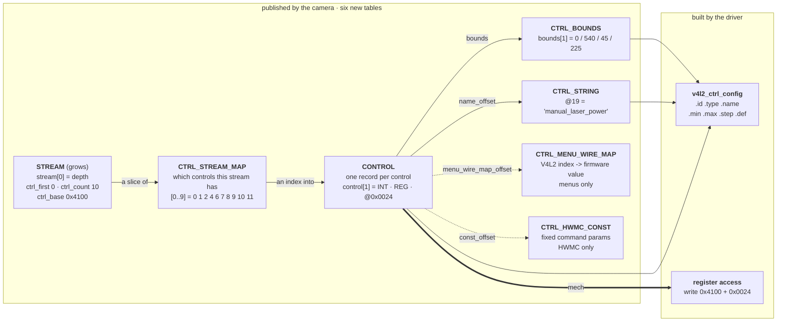
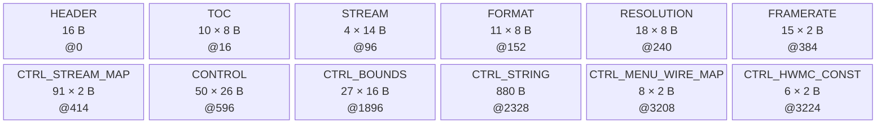
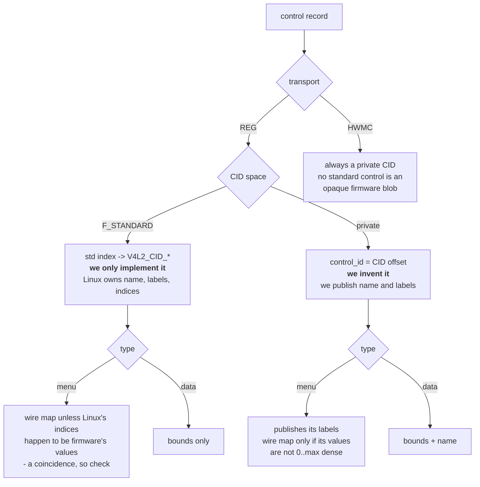

<!-- Source of truth for this design note. Edit it here.

     Companion to camera-format-descriptor.md: same blob, same aperture, more tables.
     Sections 1-11 are the design; 12-14 are the driver, the firmware obligations and the
     decisions taken against; Appendix A is the inventory it was derived from. Figures are
     Mermaid, rendered inline by GitHub and VS Code's Markdown preview. -->

# Camera-Resident Control Descriptor

Moving the V4L2 control set out of **d4xx_main.c** and onto the camera, beside the format
tables the camera already serves. What a control record has to carry so the driver can
register and operate a control it has never heard of, how the six new tables fit the blob
the format descriptor defined, what it costs on the wire — and the five controls that
**cannot** move, and why.

DESIGN NOTE **control descriptor** · STATUS **design — for review** · DRIVER **kernel/realsense/d4xx_main.c** · TICKET **RSDEV-15373** · STORY **RSDEV-14835** · COMPANION **[camera-format-descriptor.md](camera-format-descriptor.md)**

> Sources: `kernel/realsense/d4xx_main.c` at `dev` (`e9f04ee`, 1.0.7.12, including PR #700 /
> RSDEV-15386), the RS400 firmware's `I2cSlaveHostIf.c`, and a live enumeration on
> **fw-orin-5** — D585 at `9-001a`, D457 at `9-002a`, JP6.2, module 1.0.7.9. Every per-SKU
> difference claimed in Appendix A was read off those two cameras. Designed against four
> subdev instances per camera; the single-instance redesign is postponed and is not an input.

## 1 · The starting point: Forty structs, three fixup passes, five places

**Today a control exists because the driver says so.** `ds5_ctrl_init()` carries 37
`v4l2_ctrl_config` structs, branches four ways on which sensor is being set up, and then runs
three per-SKU passes that adjust ranges and hide menu entries for particular cameras. The
value's register or mailbox opcode is a `case` arm in `ds5_s_ctrl()` — about forty of them,
and as many again in `ds5_g_volatile_ctrl()`. Adding a control to a camera means editing all
of that and shipping a module; a camera with a control the driver does not know about simply
does not have it.

Unlike formats, which sat in one `switch (dev_type)`, control knowledge is spread across five
places in the driver and a sixth outside the repo:

| # | Place | What it decides | Moves? |
|---|---|---|---|
| 1 | 37 `v4l2_ctrl_config` structs | name, type, dims, flags, bounds, menu labels | Yes |
| 2 | `ds5_ctrl_init()` — four `sid` branches × `is_d58x` | which node gets which control | Yes |
| 3 | `ds5_adjust_sync_mode_control()`, `ds5_adjust_rgb_controls()`, `d500_adjust_device_mode_controls()` | post-probe per-SKU range / mask / disable fixups | Yes |
| 4 | the register map + `ds5_rgb_ctrl_offset()` | which address or opcode the value goes to | Yes, as data |
| 5 | `ds5_s_ctrl()` / `ds5_g_volatile_ctrl()` — ~40 `case` arms each | transport, encoding, locking, gating, errno | Mostly — down to two executors and five hooks |
| 6 | librealsense `RS_CAMERA_CID_*` + `xu_to_cid()` | the SDK's own copy of the CID numbering | No — separate repo |

Before designing the records, the facts have to be sorted by *who actually knows the answer*.
As with the format descriptor, this is the decision that shapes everything else:

| Fact | Known by | Consequence |
|---|---|---|
| Which controls the camera has | **CAMERA** | Moves wholesale into the blob. The driver registers what it finds and nothing else. |
| A control's range, step and default | **CAMERA** | Moves. Today it is patched per SKU after registration, in three fixup passes. |
| A private control's name and menu labels | **CAMERA** | Moves. Today 37 names and 7 label tables live in the driver. |
| The register, or the mailbox opcode, that reaches a control | **CAMERA** | Moves. It is a token in the firmware's own register vocabulary — only the firmware can state it, and today the driver keeps two parallel `#define` blocks to guess it per SKU. |
| Whether a write is permitted in the camera's *current* state | **CAMERA** | **Moves — the row with teeth.** Today the driver approximates it from its own streaming flags, which are a proxy for what firmware knows. The camera refuses and reports; the driver stops tracking. Section 9. |
| The V4L2 CID numbers, and a standard control's name, labels and type | **HOST** | **Stays.** Linux constants. A camera names a standard control by index into a thirteen-entry map the driver keeps, and inherits the rest. |
| The V4L2 type system | **HOST** | **Stays.** A six-entry map from the wire's type byte. |
| What index *n* of a private menu means, across the whole family | **SHARED** | A registry both sides append to and neither renumbers; a camera lacking an entry masks it. Section 6. |
| SerDes operations a control triggers | **HOST** | **Stays**, as a hook. `camera_sync_mode` drives ESYNC tunnelling through the serializer and deserializer. |
| The HW-reset recovery sequence | **HOST** | **Stays**, as a hook. Thirteen steps around one opcode, none of them visible to the camera. |
| The librealsense payload convention on `erb`/`ewb` | **HOST** | **Stays**, as a hook. An SDK contract the driver cannot change alone. |

> [!NOTE]
> The camera must therefore describe controls in **firmware and RealSense terms** — register
> offsets, opcodes, private CID numbers — never Linux terms. The driver keeps four small
> registries, none of them keyed by control (section 10), and five controls keep code
> because honouring them means touching something that is not the camera. Everything else
> becomes data, and a new private control of a known type costs **no driver change**.

What moves, in one table:

| | Today | With the descriptor |
|---|---|---|
| What controls exist | a table in the driver, per SKU | a table on the camera |
| Their ranges and defaults | hard-coded, patched per camera | published per camera |
| Their names and menu labels | hard-coded | published |
| Reaching the hardware | a `case` arm per control | one of two generic transports |
| Adding a control | a driver release | a firmware release |
| Who decides a write is illegal now | the driver, from its own streaming flags | the camera, which actually knows |

## 2 · The shape of it: Six tables that point one way

Six tables join the blob the format descriptor defined. They are flat arrays that reference
each other by index, in one direction, so a parser reads them in order and never looks back:



Read it as one sentence: **a stream owns a slice of the map, each map entry names a control,
and a control names its bounds, its strings, — if it is a menu whose numbering differs
from Linux's — its wire values, and — if it is a command that fixes some of its parameters —
its constants.** The driver turns the first four into a
`v4l2_ctrl_config` and the record's `mech` into the actual I2C access.

The values in the boxes are real: they are `manual_laser_power` on a D585's depth node, and
every one of them appears again in **§7.1**, which dumps the same camera's whole blob. A
reader who follows one control through that dump has seen the entire mechanism.

Three things the picture is meant to settle before any of the detail below:

- **Nothing in the chain is keyed by control.** No table in the driver has a row per control,
  so a new control costs no driver change.
- **`CONTROL` is the only fixed-stride record that grows** when a camera gains a control.
  `CTRL_BOUNDS`, `CTRL_STRING`, `CTRL_MENU_WIRE_MAP` and `CTRL_HWMC_CONST` are pools it points into and grow
  with it — a control costs its 26 B record *plus* its bounds row, its strings and any wire
  map, about 60 B on the D585 in section 7, not 26. `CTRL_STREAM_MAP` is the slice pool a
  *stream* points into.
- **`STREAM` is the only existing record that changes** — four new fields, appended (§4).

## 3 · Blob layout: Ten tables, one minor version bump

The control tables are optional as a group and sit after the format tables, which stay
mandatory. Nothing about the header, the TOC or the fetch changes; the enum grows, the stream
record grows, and the aperture grows.

```c
enum rs_desc_table {
	RS_DESC_T_STREAM = 1,
	RS_DESC_T_FORMAT,
	RS_DESC_T_RESOLUTION,
	RS_DESC_T_FRAMERATE,
	RS_DESC_T_LAST_REQUIRED = RS_DESC_T_FRAMERATE,

	/* Optional as a group, and numbered in reference order: a stream names
	 * controls, a control names its bounds, labels and wire values.
	 */
	RS_DESC_T_CTRL_STREAM_MAP,    /* flat u16 pool: control indices,
				       * one slice per stream                  */
	RS_DESC_T_CONTROL,            /* the records themselves                */
	RS_DESC_T_CTRL_BOUNDS,        /* min/max/step/def                      */
	RS_DESC_T_CTRL_STRING,        /* flat NUL-separated u8 pool:
				       * control names and menu labels         */
	RS_DESC_T_CTRL_MENU_WIRE_MAP, /* flat u16 pool: menu index -> wire
				       * value, for any menu whose two
				       * numberings differ. Omitted when no
				       * menu needs one                        */
	RS_DESC_T_CTRL_HWMC_CONST,    /* flat u16 pool: the parameters an HWMC
				       * record fixes, one run per record.
				       * Omitted when no command fixes any      */
	RS_DESC_T_MAX = RS_DESC_T_CTRL_HWMC_CONST,
};
```

- `ver_minor` bump, not `ver_major`. `ds5_desc_find_tables()` already skips table types it
  predates.
- The control set is present or absent as a whole; absent ⇒ built-in tables. **Within it, a
  pooled table with no entries is omitted rather than served empty** — `ds5_desc_find_tables()`
  rejects a TOC entry with `n_entries == 0`. `CTRL_MENU_WIRE_MAP` and `CTRL_HWMC_CONST` are
  the two that may be absent: a camera is free of the first unless some menu's indices and
  firmware values differ (today's SKUs: the standard menus and nothing else), and of the
  second unless some command fixes a parameter (today: the logger length, the calibration
  table ids and regions, the AE set-point selector). `CTRL_BOUNDS` and `CTRL_STRING` are
  absent only in theory.
- `RS_DESC_MAX_SIZE` rises **2048 → 8192**.

> [!WARNING]
> **The present-check loop.** `ds5_desc_find_tables()` skips table types it predates — so
> adding tables is safe for old drivers. But it then requires every type from
> `RS_DESC_T_STREAM` to `RS_DESC_T_MAX` to be present. Extending that enum without re-bounding
> the loop to `RS_DESC_T_LAST_REQUIRED` makes a **new driver reject every existing blob**,
> formats included. One line, and it must land with the enum.

Laid out, with the format tables it joins. Sizes are a D585's — 48 controls published as
**50 records**, since a control whose bounds or wire values differ per sensor is one record
per sensor (`exposure_time_absolute` and `auto_exposure` on depth and RGB; §7.3), across 91
(stream, record) pairs — as a concrete instance, not a requirement. A generator sizes
`CONTROL` by records, never by controls.



**Figure 1.** Regions in blob order with record count, stride and byte offset; boxes are
equal width rather than to scale. The order is **reference order** — a stream names controls,
a control names its bounds, labels, wire values and constants — matching the enum in §3. The TOC is
what the driver actually reads, so a generator may lay them out in any order; this one is
simply the order they are consumed in.

| Region | Entries | Stride | Bytes | At |
|---|---|---|---|---|
| Header | — | — | 16 | 0 |
| TOC | 10 | 8 | 80 | 16 |
| Stream | 4 | 14 | 56 | 96 |
| Format | 11 | 8 | 88 | 152 |
| Resolution | 18 | 8 | 144 | 240 |
| Framerate | 15 | 2 | 30 | 384 |
| **Stream map** | 91 | 2 | **182** | 414 |
| **Control** (records, not controls) | 50 | 26 | **1300** | 596 |
| **Bounds** | 27 | 16 | **432** | 1896 |
| **Strings** | — | — | **~880** | 2328 |
| **Menu wire values** | 8 | 2 | **16** | 3208 |
| **HWMC constants** | 6 | 2 | **12** | 3224 |
| **Total** | | | **~3236** | |

Two things the figure makes visible. **`CONTROL` is 40% of the blob and `CTRL_STRING`
another 28%** — between them they are most of the growth over the format-only descriptor,
and both scale with the control count rather than with the number of SKUs. And **every
reference is an index or offset carried in the TOC**, so a driver finds each table by type
rather than by position, and an older or newer blob with a different layout parses the same.

## 4 · The records: One that grows, one that is new, three pools

Listed in the order the blob lays them out: the stream record first, then the control record
and the tables it points into.

`rs_desc_stream` is the only existing record that changes, and growing it is safe in both
directions — `ds5_desc_rec()` zeroes the destination then copies `min(sizeof, stride)`, so a
new driver reading an old 6-byte record sees `ctrl_count = 0` and an old driver reading a
14-byte one stops at `fmt_count`.

```c
struct rs_desc_stream {               /* 6 B -> 14 B */
	u16 stream_id;
	u16 fmt_first;
	u16 fmt_count;
	u16 ctrl_first;     /* NEW: into CTRL_STREAM_MAP */
	u16 ctrl_count;     /* NEW: 0 = this stream advertises none */
	u16 ctrl_base;      /* NEW: base of this stream's control block; an
			     * F_ADDR_RELATIVE address is an offset into it */
	u16 status_addr;    /* NEW: the result register for this stream's REG
			     * controls; 0 = none, and every REG control on
			     * the stream must then set F_NO_STATUS. HWMC
			     * controls never read it */
} __packed;

/* Absent, for every optional table index and pool offset in rs_desc_control.
 * Offsets stay 0-based, so 0 is a real one; no pool reaches 0xFFFF under an
 * 8 KiB aperture, which is what makes the value safe to reserve.
 * The HWMC mech fields keep their own: an opcode is 0xFF because 0x00 is a
 * real opcode, a param index is 0 because HWMC params are numbered from 1. */
#define RS_DESC_NONE 0xFFFF

struct rs_desc_control {                  /* 26 B */
	u16 control_id;           /* private CID offset, or standard-map index if F_STANDARD */
	u8  v4l2_type;            /* enum rs_ctrl_type */
	u8  transport;            /* RS_CTRL_XPORT_* */
	u16 flags;                /* RS_CTRL_F_* */
	u16 elems;                /* array length; 1 = scalar */
	u16 menu_mask;            /* bit i set = menu index i absent; 0 = all present.
				   * Indexed by menu index, so a menu has at most 16
				   * entries. Publish the minimal form: bits above
				   * `max` are never consulted - see §6 */
	u16 bounds;               /* index into CTRL_BOUNDS; RS_DESC_NONE = the
				   * type's natural range (§12.1), legal only
				   * where the type has one */
	u16 name_offset;          /* into CTRL_STRING; RS_DESC_NONE if absent
				   * (F_STANDARD only) */
	u16 menu_offset;          /* into CTRL_STRING, max+1 labels;
				   * RS_DESC_NONE if absent (F_STANDARD only) */
	u16 menu_wire_map_offset; /* into CTRL_MENU_WIRE_MAP, max+1 values.
				   * RS_DESC_NONE = the index IS the wire value */
	union {                   /* discriminated by `transport`, never variable-length */
		struct rs_desc_mech_reg  reg;
		struct rs_desc_mech_hwmc hwmc;
	} mech;
} __packed;

struct rs_desc_mech_reg {             /* 8 B */
	u16 addr;           /* absolute, or an offset into the stream's
			     * ctrl_base if F_ADDR_RELATIVE */
	u16 extent;         /* bytes transferred; for a scalar, its width.
			     * 1..RS_CTRL_MAX_EXTENT (256) - see §5 */
	u32 rsvd;           /* holds the union at 8 B; do not shrink the struct to
			     * reclaim it - both arms must stay the same size */
} __packed;

struct rs_desc_mech_hwmc {            /* 8 B */
	u8  opcode_set;     /* 0xFF = not settable */
	u8  opcode_get;     /* 0xFF = not gettable */
	u8  value_param;    /* 0 = value rides in Data; else first param index,
			     * consuming `elems` of them */
	u8  const_mask;     /* bit i = param(i+1) is fixed; a command has four
			     * parameters, so this is the whole of its shape */
	u16 const_offset;   /* into CTRL_HWMC_CONST: hweight(const_mask) values,
			     * in slot order. RS_DESC_NONE when nothing is fixed */
	u16 resp_bytes;     /* expected response payload; 0 = take it from
			     * DS5_HWMC_RESP_LEN at read time */
} __packed;

struct rs_desc_ctrl_bounds { s32 min, max, step, def; } __packed;      /* 16 B */
```

### Type and flags

```c
enum rs_ctrl_type {                   /* -> V4L2_CTRL_TYPE_*, via the type map */
	RS_CTRL_T_INTEGER = 1, RS_CTRL_T_BOOLEAN, RS_CTRL_T_MENU,
	RS_CTRL_T_BUTTON,      RS_CTRL_T_U8_ARRAY, RS_CTRL_T_U32_ARRAY,
};

#define RS_CTRL_F_READ_ONLY      BIT(0)
#define RS_CTRL_F_VOLATILE       BIT(1)  /* read: call the driver, never the core's copy  */
#define RS_CTRL_F_EXEC_ON_WRITE  BIT(2)  /* write: call the driver even if unchanged      */
#define RS_CTRL_F_READ_TO_CLEAR  BIT(3)  /* a read consumes the value */
#define RS_CTRL_F_ADDR_RELATIVE  BIT(4)  /* REG: addr is an offset into the
					  * advertising stream's ctrl_base */
#define RS_CTRL_F_CAMERA_SCOPE   BIT(5)  /* applies to the camera, not one sensor */
#define RS_CTRL_F_STANDARD       BIT(6)  /* control_id indexes the standard-CID map */
#define RS_CTRL_F_RESP_SKIP_HDR  BIT(7)  /* HWMC: drop the 4-byte header from the response */
#define RS_CTRL_F_NO_STATUS      BIT(8)  /* firmware reports NO result for this write;
					  * skip the status read. Rare - see §8.4 */
#define RS_CTRL_F_LSW_LATCH      BIT(9)  /* REG: a scalar spanning 16-bit registers that
					  * firmware acts on at the low half-word */
```

A flag may describe only the **camera's own behaviour**. Host-side consequences are never
flagged; they are hooks (section 10).

## 5 · Two transports: A struct at an address, or a mailbox command

A transport is how a control's bytes reach the camera. There are two, the record says which
in `transport`, and `ds5_s_ctrl()`'s forty `case` arms turn out to be these two wearing
different clothes:

| Shape in the driver today | Really | What publishing the mechanism removes |
|---|---|---|
| `ds5_write(state, base \| OFFSET, ctrl->val)` | **REG**, one field | the `#define` and the `case` arm |
| `ds5_rgb_ctrl_offset()` picking one of two offsets | **REG** at a different address | *the whole category* — two parallel `#define` blocks and the helper |
| a D5xx XU window written as a struct | **REG**, several bytes | the layout; **not** the constraints on it |
| `hwm_cmd` template + `ds5_hwmc_send()`/`_wait()` | **HWMC**, interpreted | the opcode constant and the request marshalling |
| the caller's blob straight through (`hwmc`, `hwmc_rw`) | **driver-owned** | nothing to publish — the opcode is in the caller's payload, so no record can describe it; the driver registers both itself (§10.1) |

The second row is the one that pays: per-SKU register offset stops being a *kind* of
variation and becomes a field. The third is the warning — the layout moves, the semantics do
not.

`hw_reset` is not a sixth transport. It is one HWMC opcode with thirteen host-side steps
around it, which is the wrapper axis, not the transport axis.

That is the whole of it on the wire. The rest of this section is what each transport has to
carry, and the one subtlety the firmware source adds.

### REG — a packed struct at an address

The driver transfers `extent` bytes to or from `addr`. A scalar is the one-field case; a
D5xx XU window is the general one.

`addr` is absolute unless the record sets `F_ADDR_RELATIVE`, in which case it is an offset
into the **advertising stream's `ctrl_base`**, which that stream's record publishes. The
driver holds no notion of where a stream's control block lives — today it derives
`control_base` from the DT `cam-type` string and a pair of `#define`s, and that mapping goes
away. Relative addressing exists because firmware's own model is a block per camera with an
identical layout (`REG_BASE_CAM0_CONTROLS`, `REG_BASE_CAM1_CONTROLS`, stride `0x100`), so
one record can serve two streams whose bases differ.

| `extent` | Means | Today |
|---|---|---|
| 1, 2 or 4 | a scalar of that width | 1 B for a D58x XU byte, 2 B for a D4xx control register, 4 B for exposure's register pair |
| anything else | a byte window, and `elems × elem_size` must equal it (§12.2 rule 7) | 38 B — `sizeof(struct d500_dpp_xu_control)` |

**1–38 B is what cameras publish today, not the limit.** The ceiling is
`RS_CTRL_MAX_EXTENT`, **256 bytes**, the chunk size the descriptor fetch already proves good
for a single `regmap` transfer. A record above it is refused outright (§12.2), so a future
40-byte window works and a 400-byte one is declined with a log line — never truncated, and
never clocked onto the bus to find out.

### HWMC — a mailbox command

The driver builds a `hwm_cmd` from `opcode_set`/`opcode_get`, places the value in a parameter
or in `Data`, fills the parameters `const_mask` names from the record's run in
`CTRL_HWMC_CONST`, sends it, and waits on the status register. Request is a 24-byte command
plus payload; the response is bounded by `DS5_HWMC_BUFFER_SIZE`, 1 KB.

A command has exactly four parameters, and each is either the value, a constant, or unused —
so the mask is the complete description of its shape. Today four commands fix one parameter
and the two calibration setters fix two (`param1` the table id, `param2` the flash region the
driver used to add from its own template); nothing can need more than four.

A record is refused only when its opcode is one whose host sequence the driver owns and no
hook is bound for it (§12.2). An opcode the driver has never seen is registered and works.

### Two axes, not one

Transport is independent of **whose CID it is**, and both matter to what a record must carry:



**Standard** controls are ones V4L2 already defines — `V4L2_CID_EXPOSURE_ABSOLUTE`,
`V4L2_CID_SATURATION`. A camera cannot mint one, so it names it by index into the driver's
standard-CID map (§10.2) and inherits Linux's name, labels and index numbering; the camera
supplies only bounds, flags and mechanism. Thirteen of the forty-nine controls are of this
kind.

**Private** controls are ours: we assign the `control_id`, publish the name, and for a menu
publish the labels and choose the values. Today every private menu numbers its indices to
match its firmware values, so it needs no wire map — a convenience, not a rule (§6).

The one combination that does not occur is a standard HWMC control, because no V4L2-defined
control is an opaque firmware blob.

### One scalar, two registers: the low-half-word latch

The REG mechanism briefly had an `access` byte holding a width (1/2/4) and a word-order bit.
The width is gone; the order bit stayed, as `F_LSW_LATCH`, and the firmware source says why.

**The width was redundant with `extent`.** A scalar occupies exactly its own width, so
`extent` already states it; for a byte array a "width" means nothing, which is why the MinZ
example had carried a meaningless `W1` beside `extent = 38`. Dropping it removes a field two
sources could disagree about.

**The order bit is load-bearing, and a single burst would have been silently wrong.**
`i2cHostIfControlSet()` in the RS400 firmware
(`DS5_B0_DEV/AppServicesLib/I2cSlaveHostIf.c`) handles every write to the camera-control
blocks:

```c
if ( REG_CAM_CONTROL_LSW_ADDR(regAddress) )      /* 4-byte-aligned => the low half-word */
{
    pCtrlData[0] = *(uint16_t*)pBuffer;          /* store the low half */
    ...
    ret = UvcControlOutRequest(pCtrl->unit, pCtrl->control, (uint8_t*)pCtrlData);
}                                                /* ^ acts on the whole 32-bit value */
else
{
    pCtrlData[1] = *(uint16_t*)pBuffer;          /* high half: store only, no action */
}
```

Three facts follow, and together they settle the question:

1. **Firmware acts on the low half-word write.** A write to `+0x02` only stores; the write to
   `+0x00` stores *and* dispatches the complete 32-bit value to the UVC layer. So the high
   half must already be in place — the driver's `+0x02`-then-`+0x00` ordering is required,
   not stylistic.
2. **A 4-byte burst does not work.** The handler reads `*(uint16_t*)pBuffer` — exactly two
   bytes — whatever the transaction length, and `I2cHostIfSlaveWrite()` checks only that the
   offset is 2-byte aligned. A burst to `0x4100` would set the low half, dispatch with a
   **stale** high half, and silently discard the two bytes the host sent. No error anywhere.
3. **Reads are unaffected.** The read path just points the transaction buffer at the register
   array; there is no latch and no side effect, so a 4-byte read returns both halves in
   address order.

So `extent = 4` alone is ambiguous: on a D4xx control block it means two 16-bit registers
with a latch, and on an HKR XU window it means four raw bytes. `F_LSW_LATCH` distinguishes
them, which is more than the "write order" the flag was originally named for — hence the
rename.

This is worth keeping as a worked example of the general hazard: the generic executor's
natural behaviour — one transfer of `extent` bytes — is wrong here in a way that produces no
error, only a wrong exposure. Every REG control that spans more than one 16-bit register on a
D4xx control block needs this flag, and today `V4L2_CID_EXPOSURE_ABSOLUTE` is the only one.

## 6 · Menus: Whose numbering, whose values, and why the two are kept apart

A menu control has three numberings that look like one: the V4L2 index userspace sets, the
value the firmware register wants, and the label a human reads. The record keeps them
separate — `menu_mask` says which indices exist, `menu_offset` names the labels,
`menu_wire_map_offset` translates index to value — and this section is why none of the three
can be derived from another.

**A menu's index space is never the individual camera's to choose**, and that is what makes
`menu_mask` necessary rather than merely convenient.

For a **standard** menu the index space is Linux's — `V4L2_CID_EXPOSURE_AUTO` is numbered by
`enum v4l2_exposure_auto_type`, and a camera implementing two of its four modes masks the
other two.

For a **private** menu it is the *family's*, not the camera's. librealsense maps its own
option values to V4L2 menu indices at compile time, so index 2 of `camera_sync_mode` must
mean *External Sync* on a D457 and on a D585 alike. A D58x with no Master role therefore
publishes three entries and masks index 1; publishing two would shift External down to 1 and
collide with D457's Master. So **a private menu's indices are an append-only shared registry,
exactly like `control_id`** — a camera chooses which entries it *has*, never what they are
numbered.

The labels come from the camera either way, and this is the difference the two cases make
visible: a standard menu publishes no labels, because the V4L2 core names
`v4l2_exposure_auto_type` itself, while a private menu publishes `max + 1` of them at
`menu_offset`. That is how anything knows index 1 of `camera_sync_mode` is *Master* —
`control[7]` in §7.1 points at `"Default" "Master" "External Sync"` in the string pool.

**Whether the index is the wire value is a per-menu fact, not a per-kind one.** Either kind
may be identity, and `menu_wire_map_offset == RS_DESC_NONE` says so — offset `0` is a real
run, as `control[4]`'s is in §7.1:

| | Identity today | Needs a map |
|---|---|---|
| **Private** | `visual_preset` `0..5`, `camera_sync_mode` `0..2` — the camera numbered its indices to match its own values | a menu whose firmware values are sparse, say `1` and `500` |
| **Standard** | `V4L2_CID_POWER_LINE_FREQUENCY` — V4L2's `0..3` happen to be the firmware's, and the driver writes `ctrl->val` straight through | `V4L2_CID_EXPOSURE_AUTO` — index `1` is value `0` on depth and `1` on RGB |

The sparse private case is not hypothetical merely because none exists: the mask is indexed
by **menu index**, so a value of 500 would need a 501-entry menu, and `menu_mask` is a `u16`
— **sixteen entries is the ceiling**. Such a menu must publish indices `0`,`1` and a wire map
of `{ 1, 500 }`.

The asymmetry is in how the two kinds *establish* identity rather than whether they may have
it. A private menu knows by construction, because the camera chose both numberings. A
standard menu's identity is a **coincidence between two independent numberings**, confirmable
only by reading the Linux enum — so a generator must check it per control rather than assume
it, and the cross-check tool should verify that an omitted wire map really does match what
the driver writes.

**Masked entries still get a label.** The V4L2 `qmenu` array is indexed by menu index, so the
slot has to exist; the core never returns the string, so its content is free. Publishing the
real name anyway keeps the blob auditable — a cross-check tool can assert that every camera
in the family agrees on index → label, which is the only mechanical defence against a
renumber.

`menu_wire_map_offset` does not subsume it either. That maps index → *wire value* for a standard
menu; the mask says which indices exist at all. A camera needs both whenever its wire values
and the V4L2 indices diverge *and* some entries are absent.

`F_STANDARD` affects identity and naming only: `name_offset` and `menu_offset` are
`RS_DESC_NONE`, and the name and labels come from Linux (§12.1). `bounds`, `menu_mask`, `menu_wire_map_offset`,
`flags` and `mech` still come from the record.

## 7 · Worked example: A D585, twelve of fifty records

One D585, as control-descriptor tables. Twelve of its fifty records — ten controls, two of
which (`exposure_time_absolute`, `auto_exposure`) are one record per sensor — chosen so that
every mechanism above appears at least once; the rest are more of the same. The values in
section 2's diagram are these.

### 7.1 The camera, as a descriptor

```text
header      magic RSDS   ver 1.1   header_size 16   total_size 3236   crc32 ...
toc         STREAM 4×14 @96 ... STREAM_MAP 91×2 @414   CONTROL 50×26 @596
            BOUNDS 27×16 @1896   STRING 880 @2328   MENU_WIRE_MAP 8×2 @3208   HWMC_CONST 6×2 @3224

              stream_id fmt_first fmt_count ctrl_first ctrl_count ctrl_base status_addr
stream[0]             0         0         1          0         10    0x4100      0x401E  depth
stream[1]             1         4         1         16          6    0x4200      0x402E  rgb
stream[2]             2         5         1         22          2    0x4100      0x401E  imu
stream[3]             4         1         3         10          6    0x4100      0x401E  ir
                                                                     ^^^^^^      ^^^^^^
                                       depth, IR and IMU share a control block, so they also
                                       share its result register - hence §12.3's lock is
                                       camera-wide and not per node

                flat u16 pool of control indices, indexed by ctrl_first
ctrl_stream_map  [0]  0  1  2  4  6  7  8  9 10 11      depth
                [10]  0  1  2  4  9 10                  ir
                [16]  3  5  9 10 11 12                  rgb
                [22]  9 12                              imu

                id  type   xport flags       elems bnds name menu wire   mask  mech
control[0]       1  BOOL   REG   V E R           1    0    0    -    -      0  @0x0008 ext 2
control[1]       2  INT    REG   V E R           1    1   19    -    -      0  @0x0024 ext 2
control[2]       0  INT    REG   V E R S L       1    2    -    -    -      0  @0x0000 ext 4
control[3]       0  INT    REG   V E R S L       1    3    -    -    -      0  @0x0000 ext 4
control[4]       1  MENU   REG   V E R S         1    4    -    -    0   0005  @0x000C ext 2
control[5]       1  MENU   REG   V E R S         1    4    -    -    4   0005  @0x000C ext 2
control[6]      21  MENU   REG   V E R           1    5   38   52    -      0  @0x0020 ext 2
control[7]      16  MENU   REG   V E R C         1    6  114  131   -   0002  @0x002C ext 2
control[8]      44  U8[]   REG   V E N          38    -  160    -    -      0  @0x4500 ext 38  absolute
control[9]       8  U8[]   HWMC  V O           606    -  179    -    -      -  get 0x10  resp var
control[10]      5  U8[]   HWMC  V O H         512    -  183    -    -      -  get 0x15  const p1 @0     resp var
control[11]      6  U8[]   HWMC  -             512    -  199    -    -      -  set 0x62  const p1 p2 @0  in Data

                columns, abbreviated from the §4 field names:
                  id    control_id        bnds  bounds          wire  menu_wire_map_offset
                  type  v4l2_type         name  name_offset     mask  menu_mask
                  xport transport         menu  menu_offset     mech  mech.reg / .hwmc
                  ext   mech.reg.extent   const  mech.hwmc.const_mask, as slot names, @ const_offset

                flags: V volatile · E execute-on-write · O read-only · R address relative
                       S standard CID · L low-half-word latch · C camera scope
                       H drop the response header · N no status reported

                `control_id` is a private CID offset, or - when S is set - an index into
                the driver's standard-CID map, which is not in the blob:

std[0]  V4L2_CID_EXPOSURE_ABSOLUTE          std[7]   V4L2_CID_POWER_LINE_FREQUENCY
std[1]  V4L2_CID_EXPOSURE_AUTO              std[8]   V4L2_CID_EXPOSURE_AUTO_PRIORITY
std[2]  V4L2_CID_ANALOGUE_GAIN              std[9]   V4L2_CID_BRIGHTNESS
std[3]  V4L2_CID_SATURATION                 std[10]  V4L2_CID_CONTRAST
std[4]  V4L2_CID_SHARPNESS                  std[11]  V4L2_CID_GAMMA
std[5]  V4L2_CID_WHITE_BALANCE_TEMPERATURE  std[12]  V4L2_CID_HUE
std[6]  V4L2_CID_AUTO_WHITE_BALANCE

                     min      max   step     def
bounds[0]              0        1      1       1    control[0]  laser on/off
bounds[1]              0      540     45     225    control[1]  manual laser power, D585 range
bounds[2]              1   200000      1   33000    control[2]  exposure, depth
bounds[3]              1    10000      1    1660    control[3]  exposure, rgb
bounds[4]              0        3      -       3    control[4..5]  step unused on a menu
bounds[5]              0        5      -       1    control[6]
bounds[6]              0        2      -       0    control[7]

                flat u16 pool. Present when a menu's V4L2 indices and firmware values
                differ - always for a standard menu, and for a private one only if its
                values are not already 0..max dense, which none is today.
                A record's `menu_wire_map_offset` names the first entry of its run; the run
                is `bounds[].max + 1` long, and entry i is the firmware value to write
                for V4L2 menu index i. Masked indices are never read.

                              V4L2 index:    0     1     2     3
                                          AUTO  MANUAL SHUTTER APERTURE
menu_wire_map  [0]  control[4], depth:        -     0     -     1
               [4]  control[5], rgb:          -     1     -     8
                                          masked       masked
                                            by menu_mask = 0x0005

                flat u16 pool. A record's const_mask says which of param1..4 are fixed;
                const_offset names its run, one value per set bit in slot order. A getter
                shares its setter's run - its mask selects the first slot only.

hwmc_const   [0]  0x0019  0x0002     control[10]: p1 · control[11]: p1, p2  (table id, flash region)

                NUL-separated byte pool, indexed by name / menu
string       @0   "laser_power_on_off"
            @19   "manual_laser_power"
            @38   "visual_preset"
            @52   "Custom" "Default" "Hand" "High Accuracy" "High Density" "Medium Density"
           @114   "camera_sync_mode"
           @131   "Default" "Master" "External Sync"
           @160   "minz_configuration"
           @179   "gvd"
           @183   "get_coeff_calib"
           @199   "set_coeff_calib"
```

`control[8]` is the only record **in this twelve-record slice** setting `F_NO_STATUS`,
because `0x4500` is an absolute XU window outside the depth stream's `0x4100` block —
nothing there updates `0x401E`, so a poll would read a sibling's result (§8.1, rule 12).
Every other REG write here is followed by a read of its stream's `status_addr`. A full D585
blob has nine such records, every D58x XU window among them (§13.2); the HWMC records need
no flag, since they never read the register. The `std[]` list is the one table that stays in the driver (§10.2): a camera
cannot mint `V4L2_CID_SATURATION`, so it names it by index instead.

### 7.2 Reading a cross-reference

Each column is one field, so a reference reads off the row. Taking the IR node:

```text
stream[3].ctrl_first = 10, .ctrl_count = 6       ->  ctrl_stream_map[10..15] = 0 1 2 4 9 10
ctrl_stream_map[11] = 1                          ->  control[1]
control[1].id = 2, no S flag                     ->  DS5_CAMERA_CID_BASE + 2
control[1].bounds = 1                            ->  bounds[1] = { 0, 540, 45, 225 }
control[1].name_offset = 19                      ->  string@19 = "manual_laser_power"
control[1].mech.reg = { 0x0024, extent 2 }, REL  ->  write 0x4100 | 0x0024 = 0x4124
stream[3].status_addr = 0x401E                   ->  read the result there, under the lock
```

`control[2]` on the same node resolves its identity the other way: `id = 0` with the `S`
flag set is `std[0]`, so the CID is `V4L2_CID_EXPOSURE_ABSOLUTE` and the name comes from
Linux — which is why its `name` column is `-`.

A menu takes two more lookups. Setting `auto_exposure` to *Aperture Priority* on the depth
node:

```text
control[4].menu_mask = 0x0005            ->  bit 3 clear, so index 3 is a legal setting
control[4].bounds = 4, bounds[4].max = 3 ->  the menu_wire_map run is 4 entries long
control[4].menu_wire_map_offset = 0            ->  menu_wire_map[0..3] = { -, 0, -, 1 }
index 3                                  ->  menu_wire_map[0 + 3] = 1, written to 0x410C
```

On the RGB node the same control is `control[5]`, whose run is `menu_wire_map[4..7] = { -, 1, -, 8 }`,
so the identical V4L2 request writes **8** to `0x420C`. That divergence is the whole reason
`CTRL_MENU_WIRE_MAP` exists: the index belongs to Linux, the value to firmware, and on this control
they disagree differently per sensor.

> [!NOTE]
> **Why four entries and not two?** The run is indexed *directly* by the V4L2 menu index, and
> `enum v4l2_exposure_auto_type` numbers its entries `AUTO = 0`, `MANUAL = 1`,
> `SHUTTER_PRIORITY = 2`, `APERTURE_PRIORITY = 3`. The two this camera implements are 1 and
> 3, so reaching index 3 needs a run of four — entries 0 and 2 are holes.
>
> Packing it to `{ 0, 1 }` would mean "the n-th *unmasked* entry", so the lookup would have
> to popcount `menu_mask` below the index first. That couples the pool to the mask: masking
> one more entry silently repoints every value after it, and the table stops being readable
> against the enum it mirrors. Direct indexing costs 2 bytes per hole — eight bytes in the
> whole D585 blob — and keeps the lookup a single add.
>
> The same holes appear in a **private** menu's labels, for the same reason and not because
> Linux owns the numbering: `control[7]` publishes *Master* at index 1 and masks it, so that
> *External Sync* stays at index 2 on every SKU (§6).
>
> A private menu can avoid holes entirely by publishing a wire map and numbering its indices
> densely — which is also the only option when its firmware values are sparse, since
> `menu_mask` is indexed by menu index and caps a menu at sixteen entries.

That is the whole registration and execution path for one control, in six lookups and no
driver-side table.

### 7.3 What each row demonstrates

| Row | Mechanism |
|---|---|
| `control[0]`, `control[1]` | the common case — one register, bounds that differ per SKU. A D457 publishes `bounds[1] = { 0, 360, 30, 150 }` and nothing else changes |
| `control[2]`, `control[3]` | **a control whose bounds differ per sensor is two records**, referenced from different streams. Both carry `id = 0`, because that is `std[0]` — the same CID with different bounds, and nothing has to know they are "the same" control |
| `control[2]` | `LATCH`: `extent 4` here is *two 16-bit registers*, written high half first, because firmware acts on the write to the low one (§5). On an HKR window the same `extent 4` would be four raw bytes |
| `control[4]`, `control[5]` | `F_STANDARD` + `menu_wire_map_offset`: both are `std[1]` = `V4L2_CID_EXPOSURE_AUTO`, so V4L2 owns the indices and firmware owns the values — and they differ *per sensor*, `1 -> 0` on depth and `1 -> 1` on RGB. The only use of `MENU_WIRE_MAP` |
| `control[4]` | `menu_mask = 0x0005` skips indices 0 and 2, leaving the two AE modes the camera implements of the four V4L2 defines. Only bits up to `max` are ever consulted, so the mask is published in that minimal form |
| `control[6]`, `control[7]` | private menus, so both publish their own labels at `menu_offset` — that is how anything knows index 1 is *Master*. Neither carries a wire map, because both number their indices to match their firmware values: `camera_sync_mode` index 2 writes 2. That is a property of these two menus, not of private menus (§6). `visual_preset` has `menu_mask = 0`, all six entries; `camera_sync_mode` masks index 1, which a D58x has no role for, and still publishes its label so *External Sync* stays index 2. A D457 publishes mask `0` |
| `control[8]` | an opaque 38-byte window at an *absolute* address: `bounds = none`, no `REL`, and `N` — `0x4500` is outside the depth block, so nothing reports there and the refusal is invisible until **B1b** (§13.3) |
| `control[9]` | `resp_bytes = 0` — the length comes from `DS5_HWMC_RESP_LEN` at read time, bounded by `elems` |
| `control[10]`, `control[11]` | one HWMC pair sharing one two-entry run in `CTRL_HWMC_CONST`: the getter fixes `param1` (table id) and drops the 4-byte header; the setter fixes `param1` *and* `param2` (the flash region, `2` = both) and carries its payload in `Data`. The region is the constant the driver's own template used to add — now the camera says it |
| `control[7]`, `control[8]` | both still keep a driver hook (§10.1) — the records are complete, but the serializer ESYNC call and the MinZ geometry rule are not in them |
| `stream[0..3]` | three of four streams share `status_addr` — the reason §12.3's lock is camera-wide |

Two absences are as informative as the rows. **No record names a stream it is gated on**,
because the refusal is firmware's (§9); and **no record carries a width**, because `extent`
is the width for a scalar and meaningless for an array (§5).

These twelve records are a small slice of the blob §3 lays out: twelve `CONTROL` rows,
seven `CTRL_BOUNDS`, eight `CTRL_MENU_WIRE_MAP` entries, two `CTRL_HWMC_CONST` entries, 215
bytes of `CTRL_STRING` and twenty-four `CTRL_STREAM_MAP` slots. The remaining thirty-eight
records are the same shapes again.

## 8 · The write result: A status register the firmware already keeps

An I2C write is ACKed at the bus level whatever firmware thinks of it, so if the camera is to
refuse a write (section 9) the driver needs somewhere to read the answer. The USB side has had
one since UVC: a request error code read after the transfer. The GMSL side gets the same
thing — and most of it already exists.

### 8.1 The mechanism

`status_addr` holds a result for the last REG control write **into that stream's control
block** — `ctrl_base` for a stride of `0x100`, which is the range
`i2cHostIfControlSet()` handles. A write anywhere else, such as an absolute D58x XU window at
`0x45xx`, reaches a different handler that never touches the register, so polling after one
latches whatever the previous control-block write left. Such a record sets `F_NO_STATUS`
(rule 12). The values are firmware's existing `I2C_STATUS_*`:

| Wire | Meaning | Driver returns |
|---|---|---|
| `RS_CTRL_STATUS_OK` (0) | the control was applied | `0` |
| `RS_CTRL_STATUS_ERROR` (1) | firmware rejected or failed it | `-EIO` |
| `RS_CTRL_STATUS_WIP` (2) | still in flight | poll; `-ETIMEDOUT` past the bound |

When firmware also publishes the request error code (§13), the driver maps that instead:

| `ETControlReturnCode` | Driver returns |
|---|---|
| `CRC_SUCCESS` | `0` |
| `CRC_NOT_READY_ERR`, `CRC_WRONG_STATE_ERR` | `-EBUSY` |
| `CRC_OUT_OF_RANGE_ERR` | `-ERANGE` |
| `CRC_INVALID_UNIT_ERR`, `CRC_INVALID_CONTROL_ERR` | `-EOPNOTSUPP` |
| `CRC_INVALID_REQUEST_ERR` | `-EINVAL` |
| `CRC_POWER_ERR` | `-EIO` |

The status is **asynchronous**: a write is dispatched and completes later, so the driver
polls rather than reading once.

> [!WARNING]
> **A terminal value is not by itself this write's result**, so the poll must not exit on
> "anything but `WIP`". `i2cHostIfControlSet()` stores `I2C_STATUS_ERROR` **on entry** and
> only reaches `WIP` once `UvcControlOutRequest()` has accepted the dispatch, and the host's
> read is a separate I2C transaction from the write that triggered it. Two values can
> therefore be latched that say nothing about this write:
>
> | Poll lands | Reads | Reported |
> |---|---|---|
> | after entry, before the dispatch is accepted | the entry `ERROR` | `-EIO` for a write that then succeeds |
> | before the handler runs at all | the **previous** control's terminal value | a refused write reported as applied — the A1 false-OK of §13.2 |
>
> `ERROR` is doing two jobs: *not dispatched yet* and *failed*. Nothing in the value
> distinguishes them, so the driver pairs the status with the **completion counter** firmware
> already keeps (§13 B1): snapshot it, write, wait for it to advance, then read the status.
> A counter is better than requiring the poll to observe `WIP` first, because it stays
> correct when a completion overtakes the host between two reads.

> [!NOTE]
> **The reason already exists in firmware and is thrown away.** `UvcControlMsg()` computes a
> full `ETControlReturnCode` — the UVC Request Error Code Control, verbatim from the spec —
> and hands it to the completion callback, where `I2cHostIfUvcControlHandleComplete()`
> discards it with `(void)value;` and keeps only OK/ERROR. §13 asks firmware to publish it,
> not to invent it. Until it does, `-EIO` is the honest answer and the driver must not guess
> a more specific one.

**Reading the result is the default**, because firmware produces one for all but a handful
of REG controls (§8.4). `F_NO_STATUS` marks those exceptions. The driver never learns *why*
a write was refused beyond what the result says, and holds no notion of which controls are
legal in which state — that is firmware's (§9).

### 8.2 Where it comes from

A readback tells you a value differs. It does not tell you the write was rejected, or why —
and for a control whose value firmware normalises, the two are indistinguishable.

**Firmware already implements most of it.** `STStreamConfiguration` carries
`uint16_t control_status` at offset `0x1E`, which the driver knows as
`DS5_DEPTH_CONTROL_STATUS` (`0x401E`) and its three siblings. `i2cHostIfControlSet()` sets it
to `WIP` when it dispatches a control and bumps a sent counter; the asynchronous
`I2cHostIfUvcControlHandleComplete()` bumps a completed counter and sets `OK` or `ERROR` from
the UVC layer's own return code:

```c
s_controlCompletedSeqId[camIndex]++;
s_pStreamConfiguration[camIndex].control_status =
    (s_controlSentSeqId[camIndex] != s_controlCompletedSeqId[camIndex])
        ? I2C_STATUS_WIP : ( ERR_Success == status )
            ? I2C_STATUS_OK : I2C_STATUS_ERROR;
```

So the result of a control write is already derived from what the control layer actually
returned, exactly as UVC's is. Three consequences shape §12.3 and §8.1.

**It is asynchronous.** The write dispatches and completes later, so the driver polls out of
`WIP` rather than reading once. The HWMC path already does this against `0x4904`, with the
same `I2C_STATUS_*` values and a 2 s bound.

**It is per control block, not per node.** `camIndex` comes from the control address, and
depth, IR and IMU all write controls at `0x4100`: three of the four nodes share `0x401E`.
Firmware's sent/completed pair keeps the register `WIP` while more than one write is
outstanding, which is the same race seen from firmware's side. Hence the critical section,
and hence `ds5_dev->lock` rather than anything per-node.

**It is binary.** `OK`/`ERROR` cannot distinguish wrong-state from out-of-range from
unsupported, so the driver can only return `-EIO` — losing the `-EBUSY`/`-ERANGE`/
`-EOPNOTSUPP` distinctions the hand-written helpers make today. §13 asks firmware to widen
it to a UVC-style request error code. That is the gap between *shaped like* UVC and *as good
as* UVC, and it is firmware's to close.

### 8.3 The register is doing two jobs

> [!NOTE]
> Two separate overloadings share this register, and both need firmware work. The one below
> is the host's reset scratch colliding with the control result. The other is inside the
> status value itself: `I2C_STATUS_ERROR` means both *not dispatched yet* and *failed*,
> which is what B1a's counter resolves (§8.1).

The driver's only current use of `control_status` is as a **scratch pad**: before a HW reset
it writes a sentinel and waits for firmware to restore `0x0000`, as a readiness probe. That
works because `i2cHostIfCamConfigurationSet()` writes any offset in the stream-config block
with no field protection:

```c
if ( config_offset < sizeof(s_pStreamConfiguration) )
    ((uint16_t*)s_pStreamConfiguration)[config_offset>>1] = value;
```

So the host can scribble on a register firmware owns as an output, and the readiness probe
depends on being able to. Harmless while nothing reads it as a status — which is exactly
what §8.1 changes.

The two uses must separate. Either the readiness probe moves to a register of its own, or
the result moves; the first is simpler, since the probe only needs *some* register firmware
re-initialises on reset. Resolving it is a precondition for §8.1, not a follow-up.

### 8.4 How many controls actually report a result?

Most of them, which is why reading the result is the default (§8.1) and the exceptions are
flagged rather than the other way round — but the margin is narrower than the control blocks alone suggest,
and it is B1b that widens it.

`s_hostCtrlTable` maps each control register slot to a UVC unit and control. Counting the
dispatch kinds across both blocks:

| Block | Slots | UVC-dispatched | Ext-func | Unused (`vfID_Count`) |
|---|---|---|---|---|
| `etMipiDepth` | 13 | **9** | 1 — AE ROI at `4x10` | 3 — `4x14`, `4x18`, `4x1C` |
| `etMipiRGB` | 12 | **9** | 0 | 3 — `4x24`, `4x2C`, `4x30` |

**18 of the 19 live controls dispatch through UVC**, and every one of those gets a status
derived from the control handler's own return code.

That count covers the control blocks only. A D585 also publishes **nine absolute XU windows**
at `0x45xx` — the seven A-items plus `detection_distance` and
`d500_temporal_configuration` — which no handler in this table serves, so each sets
`F_NO_STATUS` until B1b (§13.3). The real ratio on a D585 is therefore **18 reporting to
nine not**, not 18 to one.

The default still holds: reading is right for twice as many controls as it is wrong for, and
`F_NO_STATUS` names the rest explicitly rather than leaving the driver to guess. B1b returns
it to near-universal, which is the state the opt-out was designed for.

The exceptions are worth naming, because both are firmware defects rather than designed
behaviour:

**AE ROI never reports success.** `i2cHostIfControlSet()` sets `control_status` to
`I2C_STATUS_ERROR` on entry, and only the `UvcControlOutRequest` branch moves it to `WIP`.
The `vfID_UnitExtFunc` branch — which is how `4x10` reaches `ctrlFuncROI()` and so
`AeRoiSet()` — never touches it. A successful ROI write therefore leaves `ERROR` in the
register. The driver does not notice today because it drives AE ROI over HWMC instead, but a
descriptor that published `4x10` as a REG control would report every success as a failure.

**The six `vfID_Count` slots do nothing.** Neither branch runs, `ret` stays
`ERR_WrongParameter`, and `control_status` stays `ERROR` — while the written value is still
stored in the shadow register, so a readback would show the write "worked". They are
vestigial: the three depth ones are the other corners of the ROI rectangle, which
`ctrlFuncROI()` reads directly out of the shadow copy, and the RGB three are unused. **A
descriptor must not publish any of them**, and §12.2's rules do not catch it — nothing on the
wire distinguishes a live control register from a dead one.

## 9 · Who refuses a write: The camera, and what that costs today

Whether MinZ's filter type may change mid-stream is a property of the camera's pipeline. By
§10.1's rule — *a flag may state a fact about the camera* — the camera owns it, and the design
gives the driver no notion of which controls are legal in which state.

An earlier draft had the host reconstruct the answer from a published `idle_streams` mask and
the driver's own `depth_streaming`/`ir_streaming` flags. Those flags are a **proxy** for what
firmware actually knows and can diverge from it, for instance after a reset-generation
invalidation — so the host would have been enforcing a rule it could only approximate.

### 9.1 The obstacle: firmware has no way to say no

An I2C write to an XU window is ACKed at the bus level whatever firmware thinks of it. This
is the same wall the verify-write pattern hit (§14), and it leaves four options:

| Channel | Verdict |
|---|---|
| **A per-stream result status register** | **Adopted** (§8.1). Firmware already drives one — `i2cHostIfControlSet()` sets `WIP` and the completion callback resolves it (§8.2) — and §12.3's camera-wide `ds5_dev->lock` serialises the four subdevs that share it |
| Read the window back and compare | One extra transaction and no new firmware surface, but it reports only *whether the bytes changed*, never why, and reports nothing at all for a write-only window |
| Route control writes through HWMC | Real status protocol, but every REG control becomes a mailbox round-trip |
| Firmware ignores silently, driver reports success | The failure this design is trying to remove |

Firmware owning the decision means firmware must also **report** it, and only the first
option carries a reason rather than an inference. §14's rejection of verify-writes stands
unchanged: a readback tells the host that bytes did not change, which is not the same as
firmware saying *why* it refused — and the reason is exactly what the `-EBUSY` / `-ERANGE` /
`-EOPNOTSUPP` contract in §8.1 needs.

### 9.2 What it removed

Everything below was in an earlier draft and is not in the design:

| Dropped | Effect |
|---|---|
| `idle_streams` | **Gone.** Record 28 → 26 B |
| `RS_DESC_T_CTRL_FIELD` | **Gone.** Six tables → five |
| `struct rs_desc_ctrl_field`, `RS_FIELD_F_CONST_WHILE_STREAMING` | **Gone** |
| `mech_reg.field_first`, `.field_count` | **Gone.** Three bytes free in the union |
| A parser rule bounding field ranges within `extent` | **Gone** |
| A REG executor that refused on live streams, read before writing, and compared byte ranges | **Gone** — replaced by §8.1's status read |
| MinZ's two published byte ranges | **Gone** — `control[8]` in §7.1 is an ordinary 38-byte window; its result is reported once **B1b** covers `0x45xx` |
| Blob size | ~110 B smaller |

MinZ is the clearest gain. Its partial rule — *the header and two of seven parameters are
frozen while depth or IR streams* — stops being expressed at all. Firmware refuses the write;
the driver writes its 38 bytes and returns the errno that comes back, **once B1b makes that
errno reachable** — `0x4500` is outside the block `status_addr` covers, so until then the
refusal is silent and the host gate has to stay. The byte ranges, the
`CONST_WHILE_STREAMING` bit and the whole addressing scheme behind them exist only to let the
host re-derive a decision firmware is better placed to make.

It also deletes the one piece of genuinely concurrency-sensitive new code in the design: the
check-streaming-flags-then-write-under-lock sequence that §12.3 has to spell out precisely
because getting it wrong reopens a race the current per-control helpers close.

### 9.3 What this puts on firmware

The obligation is in §13: refuse a write that is not permitted in the current state, and
leave the register unchanged when refusing.

**That path may not be exercised today.** For every gated control in §A.3 the *driver*
currently prevents the write from ever reaching firmware, so firmware has never had to
reject one. If HKR silently accepts a MinZ geometry change mid-stream and produces corrupt
frames, the refusal has to be implemented, not assumed.

The question is per control, and the answer has to come from firmware rather than a rig test
— "it did not crash" is not evidence that a refusal path exists. For each of
`minz_configuration`, `d500_decimation_configuration`, `enable_aligned_depth`,
`gyro_sensitivity`, `accel_sensitivity`, `device_mode` and `2c_ae_policy` — A1 to A7, the
whole list: does firmware reject the write while the relevant streams are live, and does the
register retain its previous value?

Where the answer is no today, that is a firmware ticket, not a reason to design the gate
back into the host: a host gate firmware does not share is exactly the duplicated knowledge
this design exists to remove.

**But the existing gate stays until B1b lands** (§13.5). Every one of these controls is an
XU window at `0x45xx`, so each sets `F_NO_STATUS` and the driver sees nothing either way.
That leaves two cases, and only one of them is benign: firmware does not refuse, the write
really was applied, and reporting it as applied is correct — or firmware **does** refuse,
the suppressed result never reaches the driver, and `S_CTRL(gyro_sensitivity)` mid-IMU-stream
returns `0` for a write that was dropped. Retiring the host gate before B1b is what turns the
second case from a correct `-EBUSY` into a silent no-op.

## 10 · What stays in the driver: Four registries and five hooks

Worth stating plainly, because it bounds the payoff.

### 10.1 The hooks that remain

A flag may state a fact about the **camera**. It may not state a consequence for the
**host**. `READ_TO_CLEAR` and the control result are the camera describing itself; the
deserializer line-buffer flush, the I2C alias, the serializer ESYNC call and the descriptor
reload are the host describing its own hardware and lifecycle, and none of them gets a flag.

That line is the one the format descriptor drew for `embedded_metadata_height`, and applying
it leaves exactly five hooks — of which two are not host facts either, but a payload
convention between the driver and librealsense (`erb`, `ewb`). The resulting rule is easier
to defend than a list of special cases: *a control gets driver code only when honouring it
requires touching something that is not the camera.*

A hook is not a new structure. `ds5_s_ctrl()` and `ds5_g_volatile_ctrl()` already have
a `case` for each of the five, and those arms stay exactly as they are: dispatch (§12.3)
looks the CID up in a five-entry list, `ds5_ctrl_hooked()`, and lets a hooked control fall
through to its arm instead of the generic executor. Nothing is duplicated, and the arms keep
their own locking, which is what makes `hw_reset` and `camera_sync_mode` safe to leave
alone.

| Control | Where | What it does | Why it cannot move |
|---|---|---|---|
| `hw_reset` | `s_ctrl` arm | cooldown · `dser_ops->recover_link` · stop four FW streams · bump reset generation · clear `cached_device_type` and the streaming flags · scratch readiness · send `0x20` · poll · re-alias I2C · `ds5_hw_init()` · per-link line-buffer flush · `ds5_desc_reload_after_reset()` | reaches the deserializer, the I2C alias and the driver's own lifecycle |
| `camera_sync_mode` | `s_ctrl` arm | on `External`, `ser_ops->enable_gpio_tunneling()` + `dser_ops->setup_fsync(fps)`; disable both otherwise | serializer and deserializer operations |
| `erb` | `g_volatile_ctrl` arm | offset and size taken from the caller's payload header; the actual size written back into it | a librealsense payload ABI |
| `ewb` | `s_ctrl` arm | the same convention, write direction | the same |
| `2c_ae_policy` | `s_ctrl` arm | `-EOPNOTSUPP` unless `device_mode_valid && active_device_mode == 2C` | driver-cached boot state — **removable** if firmware publishes the control only when the camera booted in 2C, since `active_device_mode` is refreshed exactly when the descriptor is (§13) |

**No hook exists because of a camera fact.** Each is the host operating hardware the camera
cannot see, or a convention between the driver and the SDK.

Two further controls are **driver-owned rather than hooked**: `hwmc` and `hwmc_rw`, the raw
passthroughs. Their opcode is in the caller's payload, so no record can describe them, and
the driver registers them unconditionally beside a published set (`ds5_ctrl_driver_owned()`);
the post-reset re-sync (§12.5) leaves them alone.

### 10.2 Driver-side registries

| Registry | Size | Content |
|---|---|---|
| CID class base | 1 | `DS5_CAMERA_CID_BASE` |
| Standard-CID map | ~13 | wire index → `V4L2_CID_*` **and its canonical `v4l2_type`**, which rule 6 checks the record against |
| Type map | 6 | `rs_ctrl_type` → `V4L2_CTRL_TYPE_*` |
| Wrapper-required opcodes | 3 | `0x20` (reset), `0x17`/`0x18` (`erb`/`ewb`, whose arms size the transfer); `0x1e` (enter DFU) a candidate |

None is keyed by control; none grows when firmware adds one. *Registry* here means
knowledge the driver must carry about controls, not memory: parsing a blob still allocates
per-control data, such as the `qmenu` pointer array a private menu needs (§12.1), exactly as
the format tables allocate per-format resolution arrays.

### 10.3 Out of scope

| | |
|---|---|
| librealsense | `xu_to_cid()` maps selectors to CIDs at compile time; a new control still needs an SDK change to be reachable by selector |
| Legacy D4xx | every shipping D4xx predates this; built-in tables stay behind the fallback indefinitely |
| The five hooks | host facts and SDK conventions; this design does not try to publish them |
| nvidia-oot | one VI patch, `0016-Tegra_channel_runtime_control_changes`: the `ctrls_dirty` mark and its consumer (§12.5), the control-set twin of the format patch `0014` |

### 10.4 Honest accounting

| | Today | After |
|---|---|---|
| `v4l2_ctrl_config` structs | 37 | 0 — built from records |
| Registration branching | 4 `sid` arms × `is_d58x` | one loop |
| Per-SKU fixup passes | 3 functions | 0 |
| Control register `#define`s | ~40, in two parallel D4xx/D58x blocks | 0 |
| `s_ctrl` / `g_volatile_ctrl` arms | ~40 each | 2 executors + 5 hooks |
| Control name / menu label tables | 7 menus + 37 names | 0 — published |

What that omits is the parser, the four registries and the post-reset re-sync (§12.5), which are new code.
As with the format descriptor, this adds code before it removes any; it pays off on the SKU
after next, and the five hooks are the floor it cannot go below.

## 11 · Cost: 3236 bytes for a D585

§3 has the byte-by-byte table; the totals are what matter here. A D585's blob grows from
**334 B** of format tables to **~3236 B** — `CONTROL` and `CTRL_STRING` are two thirds of
the addition, and both scale with the control count, not with the number of SKUs.

That is **1.5× `RS_DESC_MAX_SIZE`**, which is why §3 raises the cap. 4096 would fit today
and leave about 900 B; **8192** is the recommendation because §13's whole argument is that
the control set grows without a driver release, and the aperture is then the only ceiling
firmware cannot raise on its own.

Fetch cost goes from two 256-byte reads to thirteen. `ds5_desc_read_blob()` already chunks
and needs no change.

## 12 · Driver: Building, validating and operating controls from the blob

Everything in this section is implementation: how a record becomes a `v4l2_ctrl_config`,
what the parser refuses, what the two executors do, and how a node's control set follows
the firmware after a HW reset. None of it changes what firmware publishes.

### 12.1 Building a `v4l2_ctrl_config`

| Wire | Becomes |
|---|---|
| `control_id`, no `F_STANDARD` | `.id = DS5_CAMERA_CID_BASE + control_id` |
| `control_id`, `F_STANDARD` | `.id =` standard-CID map lookup; `.name` from `v4l2_ctrl_get_name(.id)` |
| `v4l2_type` | `.type` via the type map; `.elem_size` follows |
| `elems` | `.dims[0]`; `elems == 1` ⇒ scalar, no `dims` |
| `bounds` → `CTRL_BOUNDS` | `.min` `.max` `.step` `.def` |
| `bounds == RS_DESC_NONE` | the type's natural range — see below |
| `menu_mask` | `.menu_skip_mask` |
| `name_offset` → `CTRL_STRING` | `.name`, for a private control |
| `menu_offset` → `CTRL_STRING` | `.qmenu`, **for a private menu**, via a `max + 1` pointer array the parser builds over the label run — `.qmenu` is `const char * const *`, not a pointer into the pool |
| `flags` bits 0–2 | `.flags`, **translated** — `READ_ONLY` → `V4L2_CTRL_FLAG_READ_ONLY` (`0x0004`), `VOLATILE` → `..._VOLATILE` (`0x0080`), `EXEC_ON_WRITE` → `..._EXECUTE_ON_WRITE` (`0x0200`). The wire bits are `BIT(0..2)`; copying them would set `GRABBED`/`READ_ONLY` instead |
| `menu_wire_map_offset`, `mech` | not `v4l2_ctrl_config` fields — they drive §12.3 |

> [!NOTE]
> **`bounds == RS_DESC_NONE` is a substitution, not a blank.** `check_range()` rejects
> `step == 0` for every type it range-checks — `BOOLEAN` falls through to the same test — so
> a zeroed `v4l2_ctrl_config` registers nothing. Where the type has a natural range the
> parser substitutes it; where it does not, rule 11 refuses the record:
>
> | Type | `min` | `max` | `step` | `def` |
> |---|---|---|---|---|
> | `RS_CTRL_T_BOOLEAN` | 0 | 1 | 1 | 0 |
> | `RS_CTRL_T_U8_ARRAY` | 0 | `0xFF` | 1 | 0 |
> | `RS_CTRL_T_U32_ARRAY` | 0 | `0xFFFFFFFF` | 1 | 0 |
> | `RS_CTRL_T_BUTTON` | 0 | 0 | 0 | 0 |
>
> `check_range()` has no case for a button, so that row is inert — it exists only so the
> table covers the whole enum. `RS_CTRL_T_INTEGER` and `RS_CTRL_T_MENU` are the two types
> that **must** publish a bounds row; rule 11 refuses them without one.
>
> The substituted rows are what the hand-written configs do today for the blob controls,
> where a per-element range carries no information: `minz_configuration` is a 38-byte struct
> firmware validates as a whole, not 38 independently bounded bytes.
>
> `RS_CTRL_T_INTEGER` has no natural maximum. **A menu's `bounds.max` is its highest index**,
> and the rest of the design reads the run lengths off it — rule 5's `max + 1` labels and
> values, §12.3's run length, and the `max + 1` `.qmenu` array above. Deriving it from the
> label count instead would be circular for a private menu and undefined for an `F_STANDARD`
> one, which publishes no labels at all.

> [!NOTE]
> A standard record's `.name` is filled in by the driver, not left NULL for the core:
> `v4l2_ctrl_new_custom()` reads a NULL name as "fill everything from the CID" and
> `v4l2_ctrl_fill()` then overwrites `flags`, `type` and the bounds the camera published.
> `.qmenu` may be left NULL — that fill runs after the name check.

### 12.2 Validating the blob

The blob is **device-supplied**: it arrives over I2C from a camera that may be faulty, a
prototype, or running firmware newer than the driver. Every index, offset and length in it
is untrusted input and is bounded before it is used — not because a hostile camera is the
expected case, but because a record assembled from an out-of-range index registers with an
arbitrary `mech.reg.addr`/`extent`, and the first `VIDIOC_S_CTRL` clocks that onto the bus.

**Refuse the record** (register nothing for it, log once) when:

1. `transport == HWMC` and the opcode is on the wrapper-required list (§10.1) while no hook
   is bound for that `control_id`. An opcode the driver has never seen is **not** a reason to
   refuse.
2. `transport == REG` and `[addr, addr + extent)` overlaps another REG control's window on
   the same node — compared **after** resolving `F_ADDR_RELATIVE` against the advertising
   stream's `ctrl_base`, since a relative `0x0008` and an absolute `0x4108` are the same
   register and the rule exists to catch exactly that. An HWMC record has no window and is
   not compared: `mech` is a union, so reading `addr`/`extent` on that arm would invent one
   out of the opcode and parameter bytes.
3. The resulting CID duplicates one already registered on that node.
4. `control_id` would put the CID outside the camera control class.
5. **Any index or offset leaves its table.** Every one of them is device-supplied, so each
   is bounded against that table's TOC `n_entries` before it is dereferenced:

   | Reference | Must satisfy |
   |---|---|
   | `stream.ctrl_first`, `ctrl_count` | `ctrl_first + ctrl_count <= CTRL_STREAM_MAP.n_entries` |
   | a `CTRL_STREAM_MAP` entry | `< CONTROL.n_entries` |
   | `control.bounds` | `RS_DESC_NONE`, or `< CTRL_BOUNDS.n_entries` |
   | `name_offset`, `menu_offset` | inside `CTRL_STRING` |
   | `menu_wire_map_offset` | inside `CTRL_MENU_WIRE_MAP` |

   A name must also be terminated, at most 32 bytes and printable; a present `menu_offset`
   must have `max + 1` **labels** after it and a present `menu_wire_map_offset` `max + 1`
   **values** — labels being strings in `CTRL_STRING`, values `u16`s in
   `CTRL_MENU_WIRE_MAP`, and a menu may carry either, both or neither.
6. An enumerated field holds a value the driver does not know: `v4l2_type`, `transport`, or
   with `F_STANDARD` the `control_id` — **or, with `F_STANDARD`, a `v4l2_type` that
   disagrees with the standard-CID map's own entry** (§10.2). A standard CID's type belongs
   to Linux along with its name and labels, and nothing downstream will correct a mismatch:
   because the driver always supplies `.name` (§12.1), `v4l2_ctrl_fill()` never runs and
   `cfg->type` passes through as published. `V4L2_CID_EXPOSURE_AUTO` declared
   `RS_CTRL_T_INTEGER` would register as an integer with a NULL `qmenu`, and
   `VIDIOC_QUERYMENU` — librealsense's AE enumeration — would answer `-EINVAL`. All three are append-only registries (§6), so an
   unknown value means a camera newer than the driver — the record is skipped and the rest
   of the blob still loads. `transport` matters most: it discriminates the `mech` union, so
   an unrecognised value leaves both rule 7's arms inapplicable and no executor to run.
   A menu whose `bounds.max > 15` is refused here too — `menu_mask` is a `u16` indexed by
   menu index, so a sixteenth index could not be masked and the limit in §4 would be an
   assertion nothing enforced.
7. **The transfer does not fit.** `mech` is a union discriminated by `transport`, so each
   arm is checked on its own fields — a rule written against `extent` alone leaves the HWMC
   arm unbounded.

   **REG:** `extent` is 0, exceeds `RS_CTRL_MAX_EXTENT` (256), or disagrees with the
   payload — a scalar (`elems == 1`) must be 1, 2 or 4 bytes, and an array must have
   `extent == elems × elem_size`, `elem_size` being 1 for `RS_CTRL_T_U8_ARRAY` and 4 for
   `RS_CTRL_T_U32_ARRAY`, so a 7-slot `u32` window is 28 bytes, not 7.

   **HWMC:** a value sent in `Data` (`opcode_set` present and `value_param == 0`) exceeds
   the request payload, 1 KB less the 24-byte command; the response — `elems × elem_size`,
   **plus 4 when `F_RESP_SKIP_HDR` is set**, since the wire response carries a 4-byte opcode
   header the payload does not — exceeds the 1 KB data window; `value_param` is non-zero and
   `value_param + elems - 1 > 4`, there being four parameter slots; `const_mask` has a bit
   above those four, or shares a slot with the value run, or its `hweight(const_mask)`-long
   run leaves `CTRL_HWMC_CONST`; or `resp_bytes` exceeds the response bound. The two size
   bounds do not apply to a record on the wrapped-opcode list (rule 1): its arm sizes the
   transfer, which is how `erb`/`ewb` publish 1020 B against a 1000 B `Data`. A GET-only
   record may carry a full 1 KB payload (`logger`), since only a value sent in `Data` shares
   the buffer with the command.

   Either way a mismatch reads or writes past a buffer — the V4L2 payload, the 20-byte
   request header, or the HWMC response buffer.
8. A menu's `def` is an index the `menu_mask` skips. `check_range()` does test this —
   `if (step && ((1 << def) & step)) return -EINVAL;`, `step` *being* the mask for a menu —
   so `v4l2_ctrl_new()` returns NULL and the record never registers at all. There is no
   runtime symptom to look for: the control is simply absent.
9. `menu_mask` is non-zero on a record that is not a menu, or `bounds.step` is non-zero on
   one that is. `v4l2_ctrl_new_custom()` carries `WARN_ON(cfg->menu_skip_mask)` for the
   first and `WARN_ON(step)` for the second — a kernel splat on an otherwise ordinary blob,
   because `struct v4l2_ctrl` unions `step` with `menu_skip_mask`.
10. A record without `F_STANDARD` has `name_offset == RS_DESC_NONE`, or a **menu** without
    `F_STANDARD` has `menu_offset == RS_DESC_NONE`. For a private control the V4L2 core has
    nothing to fall back on: `v4l2_ctrl_get_name()` returns `NULL` for a CID outside its
    table and `v4l2_ctrl_fill()` assigns that to `*name`.
11. `bounds == RS_DESC_NONE` on `RS_CTRL_T_INTEGER` or `RS_CTRL_T_MENU`, the two types with
    no natural range to substitute (§12.1). An integer has no natural maximum, and a menu's
    `bounds.max` is the highest index — the source for every `max + 1` run length in §4,
    §12.2 and §12.3, so omitting it resolves `CTRL_BOUNDS[RS_DESC_NONE]` far past the table.
12. `transport == REG`, the record would poll a result that cannot be its own, and it does
    not set `F_NO_STATUS`: its stream's `status_addr` is `0`, or its resolved address falls
    outside `[ctrl_base, ctrl_base + 0x100)`. Both leave `ds5_ctrl_await_status()` reading a
    register no handler updated for this write — `0x0000` in the first case, a stale sibling
    result in the second — so a refused write reports as applied, or a good one as `-EIO`.
    An HWMC record is exempt on both counts: it never reads `status_addr` (§12.3 polls only
    inside the REG executor, `ds5_ctrl_reg_set()`), and reading `addr` on that union arm would invent one out
    of the opcode bytes — the same hazard as rule 2.
13. `F_STANDARD` is set and `name_offset` or `menu_offset` is **not** `RS_DESC_NONE`. The
    name and labels of a standard CID belong to Linux (§6); a camera that publishes its
    own would silently replace them for that control only, so `QUERYMENU` would disagree
    with every other driver exposing the same CID.

14. `F_LSW_LATCH` on anything but a REG scalar of `extent == 4`. The latch is the two
    half-words of one 4-byte register (§5); on a narrower window the second write lands
    past what rule 2 checked for overlap, carrying bytes nothing initialised.
15. `F_STANDARD` menu whose `bounds.max` is not below the entry count of Linux's label table
    for that CID. The core never checks a menu's `max` against its labels, and
    `validate_new()` indexes `qmenu[val]` unchecked — `EXPOSURE_AUTO` has four entries, so a
    published `max` of 4 lets an unprivileged `S_CTRL` dereference the terminator.
16. A private menu's labels would not fit the label pool. The pool is sized by the map
    (§12.1), one `RS_CTRL_MENU_MAX` run per slot, and two streams whose slices overlap on the
    map each resolve the shared controls' labels; the sum can exceed the pool, and the
    record that would overflow it is refused.

Rules 8 to 11 share a reason: §12.3's `hdl->error` containment turns a core rejection into a
**silently missing control** rather than a probe failure. That containment is right — one
bad record must not drop the rest — but it means anything the core would refuse has to be
caught here, where it can be logged against the record that caused it. `v4l2_ctrl_new()`'s
own sanity check is what makes rule 10 a silent drop rather than something worse: it rejects
a NULL `name` or `qmenu` up front, before either is stored.

**Rules 12 and 13 are the opposite case**, and belong here for that reason: the core accepts
both records and the control works. Rule 13's standard record works with one camera's
wording for a CID whose wording is Linux's; rule 12's record works until it is refused, and
then reports success because the register it polls is not its own. Nothing downstream can
detect either, so the parser is the only place they can be caught.

**Rule 5 is the one exception to per-record containment.** A bad `name_offset` or `bounds`
condemns its own record and nothing else, but a `ctrl_first`/`ctrl_count` past
`CTRL_STREAM_MAP`, or a map entry past `CONTROL`, means the blob's own cross-references do
not hold — there is no sound way to register *part* of it. Treat that as a malformed
descriptor: reject the control tables whole and fall back to the built-in ones, exactly as a
magic mismatch does (§12.3). The format tables are unaffected; they have their own TOC entries
and their own bounds.

**Always:**

- Save and restore `hdl->error` around each record. `v4l2_ctrl_new()` sets it on rejection
  and every later `v4l2_ctrl_new*()` early-returns while it is set, so one bad record would
  otherwise drop every control after it on that node.
- `CTRL_STRING` ends in `NUL`.
- Published strings live in the **parsed, module-lifetime** tables, never the temporary fetch
  buffer: `ctrl->name` stores the pointer, not a copy. **The same holds for the `qmenu`
  array** — `v4l2_ctrl_new()` stores that pointer too, so the `const char *[]` the driver
  builds over the label run must itself be module-lifetime, not a local in the registration
  loop.

### 12.3 Registration and dispatch

**Registration** replaces `ds5_ctrl_init()`'s `sid` branching and all three per-SKU fixup
passes. The cross-references are bounded once at load, before anything indexes through
them — rule 5 — so the loop itself can dereference freely:

```c
/* sensor->desc_ctrls: the stream's records, resolved and validated at
 * load (§12.1, §12.2); one v4l2_ctrl per record, hdl->error contained */
for (i = 0; i < sensor->n_desc_ctrls; i++)
	ds5_ctrl_new_from_desc(state, hdl, sensor, &sensor->desc_ctrls[i]);
```

`ds5_ctrl_new_from_desc()` builds the `v4l2_ctrl_config` (§12.1), calls
`v4l2_ctrl_new_custom()` and restores `hdl->error` if that one record was refused. It is the
same function the post-reset re-sync uses to register a control that appeared (§12.5), so
there is one place a record becomes a control.

**Dispatch** — `ds5_s_ctrl()` and `ds5_g_volatile_ctrl()` open the same way:

```c
c = ds5_ctrl_record(sensor, ctrl->id);     /* NULL on a built-in sensor */
if (c && !ds5_ctrl_hooked(ctrl->id))
	return set ? ds5_ctrl_desc_set(state, c, ctrl)
		   : ds5_ctrl_desc_get(state, c, ctrl);
switch (ctrl->id) {
	/* the existing arms: the five hooks, and every built-in control */
```

`ds5_ctrl_desc_set()`/`_get()` pick the executor from `c->transport`. A hooked control (§10.1)
has a record too — firmware publishes it like any other — but the lookup skips it, so it
reaches the arm it always had. Because the arm reads the control's storage the way the
built-in config declares it (`erb`/`ewb` as a 1020-byte U8 array), a hooked record of
another shape is not registered at all.

**The record found by CID is used only if it fits the registered control** — same
`type`, `elems` and `elem_size` — and a menu value is re-checked against the record's `max`
and mask before the wire map is indexed. The registered control is what the executors copy
into; the record can be newer (§12.5), and the core validated the value against the range it
was told at registration, not the one firmware holds now. A record that does not fit answers
`-EIO`. The `desc_ctrls`/`n_desc_ctrls` pair is read under `ds5_dev->lock`, like
`formats`/`n_formats`, since the reload republishes both.

**The REG executor** (`ds5_ctrl_reg_set()` / `ds5_ctrl_reg_get()`) resolves the address — `F_ADDR_RELATIVE` ⇒
`stream->ctrl_base + addr`, otherwise `addr` as given — and transfers `extent` bytes.
An `F_LSW_LATCH` scalar is **not** one transfer:
it is one 2-byte write per 16-bit register, **high half-word first**, because firmware acts
on the write to the low one (§5). Reads of the same control may burst.

Unless the record sets `F_NO_STATUS`, it then reads the result:

```c
mutex_lock(&state->ds5_dev->lock);
seq = ds5_ctrl_read_completed_seq(state, stream);   /* before the write */
ret = <write the control>;
if (!ret)
	ret = ds5_ctrl_await_status(state, stream, seq);
mutex_unlock(&state->ds5_dev->lock);
```

`ds5_ctrl_await_status()` polls with `ds5_read_poll()` until the completion counter has moved
past `seq`, bounded like the HWMC wait, then reads `status_addr` and maps it to an errno
(§8.1). **The counter is what makes the status this write's**: `RS_CTRL_STATUS_ERROR` is
stored on entry as well as on failure, so a poll that keys on the value alone can latch the
entry marker or the previous control's result. Until firmware publishes the counter (§13
B1a) the driver must treat the status as advisory and not fail a write on it.

**The lock is `ds5_dev->lock`, camera-wide, and it must span the write and the poll.** The
result register is per *control block*, not per node: depth, IR and IMU all write controls at
`0x4100` and all report into the same `0x401E`. A sibling's write between ours and our read
would hand us its result. Firmware's own sent/completed sequence counters leave the register
`WIP` while more than one write is outstanding, which is the same hazard seen from the other
side.

**The HWMC executor** (`ds5_ctrl_hwmc_xfer()`) builds the `hwm_cmd` from the opcode pair, scatters `elems` values
from `value_param` or places the payload in `Data`, plants the record's `CTRL_HWMC_CONST`
run into the slots `const_mask` names, sends and waits. It takes the response length from `DS5_HWMC_RESP_LEN` when
`resp_bytes == 0` and from `resp_bytes` otherwise, **rejects a length over the limit with
`-ENOBUFS` on either branch**, reads `DS5_HWMC_DATA` into the command's own `Data` buffer,
and copies `elems` bytes to the payload from offset 4 if `F_RESP_SKIP_HDR`, offset 0
otherwise.

**The limit is the payload plus 4 when `F_RESP_SKIP_HDR` is set**, because the wire response
includes a 4-byte opcode header the V4L2 payload does not — which is why the response lands
in `Data` and is copied out, rather than being read straight into the payload. This is what
the hand-written path already does: `table_length > length + 4` in
`ds5_get_calibration_table()`, and `.dims = {DS5_HWMC_BUFFER_SIZE + 4}` on `hwmc`. Bounding
against the bare payload instead would fail every `F_RESP_SKIP_HDR` read — `control[10]`
asks for 512 B and firmware answers 516. The published `resp_bytes` is bounded at parse time (§12.2 rule
7); the clamp still runs, because the length that arrives is firmware's at read time, not
the blob's.

**Both** return `-EBUSY` while `cached_device_type` is `DS5_DEVICE_TYPE_UNKNOWN`.

**Menu translation** — where a record carries a `menu_wire_map_offset`, the run there is
`bounds.max + 1` entries long and entry *i* is the value to write for V4L2 menu index *i*. A
write sends `CTRL_MENU_WIRE_MAP[menu_wire_map_offset + index]`; a read searches the run for
the value the camera returned and reports its index. Where the field is `RS_DESC_NONE` the
index **is** the wire value and both directions are the identity — true for every private
menu shipping today, and for the standard `V4L2_CID_POWER_LINE_FREQUENCY` as well.

**The reverse search must skip every index set in `menu_mask`.** A masked entry holds no
meaningful value, and a generator that zero-fills the ones it was not told about is the
normal case — so an unskipped search finds a hole before the real entry and reports an index
the mask says does not exist. In §7.1 that is exactly `control[4]`: its run is
`{ -, 0, -, 1 }`, the holes zero, and a camera reporting wire `0` for *manual* would match
index 0, `V4L2_EXPOSURE_AUTO`. librealsense would read AE as on with the camera in manual,
and `QUERYMENU` on the index just reported would answer `-EINVAL`. Skipping masked indices
costs one mask test per candidate and makes the hole-filling convention irrelevant.

### 12.4 Two hazards the V4L2 core hands you

**`hdl->error` poisoning.** `v4l2_ctrl_new()` rejects with `handler_set_err()`, and every
later `v4l2_ctrl_new*()` early-returns while that is set. Without the save/restore in §12.2,
one unrepresentable record silently drops **every control after it on that node** and then
fails probe.

**String lifetime, twice over.** `ctrl->name = name` stores the pointer, not a copy, so a
published name must live in the parsed module-lifetime tables rather than the temporary
fetch buffer — the same rule the format tables already follow, and the same use-after-free
if broken. The **`qmenu` array** is the easier one to miss: `v4l2_ctrl_new()` keeps that
pointer as well, so the `const char *[]` assembled over a menu's label run must be allocated
alongside the parsed tables, not built on the stack while registering.

### 12.5 After a HW reset: re-sync, not re-probe

Firmware owns the ranges now, so a DFU can change them — and a DFU ends in a HW reset. The
format tables already handle this: `ds5_desc_reload_after_reset()` re-fetches the blob and
swaps each node's tables. Control records swap with the formats, so a registered control
reads and writes through the new blob's addresses at once. What does **not** follow by
itself is what V4L2 has already told userspace: range, step, default, menu mask and labels,
and the set of controls itself.

The reload cannot fix that in place. It runs from `hw_reset`'s `s_ctrl`, under the reset
node's handler lock and `ds5_dev->lock`, and a sibling node's `s_ctrl` takes *its* handler
lock before `ds5_dev->lock` — so re-ranging a sibling's controls from the reload is an ABBA
deadlock. The formats had the same problem with the VI's format bitmap, and the same answer
applies: **mark, and let the next ioctl do the work outside every lock.**

```
hw_reset s_ctrl ──► ds5_desc_reload_after_reset()
                      swap records ──► tegra_channel_mark_ctrls_dirty(chan)   (lock-free)

next control ioctl on that node
  tegra_channel_ioctl()                      VI, before video_ioctl2: no lock held
    ├─ subdev core.command(TEGRA_CHANNEL_CMD_REFRESH_CTRLS)
    │    └─ ds5_ctrl_refresh_from_desc()     d4xx, under the role handler's lock
    │         existing control ── record changed ──► __v4l2_ctrl_modify_range(), qmenu
    │         existing control ── no record  ─────► FLAG_DISABLED
    │         record, no control ───────────────► ds5_ctrl_new_from_desc()
    └─ v4l2_ctrl_add_handler(chan, subdev)   re-merge; adds only what is new
```

The VI side is one patch, `0016-Tegra_channel_runtime_control_changes`, twin of the format
patch `0014`: a `ctrls_dirty` flag on the channel, an exported mark, and a wrapper on the
video node's `unlocked_ioctl` that, for the eight control ioctls only, consumes the mark
before `video_ioctl2` runs. It has to sit there rather than in `ioctl_ops`: the V4L2 core
serves `QUERYCTRL`/`G_CTRL`/`S_CTRL` straight from the node's control handler and never
calls a driver op for them. The re-sync itself reaches d4xx through
`v4l2_subdev_core_ops.command`, the one core op a bridge may use for a private request.

What the first post-reset control query sees is therefore the firmware's current set: a
control whose bounds moved reports the new bounds and clamps to them; one the new firmware
withdrew answers `-EINVAL` as a disabled control does; one it added is enumerable. The
`ctrls->*` pointers the driver dereferences are found by CID again after a refresh.

Two edges are deliberate. A **masked default** still has to be representable —
`__v4l2_ctrl_modify_range()` refuses it and the control keeps its old range, logged — which
is rule 11 applied at refresh time. And a camera whose descriptor **vanishes** across a DFU
(a downgrade to firmware without one) keeps its registered controls, executing through the
last records: the tables are module-lifetime, and the built-in block was never registered on
that node to fall back to. A third follows from §12.3: a control whose new record has
**another shape** (a wider array, a different type under the same CID) cannot be re-ranged
into it — `v4l2_ctrl` storage is fixed at registration — so the refresh disables it, and
until the refresh runs the executors refuse it rather than copy into the old storage.

## 13 · Firmware obligations and the migration list

**Publish as if the driver knows nothing.** A blob must be complete enough that a driver
holding no built-in control knowledge — only section 10's registries — registers the camera's full
control set from the wire alone.

Names and menu labels are on the wire for every private control, from the first blob, rather
than being a fallback for controls the driver does not recognise.

The decisive argument is not tidiness. The built-in tables exist for legacy cameras that
serve no descriptor and **will be deleted** when backward compatibility is dropped. If a blob
omitted a name because the driver of the day knew it, that deletion would become a
*firmware* change — every camera in the field needing a release to re-publish what it had
been allowed to leave out. Publishing everything now keeps it a driver-only change.

The narrow exception is permanent and safe: an `F_STANDARD` control publishes no strings
because `V4L2_CID_SATURATION` and its siblings carry their own in the V4L2 core. The driver
infers those from Linux, not from anything it knows about RealSense.

- **Every private control carries its own `name_offset`**, every private menu its `menu_offset`,
  every standard menu its `menu_wire_map_offset`. The only records that omit strings are `F_STANDARD`.
- **Ship `CTRL_STRING` populated in the first version.** A driver predating the table skips
  it, so a control relying on a published name is silently absent there. No second chance.
- **Refuse a write that is not permitted in the current state, and leave the register
  unchanged when refusing.** Whether a control may be written while a stream runs is the
  camera's to decide; the driver does not track it.
- **Publish `status_addr` per stream** and report every REG control write there, moving it
  out of `WIP` when the control completes. Set `F_NO_STATUS` only on a control that genuinely
  reports nothing.
- **Publish the request error code, which is already computed.** `UvcControlMsg()` produces
  an `ETControlReturnCode` and hands it to the completion callback as `value`;
  `I2cHostIfUvcControlHandleComplete()` drops it. Storing it beside the status — a second
  `u16` in the stream block — gives the driver the same per-control reason the USB path has
  and preserves the `-EBUSY`/`-ERANGE`/`-EOPNOTSUPP` contract the hand-written helpers keep
  today. A few lines, not a new mechanism.
- **Report a result for the ext-func controls too.** `i2cHostIfControlSet()` sets
  `control_status = I2C_STATUS_ERROR` on entry and the `vfID_UnitExtFunc` branch never
  updates it, so a successful AE-ROI write reports `ERROR` (§8.4).
- **Do not let the host's reset-readiness scratch and the control result share a register.**
  The driver currently writes a sentinel into the same `0x401E`/`0x402E` and waits for
  firmware to restore `0x0000` after a HW reset, and
  `i2cHostIfCamConfigurationSet()` accepts a write to any offset in the stream-config block
  with no field protection. One of the two uses needs its own register (§8.3).
- Serve the control set or none of it, omitting any pooled table that would be empty —
  `CTRL_MENU_WIRE_MAP` whenever no menu needs translating, `CTRL_HWMC_CONST` whenever no
  command fixes a parameter.
- Aperture ≥ 8192 B.
- `control_id`, `rs_ctrl_type`, the standard-CID indices **and every private menu's index
  space** are append-only shared registries. A value never changes meaning, and a camera that
  lacks an entry masks it rather than renumbering around it (§6).
- Import the driver's current CID allocation, gaps included, as the initial `control_id`
  space.
- **Publish `2c_ae_policy` only when the camera booted in 2C.** `active_device_mode` is
  refreshed at probe and after a HW reset — exactly when the descriptor is fetched and
  re-fetched — so conditional publication tracks it, and the hook in §10.1 disappears along
  with `d500_refresh_device_mode()` and the `active_device_mode` machinery behind it.

> Completeness is mechanically checkable and should be asserted by the cross-check tool:
> every record either sets `F_STANDARD`, or carries a real `name_offset` — plus a real
> `menu_offset` if its type is a menu. This is the same condition as §12.2's rule 10, checked
> at the other end: the tool stops a bad blob being built, the parser stops one that was.
>
> The tool should also check the **identity claim**: a menu with no `menu_wire_map_offset`
> asserts that its V4L2 index is its firmware value, and for a standard menu that is a
> coincidence between two numberings nobody controls together. Comparing it against what the
> driver writes today catches a generator that assumed rather than looked.

### 13.1 The migration list

The rules above transfer work, not just data. Every item below is something the **driver
does today** that it will stop doing, and firmware must do instead — or the behaviour is lost
silently. This is the list to take to the firmware teams.

Status is what is known from the source, not from a rig: **present** means the firmware path
exists and was read; **unknown** means it has never had to run, because the driver prevents
the case from reaching firmware; **absent** means it was read and is missing.

### 13.2 State-dependent refusals

The driver gates these seven today. Under §9 it stops tracking state entirely and writes
unconditionally, so firmware must reject the write **and leave the register unchanged**.

| # | Control | What the driver refuses today | Firmware status |
|---|---|---|---|
| A1 | `minz_configuration` | a change to the header, or to `params[FILTER_TYPE]` / `params[DOWNSCALE_RATIO]`, while depth or IR streams | **unknown** |
| A2 | `d500_decimation_configuration` | any write while the advertising node streams (`desc->idle_only`) | **unknown** |
| A3 | `enable_aligned_depth` | any write unless the whole camera is idle | **unknown** |
| A4 | `gyro_sensitivity` | any write while the IMU streams | **unknown** |
| A5 | `accel_sensitivity` | the same, at `0x4539` | **unknown** |
| A6 | `device_mode` | any write unless the whole camera is idle | **unknown** |
| A7 | `2c_ae_policy` | any write unless the camera is idle **and** booted in 2C | **unknown** |

**All seven are also unreported today.** Each is an absolute XU window at `0x45xx`, outside
the control block `status_addr` covers, so each sets `F_NO_STATUS` and the driver learns
nothing about the outcome (§8.1, rule 12). Implementing the refusal without **B1b** makes
the write silently a no-op rather than an error — worse than the host gate it replaces. B1b
is therefore a prerequisite for retiring any A-item gate, not a later refinement.

All seven are *unknown* for the same reason: the driver has always blocked the write before
firmware saw it, so the refusal path may never have executed. **"It did not crash" is not
evidence that one exists** — this needs reading the firmware, control by control, as §5 did
for the exposure latch.

Where a refusal is not implemented the gate is simply lost until firmware catches up, and
the control reports `0` for a write it should have refused — and with these seven sitting
at `0x45xx`, **B1b is what makes that reporting possible at all**. `F_NO_STATUS` is not a
substitute: the flag says a control reports *no result*, never that it reports success where
it should have said no. The gate does **not** come back to the host either: a host gate
firmware does not share is the duplicated knowledge this design exists to remove — but it
stays until B1b lands, because dropping it earlier trades a correct `-EBUSY` for a silent
no-op.

### 13.3 Reporting the outcome

| # | What | Firmware status |
|---|---|---|
| B1 | Report every REG control write at the stream's `status_addr`, moving it out of `WIP` on completion | **present for the control blocks** — `i2cHostIfControlSet()` sets `WIP` and `I2cHostIfUvcControlHandleComplete()` resolves it, but only for `0x41xx`/`0x42xx`. An absolute XU window such as `0x4500` reaches another handler and reports nothing, so those records set `F_NO_STATUS` (§8.1) |
| B1b | **Report at `status_addr` for the absolute XU windows too**, or give them a status register of their own. Every one of A1–A7 lives at `0x45xx`, outside `[ctrl_base, ctrl_base + 0x100)`, so under B1 as it stands none of them can report a refusal and all seven must set `F_NO_STATUS` (rule 12). §9 moved the gate to firmware on the premise that firmware reports the outcome; for these controls that premise is not met yet | **absent** — a different handler serves `0x45xx` and never touches the register |
| B1a | **Publish the completion counter** beside the status. `s_controlCompletedSeqId[]` already exists and is already the thing that decides `WIP` vs terminal, but it is a `LOCAL_VAR` the host cannot see — so the driver cannot tell this write's result from the previous one's, or from the `ERROR` stored on entry (§8.1) | **absent** — the value exists and is not exposed |
| B2 | Publish the UVC request error code instead of discarding it. `UvcControlMsg()` computes a full `ETControlReturnCode`; the completion callback drops it with `(void)value;` | **absent** — the value exists and is thrown away |
| B3 | Report a result for the `vfID_UnitExtFunc` path. `i2cHostIfControlSet()` sets `I2C_STATUS_ERROR` on entry and that branch never updates it, so a successful AE-ROI write reports failure | **absent** |
| B4 | Stop sharing the status register with the host's reset-readiness scratch, or give the probe a register of its own | **absent** — `i2cHostIfCamConfigurationSet()` writes any offset in the block with no field protection |

B2 is the one that decides how good the mechanism is: without it every refusal is `-EIO`,
and the `-EBUSY` / `-ERANGE` / `-EOPNOTSUPP` distinctions the hand-written helpers keep today
are gone. It is a few lines, not a new mechanism.

### 13.4 Capability, declared rather than probed

These are not checks firmware must add — they are checks firmware makes unnecessary by
**not publishing** a control it does not implement.

| # | What the driver does today | What replaces it |
|---|---|---|
| C1 | writes `0x4538`, reads it back, maps `0xFF` to `-EOPNOTSUPP` to detect firmware without the gyro register | firmware omits the record. §14 drops the readback |
| C2 | gates `error_code` on FW ≥ 5.17.6, because older D4xx aliases `0x413C` to the manual-exposure register | unreachable: firmware that old serves no descriptor at all |
| C3 | — | **do not publish the six `vfID_Count` slots.** Neither dispatch branch runs, the write is stored in the shadow register and `control_status` stays `ERROR`, so a readback would show success where nothing happened. No parser rule can detect this from the wire (§8.4) |

### 13.5 The order these matter in

**B1, B1a and C1–C3 are prerequisites** — without them the first blob is either unreadable
or actively misleading. **A1–A7 and B2–B4 can land per control**, each one closing a gate or
sharpening an errno. **B4 is a precondition for reading the status at all**, and is the only
item that also needs a driver change (§8.3).

**B1b gates every A-item.** Retiring a host gate before firmware can report the refusal
converts a correct `-EBUSY` into a silent no-op, so B1b lands before any of A1–A7, not
alongside them.

B1a is the one to raise first of the reporting items. B1 is already present, so the status
register looks usable and is not: without the counter the driver cannot tell this write's
result from the entry marker or from the previous write's, which turns the §9 refusal
mechanism into a source of both false `-EIO` and false success. B2 only sharpens an errno
that B1a has to make trustworthy first.

## 14 · Decisions taken against

Recorded because each was proposed in review and the reasoning matters more than the verdict.

| Proposal | Verdict | Why |
|---|---|---|
| **An HWMC opcode allowlist** — register an HWMC control only if the driver knows its opcode | **Rejected** | Asserted as a safety property; it is not one. Arbitrary HWMC is *already* exposed unfiltered through `DS5_CAMERA_CID_HWMC`/`_RW`, which librealsense depends on, and the driver has no allowlist anywhere. What is real is far narrower: an opcode whose host sequence the driver owns must not run without it. That is the wrapper-required list, which the existing `cmd->opcode == 0x20` interception already is |
| **Verify every REG write**, or verify by flag | **Rejected** | The four existing verifies are not load-bearing — all return straight to userspace and nothing branches on them. Their real job is detecting firmware that lacks the register, which the descriptor makes obsolete: firmware that lacks `0x4538` does not publish the control. Keeping a readback to re-derive what the camera declared is the host second-guessing the wire. The residual case — firmware publishing a control it then refuses — is a firmware self-contradiction, and belongs in firmware test |
| **A `CTRL_FIELD` table** — per-slot bounds, later byte ranges marking fields frozen while streaming | **Removed** | The bounds had no consumer once PR #700 deleted the DPP per-slot tables. The byte ranges then had none once §9 made the refusal firmware's: they existed only to let the host re-derive it |
| **`RS_CTRL_F_HETEROGENEOUS` and custom `type_ops`** | **Removed** | Same reason. #700 deleted `d500_dpp_ctrl_type_ops`; nothing is left to describe |
| **A second aperture for the control tables** | **Rejected** | One blob keeps one CRC, one version, one fetch and one reload path — including the post-reset reload the format tables already use, which the control set shares (§12.5) or goes stale after a DFU. The cost is a larger aperture, which is a `#define` and a firmware constant |
| **#700's `param_count <= 8` check** | **Not carried forward** | The generic REG executor writes `extent` bytes and parses nothing, so the check has nowhere to live. It is safe to drop: `extent` bounds the write at the window size, and firmware validates the struct it is handed — which is #700's own premise |
| **Carrying `erb`/`ewb`'s payload convention on the wire** | **Rejected** | It would need "take params from payload offsets X,Y" and "write the response length back to offset Z" — a bespoke mini-protocol for two controls, and an SDK contract the driver cannot change alone |

# Appendix A · The inventory

The control set section 1 was derived from, read out of `kernel/realsense/d4xx_main.c` and
verified live on fw-orin-5.

## A.1 The inventory: 49 control IDs

Grouped by where `ds5_ctrl_init()` registers them. A **†** marks a control the driver wraps
rather than performing as-is; §A.3 lists what each wrapper does. Addresses are absolute for a
depth node (`control_base = 0x4100`).

### A.1.1 Registered on depth, IR **and** RGB (17 custom + 3 standard)

| Control | CID | Type | Transport | Detail |
|---|---|---|---|---|
| `auto_exposure` | `V4L2_CID_EXPOSURE_AUTO` | menu | REG | `+0x0C`; menu restricted to Manual + Aperture-priority |
| `exposure_time_absolute` | `V4L2_CID_EXPOSURE_ABSOLUTE` | u32 | REG | `+0x00`/`+0x02` LSB/MSB; depth 1..200000, RGB 1..10000 |
| `analogue_gain` | `V4L2_CID_ANALOGUE_GAIN` | int | REG | `+0x04` |
| `logger` | `BASE+0` | u8[1024] RO | HWMC † | opcode `0x0F`, then a raw read of the HWMC data window |
| `fw_version` | `BASE+7` | u32[1] RO | REG | `0x030C` |
| `gvd` | `BASE+8` | u8[] RO | HWMC † | opcode `0x10`; **dims 276 (D4xx) / 606 (D58x)** |
| `get_depth_calib` / `set_depth_calib` | `BASE+3` / `+4` | u8[256] | HWMC † | `0x15` / `0x62`, table id `0x1F` |
| `get_coeff_calib` / `set_coeff_calib` | `BASE+5` / `+6` | u8[512] | HWMC † | `0x15` / `0x62`, table id `0x19` |
| `ae_roi_get` / `ae_roi_set` | `BASE+9` / `+10` | u8[8] (u16 elems) | HWMC | `0x45` / `0x44` |
| `ae_setpoint_get` / `ae_setpoint_set` | `BASE+11` / `+12` | int 0..4095 | HWMC | `0x2C` / `0x2B`, param1 `0x0A` |
| `depth_ae_mode` | `BASE+35` | int 0..1 | HWMC | `0x88` / `0x87`; single R/W control — XU selector `0x11` |
| `erb_eeprom_read` | `BASE+13` | u8[1020] | HWMC † | `0x17` |
| `ewb_eeprom_write` | `BASE+14` | u8[1020] | HWMC † | `0x18` |
| `hwmc` | `BASE+15` | u8[1028] | HWMC | legacy tools |
| `hwmc_rw` | `BASE+32` | u8[1024] | HWMC | UVC-compatible SET/GET pair |
| `hw_reset` | `BASE+33` | button | HWMC † | full recovery sequence, not a bare `0x20` |

### A.1.2 Depth **and** IR only (2)

| Control | CID | Type | Transport | Detail |
|---|---|---|---|---|
| `laser_power_on_off` | `BASE+1` | bool | REG | `0x4108` |
| `manual_laser_power` | `BASE+2` | int | REG | `0x4124`; **range differs per SKU** |

### A.1.3 RGB only (6 + 4 D58x-only)

| Control | CID | D4xx addr | D58x addr | Notes |
|---|---|---|---|---|
| `saturation` | `V4L2_CID_SATURATION` | `0x4210` | `0x4230` | |
| `sharpness` | `V4L2_CID_SHARPNESS` | `0x4214` | `0x4232` | |
| `white_balance_temperature` | `V4L2_CID_WHITE_BALANCE_TEMPERATURE` | `0x4218` | `0x4234` | |
| `white_balance_automatic` | `V4L2_CID_AUTO_WHITE_BALANCE` | `0x421C` | `0x4238` | |
| `power_line_frequency` | `V4L2_CID_POWER_LINE_FREQUENCY` | `0x4220` | `0x423A` | **menu max 3 (Auto) on D4xx, 2 on D58x** |
| `exposure_dynamic_framerate` | `V4L2_CID_EXPOSURE_AUTO_PRIORITY` | `0x4208` | `0x423C` | **`DISABLED` on D40x** |
| `brightness` | `V4L2_CID_BRIGHTNESS` | — | `0x4224` | D58x only |
| `contrast` | `V4L2_CID_CONTRAST` | — | `0x4228` | D58x only |
| `gamma` | `V4L2_CID_GAMMA` | — | `0x422C` | D58x only |
| `hue` | `V4L2_CID_HUE` | — | `0x4236` | D58x only |

### A.1.4 Depth only (3 common + 1 D4xx + 11 D58x)

| Control | CID | Type | Transport | SKU |
|---|---|---|---|---|
| `camera_sync_mode` | `BASE+16` | menu | REG `0x412C` † | both — **menu differs**; External also drives serializer ESYNC tunneling |
| `pwm_frequency_selector` | `BASE+22` | int | REG `0x4128` | both |
| `error_code` | `BASE+27` | int RO, read-to-clear | REG `0x413C` † | both — **FW-gated on D4xx** |
| `readout_shaping` | `BASE+34` | int 0..100 | REG `0x4130` | D4xx only |
| `visual_preset` | `BASE+21` | menu 0..5 | REG `0x4120` | **D58x only today** (see §A.4) |
| `soc_pvt_temperature` | `BASE+24` | int RO | REG `0x4130` | D58x only |
| `ohm_temperature` | `BASE+26` | int RO | REG `0x4134` | D58x only |
| `projector_temperature` | `BASE+25` | int RO | REG `0x4138` | D58x only |
| `device_mode` | `BASE+36` | menu 3C/2C | REG `0x4528` † | D58x only — caches the mode that gates `2c_ae_policy` |
| `2c_ae_policy` | `BASE+37` | menu | REG `0x4530` † | D58x only — **`DISABLED` unless 2C** |
| `enable_aligned_depth` | `BASE+55` | bool | REG `0x4599` † | D58x only — camera must be idle |
| `detection_distance` | `BASE+40` | bool | REG `0x4598` † | D58x only |
| `minz_configuration` | `BASE+44` | u8[38] | REG `0x4500` † | D58x only — the whole XU struct |
| `d500_decimation_configuration` | `BASE+49` | u8[38] | REG `0x4540` | D58x only — idle-gated |
| `d500_temporal_configuration` | `BASE+51` | u8[38] | REG `0x4568` | D58x only — no gate |

> `readout_shaping` and `soc_pvt_temperature` share offset `0x0030`. The two meanings are
> mutually exclusive by SKU and `ds5_ctrl_init()` registers exactly one of them — a hazard a
> descriptor would remove by construction, since the camera would name only its own.

### A.1.5 IMU only (1 + 2 D58x)

| Control | CID | Type | Transport | SKU |
|---|---|---|---|---|
| `fw_version` | `BASE+7` | u32[1] RO | REG | both |
| `gyro_sensitivity` | `BASE+38` | menu 0..4 | REG `0x4538` † | D58x only |
| `accel_sensitivity` | `BASE+39` | menu 0..3 | REG `0x4539` † | D58x only |

### A.1.6 Not ours

The mux subdev registers **zero** controls. Every node additionally carries ~15 controls from
the Tegra VI channel (`bypass_mode`, `override_enable`, `height_align`, `size_align`,
`write_isp_format`, `sensor_*_properties`, `sensor_modes`, `low_latency_mode`,
`preferred_stride`, `override_capture_timeout_ms`, and three `tegracam` entries that always
fail with `EINVAL`). None of these are camera-owned and none are in scope.

## A.2 Per-camera matrix

Counts are d4xx-registered controls only, excluding the VI/tegracam block. Verified by
enumeration on fw-orin-5.

| Node | D4xx (D457) | D58x (D585) | Δ |
|---|---|---|---|
| Depth | **26** | **36** | D58x: +11 (device mode, 2C policy, preset, 3 temps, MinZ, decimation, temporal, aligned depth, detection distance) / −1 (readout shaping) |
| IR | **22** | **22** | identical set; `manual_laser_power` range differs |
| RGB | **26** | **30** | D58x: +brightness, contrast, gamma, hue; all six shared ISP controls at different addresses |
| IMU | **1** | **3** | D58x: +gyro, +accel |
| Mux | 0 | 0 | — |

Differences that are **not** presence, read live from the two cameras:

| Control | D457 | D585 |
|---|---|---|
| `manual_laser_power` | `min=0 max=360 step=30 default=150` | `min=0 max=540 step=45 default=225` |
| `analogue_gain` (RGB) | `min=0 max=128 default=64` | `min=16 max=248 default=16` |
| `gvd` | `dims=[276]` | `dims=[606]` |
| `camera_sync_mode` menu | `0: Default · 1: Master · 2: External Sync` | `0: Default · 2: External Sync` |
| `power_line_frequency` menu | `0..3`, incl. Auto | `0..2` |
| `visual_preset` | not registered | `0..5` |
| `readout_shaping` | `0..100` | not registered |

The remaining SKUs (D40x, D41x, D43x) are not on this rig. From the source, the only
per-model divergence below D45x/D58x granularity today is `ae_priority` being `DISABLED` on
D40x. **That is the whole of the per-model control variation the driver currently models** —
which is itself a finding: the driver distinguishes six device types for *formats* but only
three (`D40X`, other D4xx, `D58X`) for *controls*.

## A.3 What each wrapped control does

| Control | What the driver does around the write | Status |
|---|---|---|
| `camera_sync_mode` | writes `0x412C`, then on `External` calls `ser_ops->enable_gpio_tunneling()` and `dser_ops->setup_fsync(fps)`; on any other value disables both. Skipped entirely unless the deserializer is max96712/max96724 | **No.** Serializer and deserializer operations, chosen from the host's own topology |
| `2c_ae_policy` | under `ds5_dev->lock`: `-EOPNOTSUPP` unless `device_mode_valid && active_device_mode == 2C`, then `-EBUSY` unless the whole camera is idle, then writes `0x4530` | **No.** Gated on the *boot-time* device mode, which is driver state, not the control's current value |
| `device_mode` | `is_depth` + D58x gates, `-EBUSY` unless camera idle, writes `0x4528`, caches `configured_device_mode` | **Retired once B1b lands** — the cache is a dead store either way, but `0x4528` reports nothing until then |
| `gyro_sensitivity` | lock; `-EBUSY` if IMU streaming; write `0x4538`; **read back**; `0xFF` → `-EOPNOTSUPP`, mismatch → `-EIO` | **Retired once B1b lands** — `0x4538` reports nothing today |
| `accel_sensitivity` | identical, at `0x4539` | **Retired once B1b lands** — same |
| `enable_aligned_depth` | lock; `-EBUSY` unless whole camera idle; write `0x4599`; read back; mismatch → `-EIO` | **Retired once B1b lands** — same |
| `detection_distance` | lock; write `0x4598`; read back; mismatch → `-EBUSY`. No idle gate | **Retired once B1b lands** — same |
| `minz_configuration` | lock; **if depth or IR is streaming**, read the current window and refuse (`-EBUSY`) if `filter_type` or `downscale_ratio` would change; validate every slot; write the 38 B window | **Retired once B1b lands** — `control[8]` sets `F_NO_STATUS` until then |
| `error_code` | `-EINVAL` if not depth; `-EBUSY` while device type is `UNKNOWN`; `-EOPNOTSUPP` on D4xx below FW 5.17.6; then an ordinary read | **Retired** — the gate is unreachable once capability is declared|

### HWMC

| Control | What the driver does around the command | Status |
|---|---|---|
| `hw_reset` | cooldown throttle · post-DFU `dser_ops->recover_link` · stop all four FW streams · bump reset generation · clear `cached_device_type` · clear the four streaming flags · scratch `DS5_*_CONTROL_STATUS` · send `0x20` · poll readiness · re-establish the I2C alias · `ds5_hw_init()` · per-link MAX96712 line-buffer flush · `ds5_desc_reload_after_reset()` | **No.** Thirteen steps, none of them knowable to firmware |
| `gvd` | send `0x10`, wait, read `DS5_HWMC_RESP_LEN`, bound-check against the control buffer, raw-read `DS5_HWMC_DATA` | **Retired** — `resp_bytes = 0` (`control[9]`)|
| `logger` | send `0x0F`, wait, read `RESP_LEN`, reject > 1024 (`-ENOBUFS`), raw-read `DATA` | **Retired** — same |
| `get_depth_calib`, `get_coeff_calib` | send `0x15` with `param1 = table_id`, wait, read `RESP_LEN`, bound-check, raw-read `DATA`, **skip the 4-byte opcode header** | **Retired** — `resp_bytes = 0` + `F_RESP_SKIP_HDR` (`control[10]`) |
| `set_depth_calib`, `set_coeff_calib` | build `0x62` with `header = 532`, `param1 = table_id`, `param2 = 2` (both flash regions), copy the payload into `Data`, send, wait | **Retired** — `const_mask = p1 p2` (table id, region) + payload in `Data` (`control[11]`)|
| `erb` | reads **offset and size out of the caller's own payload header**, builds `0x17`, sends, then writes the *actual* size back into payload bytes 2–3 and copies the response to payload + 4 | **No** — a librealsense payload ABI, not an HWMC shape |
| `ewb` | same payload header convention, `header = 0x14 + size`, copies payload + 4 into `Data`, sends `0x18` | **No**, same reason |

### Findings

**`device_mode`'s cache is a dead store.** `configured_device_mode` is written in three
places — `d500_refresh_device_mode()`, the `s_ctrl` set and the `g_volatile_ctrl` get — and
**read nowhere**. The value `2c_ae_policy` actually gates on is `active_device_mode`, which
is only ever written at boot. Strip the dead store and `device_mode` is an idle-gated write,
which the published control result covers once B1b reaches `0x4528`: no hook.

**The four verify-write controls are one pattern, four times.** Write, read back, map
`0xFF` to `-EOPNOTSUPP` and a mismatch to an error. They differ only in which errno the
mismatch returns (`-EIO` for three, `-EBUSY` for `detection_distance`, which looks accidental)
and in the idle scope. None is load-bearing: all four return straight to userspace and
nothing in the driver branches on the result. §14 drops the pattern — what it really detects
is firmware that lacks the register, which the descriptor answers by not publishing the
control.

**Four HWMC getters are one pattern, four times.** `gvd`, `logger` and the two calib getters
all do send → wait → `RESP_LEN` → bound-check → read `DATA`, differing only in whether they
skip a 4-byte header — which is why §4 gives `resp_bytes = 0` that meaning and §6 adds
`F_RESP_SKIP_HDR`. Four hooks for one shape.

## A.4 Gaps the inventory exposed

Worth logging regardless of the descriptor, because they are defects the enumeration found:

- **`visual_preset` is D58x-only on MIPI.** librealsense maps `RS_HARDWARE_PRESET →
  RS_CAMERA_CID_PRESET` (`BASE+21`) unconditionally, so the selector resolves to a CID a
  D457 GMSL node does not register. The register (`0x4120`) is a D4xx register.
- **Registered-but-unserviceable reads.** On the D585, `logger` fails `ENOBUFS(105)`,
  `get_depth_calib`/`get_coeff_calib` fail `ENOENT(2)`, and `gvd` intermittently fails
  `EIO(5)` on the depth node while succeeding on IR and RGB. On the D457, `error_code` fails
  `EOPNOTSUPP(95)` — that one is by design (FW < 5.17.6). `hwmc_rw` fails `ENODATA(61)` on
  both, which is the expected answer to a read with no pending response. **These are exactly
  the cases a camera-declared control list would eliminate**, and they are the strongest
  single argument for the feature.
- **The SDK reaches 9 of 49.** `xu_to_cid()` covers nine selectors and only
  `xu.subdevice == 0`, with four `TBD` comments still in the source. Everything D5xx-specific
  is unreachable through a selector today.
- **Split get/set pairs are a legacy shape.** Four settings (AE ROI, AE setpoint, depth
  calib, coeff calib) burn eight CIDs and cannot be reached by a selector at all.
- **CID space is being consumed unevenly.** `BASE+17..20`, `+23`, `+28..31` are claimed by
  librealsense but unused by the driver; `+41..43` are reserved; `+45..48`, `+50`, `+52..54`
  are skipped. A descriptor does not fix this, but a design should not pretend the space is
  dense.

*Design note · control set and per-SKU differences enumerated from `kernel/realsense/d4xx_main.c`
at `dev` e9f04ee and verified live on fw-orin-5 (D585 9-001a, D457 9-002a, d4xx 1.0.7.9)*

---

*Design note · control set and per-SKU differences enumerated from `kernel/realsense/d4xx_main.c`
at `dev` e9f04ee and verified live on fw-orin-5 (D585 9-001a, D457 9-002a, d4xx 1.0.7.9)*
